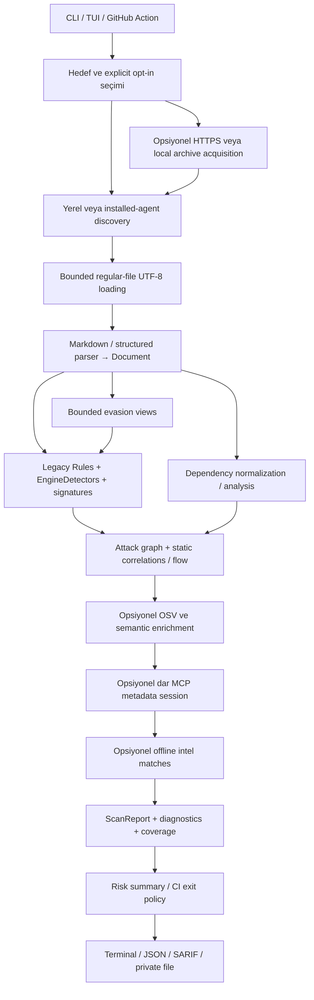

# Dragons AI Agent Scanner — Teknik Değerlendirme

**İnceleme tarihi:** 26 Kasım 2026  
**İncelenen ürün:** `dragons-ai-agent-scanner` / `dragonscan`, sürüm `0.1.0`  
**Kaynak tabanı:** `main`, HEAD `db23dd52fab34a15346df05f69c6b289ef4b680c` ve inceleme başlangıcında bulunan tracked/untracked çalışma ağacı değişiklikleri. Bu rapor yalnız HEAD sürümünü anlatmaz.  
**Yöntem:** Salt okunur kaynak, test, manifest, CI ve mevcut benchmark kayıtlarının incelemesi. Kod, test, fixture, MCP sunucusu veya hedef komutu çalıştırılmadı; bağımlılık kurulmadı. Git durum/kimlik okumaları ve Python standart kütüphanesiyle kaynak AST/envanter/hash incelemesi yapıldı. Ağ üzerinden servis, yayın veya CI doğrulaması yapılmadı. Rapor depo dışında oluşturuldu.

## Yönetici özeti

Dragons AI Agent Scanner, AI-agent talimatlarını ve yapılandırmalarını güvenilmeden önce incelemek için geliştirilmiş, yerel ve varsayılan olarak çevrimdışı çalışan bir statik güvenlik tarayıcısıdır. Üretim kodunda Markdown/structured config parsing, bilinen ajan yerleşimlerinin keşfi, deterministik tespitler, sınırlandırılmış obfuscation çözümleme, artifact'ler arası kanıt grafiği, statik source/sink ilişkileri, bağımlılık analizi ve terminal/JSON/SARIF raporlama bulunuyor.

En güçlü tarafı, bir kelimenin dosyada geçmesini çalıştırılabilir saldırı yolundan ayırmaya çalışmasıdır. `behavior.py`, `attack_graph.py`, `flow.py` ve MCP korelasyonu; komut bağlamı, açık referans, kaynak-hedef ilişkisi ve sınırlı provenance üretir. Risk etiketleri gerçekleşmiş saldırı kanıtı değildir. Ürün bu ayrımı `report_context.py:11-13` içinde kullanıcıya da bildirir.

**Runtime koruma ürünü olarak değerlendirilmemelidir.** Sürekli agent/process/network izleme, araç çağrısı interception, pre-execution policy enforcement, karantina ve runtime DLP bulunmuyor. Dinamik MCP yalnız seçilen yerel sunucudan tek oturumluk metadata listeleri alır. Gerekli OS izolasyonu uygulanmadığından normal dinamik istek bloklanır; ayrı `--allow-uncontained-mcp` onayıyla kullanıcı yetkilerinde süreç çalıştırılabilir. Yüksek/kritik statik finding, bu onaylı başlatmayı kendi başına veto etmez (`dynamic_mcp.py:80-147,364-382`; `scanner.py:548-588`).

Semantik model, OSV ve threat-intelligence entegrasyonları mevcut fakat isteğe bağlıdır. Semantik analiz seçilmiş/redakte edilmiş parçaları güvenilir olarak seçilen sağlayıcıya gönderir; tam gizlilik veya model doğruluğu garantisi vermez. OSV kesin paket kimlikleriyle advisory sorgular; runtime exploitability doğrulamaz. Feed SHA256 doğrulaması yayıncı imzası değildir; tazelik zorlaması yoktur.

**Olgunluk değerlendirmesi:** Geniş statik analiz kapsamı ve önemli negatif/regresyon testleri bulunan erken sürüm. Evrensel agent uyumluluğu, gerçek-dünya tespit doğruluğu, mevcut dirty tree'nin test başarısı ve tüm platformların release kabulü kanıtlanmış değildir. Belgelerde geçmiş cross-platform release başarısızlıkları vardır. Bu rapor bunları güncel bir yeniden test sonucu olarak sunmaz.

### Kanıt ve durum sözlüğü

| Durum | Bu rapordaki anlamı |
|---|---|
| IMPLEMENTED | Ulaşılabilir uygulama kodu var. Bu incelemede canlı başarı veya tüm olası girdilere doğruluk garantisi değil. |
| PARTIAL | Dar format/bağlam desteği, best-effort analiz veya daha geniş iddiayı karşılamayan mekanizma var. |
| PLANNED | Vizyon/sözleşme var; çalışan özellik yok. |
| MISSING | İncelenen üretim mimarisinde mekanizma yok. |
| UNKNOWN | Kaynak ve mevcut kayıtlar soruyu çözmüyor; harici/canlı doğrulama gerekli. |
| NOT_APPLICABLE | İncelenen bileşenin işlevine uygulanmıyor. |

Test atıfları testin amaçladığı kontrolü gösterir, bu oturumda geçtiğini değil. Tarihsel benchmark rakamları kendi snapshot'larına aittir. Kaynak referansları aksi belirtilmedikçe depo köküne göredir; kısaltılmış kaynak modülü atıfları `src/dragonscan/` dizinine aittir. Eklerdeki kural ve ajan tabloları bu raporun parçasıdır.

## 1. Ürün genel görünümü

- **Amaç:** AI-agent instruction, skill, memory, MCP ve ilgili config/bağımlılık artifact'lerindeki tehlikeli talimat, zayıf ayar, hassas veri aktarımı ve tedarik-zinciri işaretlerini güven öncesinde görünür kılmak.
- **Hedef kullanıcı:** Agent/skill geliştiricileri, AI araçlarını benimseyen geliştirici ekipleri, AppSec mühendisleri ve CI'da yerel güvenlik kontrolü isteyen ekipler. Bu segmentler CLI/Action/rapor akışlarından çıkarımdır; kullanıcı araştırması kanıtı yoktur.
- **Aşama:** `0.1.0`; Python paket, CLI, TUI, container/standalone build ve CI tarifleri mevcut. Resmî yayınların şu anki durumu **UNKNOWN**; README ve release belgeleri tarihsel durumu anlatır.
- **Platform:** Yerel statik kod Linux/macOS/Windows yollarını içerir. Dinamik MCP POSIX ile sınırlıdır; Windows feed update güvenli store ACL kontrolü eksik olduğundan fail-closed davranır. Platform testi varlığı platform kabulü değildir.
- **Agent kapsamı:** Hardcoded `AgentSpec`/`Location` tablosunda 19 ürün ve ayrıca Shared skills kaydı bulunur. Claude Code, Codex, Cursor, Gemini CLI, Windsurf, Cline, Roo Code, OpenCode ve diğer kayıtlar Ek A'dadır. GitHub Copilot ve Aider için özel adapter yoktur. Config keşfi executable kurulumu kanıtlamaz.
- **Dağıtım:** `pyproject.toml` console script; uv/source kurulumu; wheel/sdist; PyInstaller standalone üretim scriptleri; Dockerfile; GitHub composite Action. Public PyPI/Release/container erişilebilirliği bu incelemede kontrol edilmedi.

### Uygulanan CLI yüzeyi

| Komut/seçenek | Davranış ve sınır |
|---|---|
| `dragonscan scan PATH` / `dragonscan PATH` | Tek seferlik yerel tarama; `scan` sözcüğü opsiyonel alias akışında kabul edilir. |
| Argümansız `dragonscan` | Etkileşimli terminal seçim menüsü; sürekli koruma daemon'ı değil. |
| `dragonscan -tui` | Textual tam ekran arayüz; etkileşimli terminal gerekir. |
| `--installed-agents`, `--agent` | Bilinen kullanıcı/project yerleşimleri; dış enrichment/dynamic kapalı. |
| `--remote`, `--git` | Explicit acquisition seçimi. Yerel Git working tree desteklenir; remote Git blokludur. HTTPS artifact/archive acquisition farklı bir yoldur. |
| `--format terminal/json/sarif`, `--output` | Ortak report modelinden çıktı; dosya çıktısında private creation yolu. |
| `--fail-on`, `--fail-on-incomplete` | Rapor sonrası CI exit policy; agent execution firewall değil. |
| `--signature-pack`, `--intel`, `--intel-store` | Açık seçilmiş yerel veri paketleri; scan otomatik güncelleme yapmaz. |
| `--vuln-check` | OSV opt-in. |
| `--semantic` ve provider seçenekleri | Seçilmiş parçalar için OpenAI-compatible model görüşü; model/endpoint operatörden gelir. |
| `--dynamic-mcp` ve ayrı uncontained/server/executable seçenekleri | Dar stdio metadata inspection; güvenli izolasyon varsayılmamalı. |
| `dragonscan intel update --url … --sha256 … --store …` | Public HTTPS, beklenen hash, doğrulama ve atomik feed replacement. |

Kaynak: `cli.py:32-100,103-277,328-464,490-526`; `target_acquisition.py:418-461`. `IDEA.md` içindeki örnekler ayrıca doğrulanmadıkça çalışan CLI sayılmadı.

## 2. Teknoloji yığını

| Teknoloji | Kullanım / kod kanıtı | Sınır |
|---|---|---|
| Python `>=3.12` | Core package, standart kütüphane dataclass/enum/pathlib/regex/json/tomllib, urllib/http/socket, subprocess | Seçim gerekçesini açıklayan tasarım kaydı yok; görülen işlevi tarif ediyoruz. |
| Click `>=8.1,<9` | CLI argüman/flag/error/exit kontrolü (`cli.py`) | Tarama mantığı CLI dışında. |
| markdown-it-py `>=3,<5` | Markdown tokenizasyonu (`markdown_parser.py`) | Programlama dili AST'si değil. |
| PyYAML `>=6,<7` | Sınırlandırılmış SafeLoader türevi (`structured_parser.py:61-92`) | Arbitrary object construction yok; parser hâlâ TCB içinde. |
| Textual `>=3,<9` | TUI, worker thread (`tui.py:1026`) | Scanner için paralel dosya motoru anlamına gelmez. |
| uv + `uv.lock` | Kilitli geliştirme/build bağımlılıkları | Bu inceleme `uv sync` çalıştırmadı. |
| Hatchling | wheel/sdist üretimi, `dragonscan = dragonscan.cli:main` | Native executable için ayrı PyInstaller yolu. |
| PyInstaller `6.16.0` | Optional standalone build | Native runtime notice ve cross-platform kabul yükü getirir. |
| pytest, Ruff, mypy | Test, format/lint, strict typing | Güncel çalışma ağacında bu oturumda çalıştırılmadı. |
| GitHub Actions | quality, wheel, release matrix ve scanner composite Action | CI tarifinin bulunması son koşunun başarılı olduğu anlamına gelmez. |
| JSON / JSONC / YAML / TOML / Markdown / seçilmiş text | Config, artifact, feed, pack, rapor biçimleri | Evrensel dosya parser'ı yok. |
| Dosya tabanlı store | JSON reports, `intel.json`, geçici acquisition workspace | Üretim veritabanı, SQLite/Postgres veya merkezi backend yok. |
| OSV API | Paket adı/ekosistem/kesin sürüm advisory sorgusu | Varsayılan kapalı; npm/PyPI ve desteklenen kaynaklarla sınırlı. |
| OpenAI-compatible chat completions | Optional semantic provider | Lokal/özel endpoint veya cloud olabilir; host/model güveni operatördedir. |
| HTTPS acquisition/feed | Açık seçilmiş artifact ve intel indirimi | Content içindeki linkleri takip eden web crawler değil. |

Kaynak: `pyproject.toml`; `parsing.py:19-64`; `semantic_provider.py:10-126`; `osv.py:14-59`; `Dockerfile`; `.github/workflows/quality.yml`. Varsayılan çalışma için cloud, API key, Docker veya hedefin dependency kurulumu gerekmez. Telemetri SDK'sı/otomatik scan upload akışı saptanmadı; opt-in provider trafiği telemetriyle karıştırılmamalı.

## 3. Mimari

### 3.1 Yapı ve iç sözleşmeler

Kaynak envanterinde `src/dragonscan/` altında 53 Python dosyası ve 16.980 fiziksel satır; `tests/` altında 73 Python dosyası ve 22.886 satır; `scripts/` altında 19 Python dosyası ve 4.728 satır bulundu. Bunlar yorum/boş satır dahil fiziksel sayımlardır; yürütülebilir LOC veya coverage yüzdesi değildir. 72 `test_*.py` modülü vardır. Build output, dependency ortamları ve `.git` kaynak metriklerine dahil edilmedi.

| Katman | Temel modüller / sorumluluk |
|---|---|
| UI / giriş | `cli.py`, `cli_interface.py`, `tui.py`; hedef ve policy seçimi, format/render/export. Console entry `dragonscan.cli:main`; pakette `__main__.py` yok. |
| Keşif | `discovery.py`, `installed_agents.py`; isim/path classification, bounded traversal, provenance |
| Acquisition | `target_acquisition.py`; explicit HTTPS/local archive, güvenli workspace, hash/provenance |
| Bounded loading | `loading.py`; regular-file, inode/no-follow, byte/encoding kontrolleri |
| Parsing | `parsing.py`, `markdown_parser.py`, `structured_parser.py`, `jsonc.py`, `mcp_normalization.py`, `dependencies.py` |
| Temel modeller | `models.py`; `Target`, `Artifact`, `Document`, `Finding`, `Diagnostic`, `ScanReport`, source/flow evidence |
| Tespit | `rules.py`, `detection.py`, `detectors.py`, `behavior.py`, `mcp_security.py`, `supply_chain.py` |
| Evasion / signature | `evasion.py`, `evasion_graph.py`, `signature_*.py`, `signatures.py` |
| İlişkilendirme | `attack_graph.py`, `correlation.py`, `mcp_correlation.py`, `flow.py`, `vuln_flow.py` |
| Opt-in enrichment | `semantic.py`, `semantic_provider.py`, `vulnerability.py`, `osv.py`, `threat_intel.py`, `dynamic_mcp.py` |
| Sonuç | `risk.py`, `policy.py`, `report_context.py`, `reporting.py`, `sarif.py`, `private_output.py`, `windows_output.py` |
| Geliştirme / dağıtım | `tests/`, `benchmarks/`, `scripts/`, `.github/workflows/`, `Dockerfile`, `action.yml` |

`Rule.evaluate(Document)` basit legacy sözleşmedir (`rules.py:20-44`). `EngineDetector.detect(DetectionContext)` ve `DetectionMetadata` daha zengin detector yoludur (`detection.py:13-126`). `Scanner` bu iki yolu birlikte taşır; explicit legacy rule seçimi builtin detector/correlation davranışını değiştirir (`scanner.py:78-115`). Bu uyumluluk kararı yeni eklentiler için dikkat gerektirir.

### 3.2 Veri akışı



Kaynak akışı: `Scanner.scan`, `scanner.py:121-591`. `Discovery → load → parse → detector` her artifact için seri yürür. Cross-artifact analiz için sınırlı bağlam saklanır. Parse/coverage/graph limitleri bulgu yerine diagnostics ve eksiklik durumu üretir. Opt-in başarısızlığı statik sonuçları silemez. Feed eşleşmelerinin dinamik adımdan sonra eklenmesi, intel'in launch authorization olmadığına somut örnektir.

### 3.3 Yaşam döngüleri ve darboğazlar

- **Tarama:** Explicit target/discovery snapshot → load/parse → local analysis → cross-artifact correlation → optional enrichment → policy/report. Değişiklik izleyen scan loop yok.
- **Runtime monitoring:** Böyle bir lifecycle yok. Dinamik MCP kısa ömürlü ayrı bir session; metadata sonrası process-group cleanup yapar.
- **Config:** Agent config'i güvenilmeyen input olarak normalize edilir. Home config'leri yalnız installed mode'da aranır. Provider, pack ve feed seçimi CLI/API operatör parametresidir. Persistent merkezi policy config/exception store yok.
- **Hata:** `LoadError`, `ParseError`, `DiscoveryError` ve provider-specific status/diagnostic ayrımı; CLI beklenmeyen hataları genel mesajla kapatır. Hatalı dosya güvenlik bulgusuymuş gibi gösterilmez (`policy.py:26-89`; `tests/test_ci_policy.py:39-173`).
- **Rapor:** Finding evidence ile operation/coverage diagnostics ayrı; risk en yüksek severity ve sayımlar. Audit-event database veya değişmez audit log yok.
- **Darboğazlar:** Seri analiz, tuple/list olarak biriken artifact/finding sayısı, merkezi `Scanner.scan` orkestrasyonu, aynı anda legacy ve yeni detector API'leri; İngilizce regex ağırlıklı dil katmanı; tam program AST/CFG/type sistemi bulunmaması; user/project config precedence'i efektif runtime config olarak çözememesi.
- **Bellek:** 32 MiB/100.000 item sınırı yalnız retained cross-artifact context içindir; bütün process heap'ini sınırlamaz (`scanner.py:58-60`). Flow budget aşımı tüm analizin eksiksiz olduğu iddiasını kaldırır (`scanner.py:513-523`).

## 4. AI-agent keşfi

**Ek A**, agent başına global/project path, artifact türü, parser kapsamı, OS farkı ve test referanslarını listeler. Mimari hardcoded kayıtlar + bounded walk + agent-specific structured parser adaptörlerinden oluşur (`installed_agents.py:28-500,545-619,646-781`). PATH üzerinde executable arama, process listesi veya agent CLI/version komutu çalıştırılmaz.

Temel ayrımlar:

1. `InstalledEnvironment.installation_evidence = not_checked`: config bulundu diye uygulama kurulu/çalışıyor denemez.
2. Shared `AGENTS.md` tek başına belirli agent kimliğini kanıtlamaz; agent-specific root/marker provenance gerekir.
3. Aynı inode için hardlink dedup vardır; farklı parser türü/provenance ayrımları korunur. Dosyanın iki ajan tarafından gerçekten okunduğu kanıtlanmaz.
4. Global/project/system override, import, env expansion ve runtime flags tüm ajanlar için tam efektif precedence çözümü değildir. Kaynakların birlikte görülmesi, hangisinin yürürlükte olduğunun ispatı değildir.
5. Agent sürüm matrisi ve harici güncel format uyumluluğu **UNKNOWN**. Hardcoded yerleşimler ajan güncellemeleriyle geride kalabilir.
6. Hooks/permissions/memory desteği ortak bir bütün değildir: keşfedilen metadata/command alanlarının normalize edilen alt kümesi analiz edilir; runtime hook kurulumu/çalıştırma yok.

Test örnekleri: `tests/test_installed_agents.py:124` non-execution; `:157-180` symlink; `:293-307` hardlink/provenance; `:417` platform layout; `:477-530` kimlik/MCP/partial; `:661` dış enrichment reddi; `:705-719` büyük project/depth budget.

## 5. Statik tarama motoru

### 5.1 Gerçek desteklenen girdiler

| Girdi | Discovery/parser ve uygulanan analiz |
|---|---|
| `SKILL.md`, `AGENTS.md`, `SOUL.md`, `MEMORY.md`, `CLAUDE.md` | Markdown instruction/metadata/block/reference çıkarımı; instruction, capability, secret-flow, execution, evasion/signature ve graph tespitleri |
| Agent-specific ek instruction/rule adları | Installed/project adapter koşullarında; genel `.md` glob desteği yok |
| `mcp.json`, `.mcp.json`, `mcp-config.json`, `claude_desktop_config.json` | Server command/args/env/transport/URL ve desteklenen tool metadata normalize etme; MCP/config/command/security rules |
| Bilinen agent `config/settings` JSON/JSONC/YAML/TOML | İsim/path ve adapter'a bağlı; structured fields, hooks, permissions, refs, MCP alt kümeleri |
| `.claude-plugin/plugin.json`, bilinen ekosistem `hooks.json` | Metadata/hook komutları; plugin kodu yüklenmez |
| `pyproject.toml`, `uv.lock`, `requirements*.txt/.in` | Python manifest/lock/provenance; desteklenen syntax ve dependency limitleri |
| `package.json`, `package-lock.json`, `npm-shrinkwrap.json`, `pnpm-lock.yaml`, `yarn.lock`, `.npmrc` | Node dependency/provenance/registry/lifecycle string analizi; bütün lock sürümleri değil |
| ZIP/TAR/TAR.GZ/TGZ | Önce ayrı acquisition; çıkarılan desteklenen artifact'lere normal scan; iç içe arbitrary arşiv recursion yok |
| `.py/.js/.ts/.sh/.ps1`, binary, genel assets/templates | Genel kaynak kodu veya binary tarama desteği **MISSING**. Desteklenen artifact içindeki komut/metin ve referanslar incelenebilir; referansın tüm script gövdesi otomatik analiz edilmez. |

Kaynak: `discovery.py:11-118`; `parsing.py:19-64`; agent ayrıntıları Ek A. Bir uzantının `FORMATS` içinde olması, o uzantıdaki her dosyanın discovery'de kabul edildiği anlamına gelmez.

### 5.2 Traversal ve yükleme sözleşmesi

- Rekürsif, deterministik sıralı yerel walk; `.git`, `.venv`, `node_modules`, `__pycache__` atlanır. Genel `.gitignore`/kullanıcı ignore policy motoru yok (`discovery.py:11-19,121-289`). Gizli dosyaların hepsi atlanmaz; `.mcp.json`, `.npmrc`, agent dizinleri bilerek desteklenir.
- Standart proje keşfinde varsayılan cumulative artifact cap yok. Depth 64, pending dirs 8192 ve directory entry budget 100.000 gibi traversal çalışma sınırları var. Installed/project adapter modunda farklı budget'lar uygulanır. Limitler ve incomplete işaretleri başarıyla taranmış dosya sayısından ayrı değerlendirilir.
- Symlink target reddi; traversed symlink'ler izlenmez. Loader `lstat → O_NOFOLLOW → fstat inode/device → bounded read` kullanır. Bu snapshot tutarlılığını bütün directory ancestor yarışları için atomik yapmaz.
- Dosya başına 1 MiB; NUL içeren binary ve geçersiz UTF-8 reddi. UTF-8 BOM kabul edilir (`loading.py:7-45`). Encoding guesser, UTF-16/Latin-1 fallback veya binary disassembly yok.
- Markdown ve structured parser güvenilmeyen girdiyi `Document` nesnesine dönüştürür. YAML safe loader, node/depth/duplicate-key sınırları; JSONC normalization ve agent-specific shape validation vardır. Parsing hedef modülü import etmez.
- Parse başarısı bütün semantiğin çözüldüğü anlamına gelmez. Desteklenmeyen shape/limit diagnostics ile partial kalabilir.

### 5.3 Hash, cache ve paralellik

Artifact hash'leri farklı bağlamlarda kullanılır: acquisition ham indirme hash'i; threat-intel ham dosya SHA256; signature `artifact_hash` ise load edilen metnin UTF-8 yeniden kodlanmış hash'i. BOM nedeniyle son ikisi farklı olabilir (`scanner.py:186-188`; `signatures.py:158-166`).

Incremental scan, persistent scan cache, dosya değişikliği izleme ve çok işlemcili dosya tarama motoru yok. Semantik/OSV'de bir işlem içinde RAM cache/dedup vardır; bu incremental tarama değildir. TUI worker thread UI'ın donmaması içindir (`tui.py:1026`).

## 6. Tespit kuralları ve yöntemler

**Ek B**, kaynakta bulunan her builtin finding/rule kimliğinin adı, kategori, severity/confidence, hedefi, matching/evidence/remediation, kaynak ve testlerini listeler. Harici signature/feed ID'leri kullanıcı verisinden gelir; sabit builtin listesiyle karıştırılmadı. Ek C opsiyonel provider/signature/intel sınırlarını ayrıntılandırır.

| Yöntem | Durum | Gerçek uygulama |
|---|---|---|
| Regex / keyword | IMPLEMENTED | Builtin bounded-context patterns, imperative/negation/command sinyalleri |
| İçerik/IOC signature | IMPLEMENTED | Yerel JSON pack, literal/casefold ve normalize indicator matching |
| Hash matching | IMPLEMENTED | Signature text hash ve intel raw-byte hash ayrı sözleşmeler |
| Markdown / config yapısal analiz | IMPLEMENTED | Token/structured field parsing, source konumu |
| Programlama dili AST / CFG | MISSING | Python/JS/PowerShell program AST'si ve compiler-level analiz yok |
| Semantik model | PARTIAL | Opt-in, seçilmiş snippet, strict response schema; kapsamlı program anlamı yok |
| Statik data/control-flow | PARTIAL | Açık referans/eligible edge/source-sink üzerinden bounded graph; genel taint engine değil |
| Behavioral analysis | PARTIAL | Metinden davranış gözlemi; canlı syscall/process davranışı değil |
| Threat intelligence | IMPLEMENTED | Explicit offline feed ve ayrı update; harici reputation/freshness garantisi yok |
| Rule correlation | IMPLEMENTED | Local finding + graph + MCP + supply-chain + bounded toxic-flow |
| Context-aware suppression | PARTIAL | Negation, quote/code/documentation context, local evidence eligibility; kullanıcı suppression yönetimi değil |
| Custom rule API | IMPLEMENTED | `Scanner(rules=…, detectors=…)`; trusted caller code |
| Custom data pack | IMPLEMENTED | Validated JSON signature, kod/regex import yok |
| YARA | PLANNED | `signature_yara.py:1-16` Protocol; çalışan backend yok |
| Otomatik signed rule update | MISSING | Builtin değişimleri kod sürümüyle; pack/feed trust operatörden |

`Scanner.__init__` duplicate builtin ID reddeder, reserved namespace ile signature pack çakışmasını engeller (`scanner.py:94-115`). Kural güncelleme pipeline'ı code review/tests/CI üzerinden; hot-loaded executable plugin veya registry auto-update yok.

## 7. Prompt injection tespiti

| Saldırı sınıfı | Durum | Kanıt ve sınır |
|---|---|---|
| Direct / indirect instruction override | PARTIAL | Instruction ve MCP metadata regex/declarative rules; gerçek agent context'i veya fetched content bütünü görülmez |
| System/developer rol taklidi, hierarchy manipulation | PARTIAL | Desteklenen rol/authority override ifadeleri; evrensel dil modeli veya protocol-role doğrulaması değil |
| Security policy override / approval bypass | PARTIAL | Talimat/ayar pattern'leri ve provenance; actual permission engine doğrulanmaz |
| User deception | PARTIAL | Concealment/deception sinyalleri; niyet garantisi yok |
| Secret extraction / exfil instructions | PARTIAL | Credential source + aktarım/endpoint ilişkilendirme; generic mention exfil sayılmaz |
| Gizli HTML/comment talimatları | PARTIAL | Evasion view; hidden-HTML bulguları düşük/informational ve executable flow yetkisi olmadan |
| Unicode, bidi, zero-width, encoded text | PARTIAL | Bounded transformations/decoders; tüm polyglot/encryption/encoding kombinasyonları değil |
| Memory poisoning | PARTIAL | `MEMORY.md`/`SOUL.md` input; statik instruction/persistence routes; canlı memory change izlenmez |
| Cross-agent propagation | PARTIAL | Explicit local artifact/reference graph; agent-to-agent message bus interception yok |
| Tool response injection | PARTIAL | Statik MCP tool description/result-route sinyalleri; gerçek `tools/call` yanıt interception yok |
| Multilingual | PARTIAL | Genel Unicode handling var; kurallar/router ağırlıkla İngilizce, kapsamlı dil benchmark'ı yok |

Kaynak: `rules.py`, `detectors.py`, `behavior.py:470-623`, `mcp_security.py:75-171`, `evasion.py:301-513`, `scanner.py:395-421`, `semantic.py:37-66,178-282`. Testler: `tests/test_scanner.py:96-116`; `tests/test_evasion.py:204-217,292-357,487-610`; Ek B rule-specific testleri.

Motor salt kelime listesi değildir: negation, quotation/fence, executable command position, explicit load ve source/sink şartları yanlış pozitifleri azaltır. Fakat belgelerde saldırı örneği ile zararlı operasyonel talimatın ayrımı her dil/formatta çözülemez. Statik router'ın atladığı metin semantik sağlayıcıya hiç gitmeyebilir. `hidden-html` bulgularını informational tutmak yanlış saldırı zinciri kurmayı azaltırken active-hidden-instruction riskinin severity'sini sınırlayabilir.

## 8. Skill güvenliği

`SKILL.md` Markdown parser'ına girer; instruction blocks ve desteklenen referanslar çıkarılır. Genel skill YAML frontmatter için `name/description/allowed-tools/permissions` typed şeması yoktur; metindeki alan adlarını görmek izin semantiğini çözmek değildir. Özel frontmatter parser'ı Cursor `.mdc` dosyaları içindir (`markdown_parser.py:62-105`). Skill directory içinde **desteklenen artifact adları** keşfedilir; arbitrary `scripts/`, `assets/`, `templates/`, `references/` ağaçlarındaki her dosyanın gövdesini analiz eden genel skill-package inceleyicisi yok.

| Skill öğesi | Durum / açıklama |
|---|---|
| SKILL.md | IMPLEMENTED: bounded Markdown extraction ve statik talimat analizi |
| Genel skill YAML frontmatter şeması | MISSING: typed metadata/permission validator yok; Cursor `.mdc` parser'ı ayrı |
| Description/instruction/allowed-tools | PARTIAL: metin/behavior sinyalleri; declared tools için typed izin modeli yok |
| Scripts / executable files | PARTIAL: komut/referans string'leri; genel script AST veya binary incelemesi yok |
| References/nested artifacts | PARTIAL: explicit refs ve discovery-supported dosyalar; eksik/ambiguous/external refs gerçek flow sayılmaz |
| Assets/templates | MISSING genel içerik analizi; desteklenen ad taşıyan artifact istisnası olabilir |
| Dependencies/lifecycle commands | PARTIAL: Python/Node manifest ve instruction/config command normalizasyonu |
| URL'ler | PARTIAL: statik endpoint/IOC; linkleri kendiliğinden indirmez |
| Symlink | IMPLEMENTED güvenli reddetme/atlama; hedef içeriğini tarama desteği değil |
| Remote skill acquisition | PARTIAL: explicit HTTPS artifact/archive; içerikteki remote refs otomatik takip edilmez |
| Integrity changes | MISSING temporal monitoring; tek-run/hash intel eşleşmesi değişim tespiti değildir |
| Declared purpose ↔ actual behavior mismatch | PARTIAL: statik metin/kanıt sinyalleri; özel semantic `behavior_mismatch` MCP adaylarına ait. Skill script gövdesiyle kapsamlı amaç karşılaştırması ve actual runtime davranışı yok |

Kaynak: `markdown_parser.py:62`; `discovery.py:54-118`; `attack_graph.py:69-115`; `semantic.py:178-261`; `tests/test_attack_graph.py:300-375`; `tests/test_semantic.py:607`. Dosyaya referans verilmesi execution gerçekleştiğinin veya dosyanın içeriğinin güvenli olduğunun kanıtı değildir.

## 9. MCP güvenliği

Ürün statik config/metadata analizi ile ayrı opt-in dar canlı protokol envanterini birleştirir. Runtime interception yapmaz.

| Yetenek | Statik kapsam | Canlı kapsam / durum |
|---|---|---|
| Server discovery/config | Agent adapters, ortak MCP shape, command/args/env/URL | IMPLEMENTED statik; binary installation teyidi yok |
| Local stdio | Command/args ve execution/credential/capability sinyalleri | PARTIAL: tek seçilmiş local executable, args/env/cwd/package/header olmayan declaration |
| HTTP/SSE/streamable HTTP | Normalize transport/URL/headers | MISSING canlı transport/auth handshake |
| Tool discovery | Config içindeki tool list/description/schema fields | PARTIAL: `tools/list` snapshot |
| Prompt/resource inventory | Metadata | PARTIAL: `prompts/list`, `resources/list`; içerik okuma yok |
| Tool descriptions/instructions | Poisoning ve privileged action/source-sink sinyalleri | Dynamic description yalnız hash; detector'a sokulmaz |
| Tool JSON Schema | Shape ve field name alt kümesi | MISSING tam schema/arg validation veya temporal diff |
| Tool shadowing / response routing | Bilinen isim/delegation/explicit route korelasyonu | MISSING actual call interception |
| Rug pull | Mutable metadata exposure göstergesi | MISSING geçmiş baseline/temporal saldırı kanıtı |
| Permission escalation / excessive permissions | Config/metadata'da privilege ve broad capability uyarıları | MISSING gerçek authorization enforcement |
| Unauthorized tool execution | Tehlikeli instruction/command uyarısı | MISSING block/approve/proxy; `tools/call` gönderilmez |
| OAuth scopes/authentication | Bazı config alanları kabul edilir | MISSING OAuth/PKCE/token exchange/refresh/audience enforcement |
| Token handling | Env/header sensitive değerlerini raporlamama/uyarı | MISSING MCP token vault/lifecycle; dynamic env/header reddi |
| Package provenance | Command/dependency statik ilişkisi | MISSING installed code integrity/actual loaded version attestation |
| Server integrity | Local path validation; hash/feed göstergeleri bazı statik bağlamlarda | MISSING executable signing/hash pinning/launch-time atomic attestation |

Kaynak: `mcp_normalization.py:116-209`; `mcp_security.py:96-356`; `mcp_correlation.py`; `dynamic_mcp.py:100-147,164-290,333-442`; `structured_parser.py:470-551`. Ek C sınırları ve testleri verir.

**Önemli:** `dynamic_mcp.available_capabilities()` filesystem/network/resource isolation için `unsupported` döndürür. Private cwd, temiz env, shell-free launch ve process group; sandbox oluşturmaz. Sunucunun kendi metadata beyanı, sakladığı başka araçları veya davranışı göstermez. Aynı scan içindeki declared/observed name farkı persisted drift baseline değildir.

## 10. Komut ve kod güvenliği

Komutlar temel olarak string/token/regex ve sınırlı shell yapılarıyla incelenir. `behavior.py` stdin pipeline, command-string flags, literal wrappers, encoded pipeline, shell read/write ve transfer ilişkilerini çıkarır. Her shell syntax'ını çözümleyen parser veya program AST'si yok.

| Kontrol | Durum / sınır |
|---|---|
| Remote download → execution | PARTIAL: stdout'un program stdin'ine bağlandığı desteklenen pipeline biçimleri; salt URL+shell birlikteliği yeterli değil |
| Dangerous/destructive shell | PARTIAL: bilinen execution/destructive/capability kalıpları; tam Unix/Windows komut semantiği yok |
| PowerShell / encoded command | PARTIAL: encoded-command signature ve UTF-16/static literal evasion; PowerShell AST yok |
| Dynamic evaluation | PARTIAL: desteklenen eval/exec/interpreter string bağlamları; runtime-created code görülemez |
| Untrusted download / installer | PARTIAL: remote installer ve package runtime provenance; binary authenticity incelemesi yok |
| Command injection | PARTIAL: tehlikeli string/capability ilişkileri; web/API input'tan shell'e genel program taint analizi yok |
| Privilege escalation / sandbox bypass | PARTIAL: permission/unsafe execution metadata uyarıları; exploit veya OS privilege transition gözlemi yok |
| Persistence / security-control tampering | PARTIAL: explicit config/instruction write/load routes; registry/service/cron/systemd runtime audit yok |
| Unauthorized remote access | PARTIAL: bilinen remote endpoint/credential/command/IOC sinyalleri; network session izlemesi yok |

Kaynak: `behavior.py:39-153,306-517,623`; `detectors.py:89-242`; `evasion.py:136-282`; `tests/test_detection_accuracy.py:154-316`; `tests/test_execution_stdin_regressions.py`. Bu testler `sh -s` ile stdin'i komut olarak okumayan örneklerin ayrımını ve encoded view'ın execution authority uydurmamasını hedefler.

## 11. Sırlar ve hassas veri

Mevcut yaklaşım iki parçalıdır: sensitive-source/credential access/transfer tespitleri ve çıktı/provider redaksiyonu. Generic secret scanner veya runtime DLP değildir.

- API key/token/password/env/header, SSH private key ve bilinen credential path/format göstergeleri desteklenen detector/redaction bağlamlarında işlenir.
- Cloud/database/browser/wallet sırları için genel kaynak/credential sınıfları bazı ifadeleri yakalayabilir; provider/provider-format bazında eksiksiz secret türü matrisi, entropy taraması veya güncel credential validation yok. Bu kapsam **PARTIAL**; her aileye özel kapsam **UNKNOWN**.
- `.env`, credential dosyası veya home secret store'ları key bulmak için tarayıcı tarafından otomatik açılmaz. Talimatta bu dosyalara erişim istenmesi source evidence olabilir.
- Public SSH key ile private credential ayrımı için regresyonlar bulunur (`tests/test_detection_accuracy.py:59-129`). Hassas kaynak ve dış endpoint'in aynı dosyada bulunması tek başına exfiltration değildir (`tests/test_attack_graph.py:201-213`).
- Secret redaksiyonu regex/shape temelli best-effort'tür. Tam PEM, auth/header/bearer/assignment/URL userinfo ve bilinen key pattern'leri için koruma vardır. Alışılmadık token, PII ve ticari sır otomatik olarak garanti altında değildir (`semantic.py:67-81,139-152`).
- JSON `ensure_ascii`, terminal control sanitation ve private file permissions farklı riskleri azaltır; dosyayı yetkili okuyandan sır gizlemez.
- Runtime file read/exfil/network monitoring ve block **MISSING**. Credential-access finding, dosyanın gerçekten açıldığını göstermez.

Kaynak: `behavior.py:204-409`; `detectors.py:166-239`; `report_context.py:16-26`; `reporting.py:28-32`; `private_output.py:14-79`; Ek C semantic privacy bölümü.

## 12. Tedarik zinciri güvenliği

| Yetenek | Durum | Uygulama/sınır |
|---|---|---|
| Manifest / lockfile | IMPLEMENTED | Seçili Python/Node biçimleri; `dependencies.py:165-510` |
| Transitive dependencies | PARTIAL | Desteklenen lock içeriğinden package/relationship; resolver çalıştırılmaz |
| Known vulnerabilities | PARTIAL | Explicit OSV, npm/PyPI exact public-registry version; ambiguous/range/custom source skip |
| Known malicious packages | PARTIAL | Operatörün sağladığı exact identity feed; yerleşik kapsamlı malware DB yok |
| Typosquatting / hallucinated packages | MISSING | Registry varlık/similarity/isim niyeti doğrulaması yok |
| Dependency confusion | PARTIAL | Registry/source ve ambiguous provenance görünürlüğü; gerçek registry resolution/ownership yarışı doğrulanmaz |
| Unpinned/mutable dependencies | IMPLEMENTED | Runtime install/execute ve provenance bağlamında risk; her development range kötü niyetli sayılmaz |
| Lifecycle/install scripts | PARTIAL | Manifest script string'i ve encoded view; script çalıştırılmaz, tüm gövde AST'si yok |
| Package age / publisher/repository reputation | MISSING | Yaş, indirme istatistiği, maintainer güveni, domain registration sorgusu yok |
| Package signatures/checksum authenticity | MISSING | Hedef paket indirilip imza/hash karşılaştırılmaz; hash metadata/publication authenticity ayrı |
| Provenance | PARTIAL | Registry/url/git/path/exact version/runtime-use metadata; SLSA attestation verification yok |
| Registry validation | PARTIAL | URL/source classification; canlı package existence/ownership doğrulaması yok |
| OpenSSF / direct GH Advisory DB | MISSING | Doğrudan API entegrasyonu yok; OSV üzerinden gelen advisory başka kaynaklı olabilir |
| Patch enforcement | MISSING | Fix/upgrade/install/block uygulamaz |

`analyze_dependencies` dosyaları scan boundary'lerine göre gruplar (`scanner.py:451-474`). Command içinden runtime dependency extraction, gerçek runtime gözlemi değildir. `vuln_flow.py` ve `vulnerability.py:106-153` içindeki `runtime-execution` etiketleri statik graph ilişkisini anlatır. Kaynak/test: `supply_chain.py:114`; `tests/test_supply_chain.py:49-391`; `tests/test_vulnerability.py:51-495`.

## 13. Web ve URL güvenliği

Yerel instruction/skill/MCP içindeki URL'ler normalize endpoint/IOC/remote-execution kanıtıdır; otomatik fetch edilmez. Arama motoru sonuçları, tarayıcı içeriği ve ajan web istekleri için interception yok.

| Yüzey | Durum / sınır |
|---|---|
| Yerel metin/config URL'leri | IMPLEMENTED extraction/normalization; URL'nin gerçekten ziyaret edildiği bilinmez |
| Known malicious URL/domain/IP | PARTIAL exact offline IOC/feed; kapsam ve doğruluk feed'e bağlı |
| Remote script URL | PARTIAL command/flow ilişkisinde; indirilen binary/script gövdesini otomatik çalıştırma yok |
| Explicit HTTPS target | IMPLEMENTED public-IP validation, IP pinning + TLS hostname, bounded redirects/download |
| Redirect chain güvenliği | IMPLEMENTED yalnız acquisition/feed download yolunda; her hop doğrulanır |
| Domain reputation/registration/age/expiry | MISSING |
| Domain typosquatting | MISSING |
| Unicode/punycode | PARTIAL normalization/hostname policy; IDN homograph reputation/detection motoru yok |
| Hidden web instructions | PARTIAL yalnız supported fetched artifact'in metni analiz edilebilirse; genel HTML/browser DOM taraması yok |
| Agent'e ulaşmadan web inspection | MISSING otomatik inline inspection; kullanıcı explicit supported artifact taraması yapabilir |
| Runtime web request/search response | MISSING |

Acquisition: HTTPS/443, userinfo/query/fragment reddi, tüm DNS cevaplarının public olması, connect-time doğrulanmış IP, her redirect'te yeniden kontrol; 32 MiB indirme, 3 redirect sınırı (`target_acquisition.py:255-390`). Bu, semantic provider endpoint trust modeliyle aynı değildir: semantik endpoint'i operatör seçer ve private HTTPS endpoint kabul edilebilir. OSV sabit host kullanır.

## 14. Runtime güvenliği

**Çalışan bir AI agent'ı izleyen lifecycle bulunmuyor.** CLI bir hedefi tarar ve raporlar; kullanıcı daha sonra hedefi değiştirip çalıştırabilir. Taramayla kullanım arasında bütünlük bağı yoktur. Dynamic MCP, çalışan agent'ın MCP bağlantısına yerleşmez; ayrı, kısa süreli sunucu süreci açar.

### Runtime gözlem ve enforcement matrisi

Buradaki “yok”, ilgili agent olayının runtime hattında gözlenmediğini belirtir. Dosyadaki aynı davranışın statik işareti başka bölümlerde PARTIAL olabilir.

| Yetenek / olay | Gözlem | Tespit | Çalıştırma öncesi inceleme | Onay | Enforcement / blocking | Karantina |
|---|---|---|---|---|---|---|
| Agent hook olayları | Yok | Yok | Hook config/komut metni statik | Yok | Yok | Yok |
| Agent CLI wrapper | Yok | Yok | Manuel ayrı scan | Yok | Yok | Yok |
| Filesystem watcher | Yok | Yok | Snapshot taraması | Yok | Yok | Yok |
| File read/write/delete | Yok | Yok | Metindeki kaynak/hedef ilişkileri | Yok | Yok | Yok |
| Agent/child process execution | Yok | Yok | Desteklenen command string'leri | Yok | Yok | Yok |
| Network/web request | Yok | Yok | URL/endpoint metadata | Yok | Yok | Yok |
| Search/fetched response | Yok | Yok | Explicit supported artifact hedefi | Yok | Yok | Yok |
| Tool call / tool response | Yok | Yok | Statik tool metadata | Yok | Yok | Yok |
| MCP interception/proxy | Yok | Yok | Config taraması | Yok | Yok | Yok |
| Package installation | Yok | Yok | Manifest/lifecycle/runtime command beyanı | Yok | Yok | Yok |
| Permissions/config değişimi | Yok | Yok | Mevcut dosyanın snapshot'ı | Yok | Yok | Yok |
| Skill loading / memory değişimi | Yok | Yok | Desteklenen artifact snapshot'ı | Yok | Yok | Yok |
| Scanner'ın kendi MCP alt süreci | Sınırlı protokol/envanter ve süre | Protocol/limit hataları | Path/declaration/izin kontrolü | Explicit uncontained opt-in | Başlatma koşulları, timeout ve process-group cleanup | Yok |
| CI severity gate | Agent gözlemi değil | Tarama finding'leri | Tarama CI job'ında önce konumlandırılabilir | Eşik operatörden | İşlem sonrası exit code; agent çağrısını kesmez | Yok |

Kanıt: `src/dragonscan/cli.py:171-277,490-526`; `src/dragonscan/scanner.py:548-588`; `src/dragonscan/dynamic_mcp.py:80-147,266-290,364-480`; `src/dragonscan/policy.py:26-89`. Üretim giriş noktalarında daemon, hook registration, proxy veya event subscriber hattı yoktur. Testlerde `tests/test_dynamic_mcp.py:534-582` uncontained filesystem/network erişimi ve temporal rug-pull sınırlamasını açıkça ele alır; bu incelemede çalıştırılmadı.

**Önleme sınırı:** Dynamic MCP normal isteği, gerekli izolasyon sağlanamadığında fail-closed reddedilir. Ayrı uncontained onayı bu güvenlik şartını kaldırır. Sunucu, metadata çağrısını beklemeden başlangıçta yan etki üretebilir. Shell kullanılmaması, çevre değişkenlerinin temizlenmesi ve private cwd; host dosyası/ağ erişimini engellemez. Process-group dışına çıkan torunlar için tam temizleme güvencesi yoktur. Statik high/critical finding veya sonradan eklenen TI eşleşmesi başlatma veto'su değildir. Bunlar kaynakla belirlenen sınırlar; bu rapor bir bypass deneyi veya gerçekleşmiş istismar iddiası içermez.

## 15. Risk ve severity motoru

`models.py:32-51` severity olarak `critical/high/medium/low/info`, confidence olarak `high/medium/low`, classification olarak `malicious/exploitable/risky/suspicious/informational` tanımlar. Classification bir kuralın yorumudur; `malicious` etiketi runtime'da saldırı gerçekleştiğini kanıtlamaz. `exploitable` enum değerinin bulunması her bulgu için exploit doğrulaması yapıldığı anlamına gelmez.

- **Risk aggregation:** `risk.py` en yüksek severity ve seviye başına sayım üretir. Sayısal 0–100 risk, rule weight, olasılık veya kalibre edilmiş confidence yüzdesi yoktur.
- **Context:** Rule-specific koşullar, graph provenance, açık source/sink ve runtime-use beyanları severity'yi etkileyebilir. Bu statik exposure değerlendirmesidir; uygulamanın gerçek erişim yetkileri veya exploitability ölçümü değildir.
- **CI policy:** `policy.evaluate()` hata → incomplete → severity threshold → pass sıralamasını uygular. `--fail-on` belirtilmezse bulgu tek başına exit 1 üretmez. `--fail-on-incomplete` bütün incomplete sonuçların tek anahtarı değildir; kod bazı incomplete statülerini zaten exit 3 yapar, flag özel semantic-budget koşulunu da devreye sokar (`policy.py:34-76`).
- **Hard block:** Runtime hard-block rule listesi yoktur. Acquisition/loader/dynamic validation reddi scanner sınır kontrolüdür, tespit edilen saldırı için agent enforcement değildir.
- **Exceptions/suppression:** Persisted allowlist, suppression expiry/owner, baseline accept/reject, policy exception UI veya finding disposition store bulunmuyor. Benign documentation/negation filtreleri kullanıcı tarafından yönetilen suppression değildir.
- **Onay:** Optional network/model/dynamic yetkileri operatör seçimine dayanır. Her riskli tool çağrısı için kullanıcı challenge'ı yoktur.

| Ayrım | Mevcut davranış / kaynak örneği |
|---|---|
| Potansiyel zararlı talimat | Rule pattern/bağlam finding'i; gerçekleşmiş eylem değil |
| Riskli yapılandırma | Permission/transport/package/command beyanına dayalı `risky`/`suspicious` |
| Bilinen vulnerability | Exact package/version advisory + statik kullanım bağlamı; deployment exploitability UNKNOWN |
| Informational | Hidden HTML dönüşümünden gelen bulgunun low/informational tutulması; executable path/flow üretmemesi (`scanner.py:395-421`; `tests/test_evasion.py:342`) |
| Model görüşü | SEM finding `suspicious`; low veya kanıta bağlı medium; static bulgu silinmez (`semantic.py:499-564`) |
| Bilinmeyen/taranamayan | Parse/load error veya incomplete diagnostic; “temiz” finding listesiyle eşitlenmez (`policy.py:30-55`) |

Örnekler kaynak/test assertion'larından alınmıştır, bu oturumda üretilmiş scan çıktıları değildir. `tests/test_ci_policy.py:39-96` terminal/JSON/SARIF için ortak policy ve exit-code sözleşmesini kontrol eder.

## 16. Threat intelligence

İki ayrı katman vardır: JSON signature pack ve JSON intelligence feed. “Signature”, burada çoğunlukla içerik/IOC/hash eşleşmesi demektir; yayıncıya ait kriptografik imza değildir.

| Yetenek | Gerçek kapsam |
|---|---|
| Malware/content signatures | Builtin encoded-PowerShell yapısal kayıt ve yerel inert JSON pack; genel antivirüs veritabanı yok |
| File hashes | Signature text hash; TI raw-byte SHA256. Aynı semantik değildir |
| IOC | Normalize domain/URL/IP ve desteklenen exact identity kayıtları; substring eşleşmesi değil |
| Malicious package/skill/plugin/MCP | Feed'in desteklenen kimlik/kapsam/hash/endpoint şartlarıyla; isim tek başına davranış kanıtı değil |
| Vulnerability feed | Ayrı explicit OSV sorgusu; exact npm/PyPI package/version |
| Update | Ayrı `intel update`, public HTTPS, beklenen SHA256, schema/permission/version kontrolü, atomic replacement |
| Offline | Explicit yerel pack/feed/store ile scan; scan kendiliğinden update yapmaz |
| Cache | Diskte seçilmiş intel store; provider scan-içi RAM dedup. Merkezi threat service veya kalıcı scan cache yok |
| Freshness | Kaynak/provenance verileri var; zorunlu TTL/expiry/freshness servisi yok |
| Authenticity | Expected hash ve downgrade guard var; trusted signer/key rotation/revocation sistemi yok |
| Reputation | Feed beyanını kaynak olarak korur; domain yaş/reputation araştırması yapmaz |

`DRAGON-TI-001` feed confidence/classification değerlerini severity'ye doğrudan taşımaz. Raw artifact hash eşleşmesi high/high; aktif veya dependency/MCP package bağlamı medium/medium; diğer bağlamlar low/medium olur. Birden çok feed aynı olgu için otomatik yükseltme sağlamaz (`threat_intel.py:600-639`). Detection graph'a execution/taint yetkisi eklemez.

**Mahremiyet:** Yerel feed scan'i dışarı artifact göndermez. Feed indirme sunucusu istek/IP bilgisini görür. OSV paket kimliklerini, semantic endpoint redakte edilmiş seçili metni alır. Kullanıcı yerel endpoint seçse bile sağlayıcının log/retention/training davranışı **UNKNOWN**. Windows intel update, güvenli store ACL doğrulaması uygulanmadığından reddedilir; statik feed okuma ile karıştırılmamalıdır (`threat_intel.py:351-399`). Ayrıntı ve testler Ek C'dedir.

## 17. Tarayıcının kendi güvenliği

Aşağıdakiler savunma ve sınır değerlendirmesidir; her eksiklik doğrulanmış zafiyet değildir.

| Tehdit | Mevcut savunma | Kalan sınır / kanıt |
|---|---|---|
| Zararlı dosya / unsafe deserialization | Bounded UTF-8 loader; safe YAML; duplicate/depth/node kontrolleri; hedef import edilmez | Parser kütüphaneleri TCB'dir; bütün girdiler için formal güvence yok (`loading.py:18-45`; `structured_parser.py:61-92`) |
| Symlink / TOCTOU | lstat, no-follow, opened inode/device karşılaştırması; installed ancestor kontrolü | Genel directory traversal atomik dirfd-root sabitlemesi değil; launch path validation ile exec ayrı (`installed_agents.py:760-778`; `dynamic_mcp.py:138-147,372-382`) |
| Path traversal / archive bomb | Absolute/parent/link/special entry reddi ve acquisition kotaları | Bütün pipeline RAM/CPU/duvar süresi için OS quota yok; çıkarılan dosya loader'da ayrıca reddedilebilir (Ek C) |
| ReDoS | Bounded input/view/graph; kullanıcı pack'i custom regex yürütmez | Builtin regex için genel timeboxing/formal worst-case kanıtı yok; adversarial latency UNKNOWN |
| Resource exhaustion | File, parser, evasion, graph, provider ve protocol limitleri | Varsayılan toplam artifact/finding ve process heap sabit kotalı değil; çok küçük dosya etkisi sürer |
| Scanner config/rule tampering | Target, provider/policy seçimi yapamaz; pack inert data ve explicit path | Operatörün seçtiği code/pack/feed için signer/policy integrity attestation yok |
| Baseline tampering | Runtime baseline sistemi yok | Runtime baseline koruması NOT_APPLICABLE; benchmark JSON'ları imzalı güven kökü değildir |
| Terminal escape injection | Control sanitation, JSON escaping, Textual `markup=False` | Her serbest alanın gizlilik garantisi değildir; dynamic item adları da untrusted rapor verisidir |
| Semantic prompt injection | Untrusted-input system contract, tool dispatch yok, strict response schema/evidence refs/limits | Model yargısı manipüle olabilir; istemci provider iç uygulamasını attest etmez (`semantic.py:82-109,499-564`) |
| SSRF | Acquisition/feed public DNS/IP validation ve pinned bağlantı; redirect tekrar kontrolü | Semantic endpoint operatör-trusted farklı model; private HTTPS mümkündür; plaintext LAN ayrıca opt-in |
| Secret leakage | Redaction before truncation, bounded evidence, credential-field minimization, private output | Regex redaksiyonu best-effort; PII/arbitrary secret guaranteed değil (`report_context.py:16-26`) |
| Report output filesystem saldırısı | Private sibling/new file, POSIX 0600 veya Windows protected DACL, atomic replace, fail-closed | Parent directory güveni çağırana ait; disk/log/backup lifecycle güvence değil (`private_output.py`; `windows_output.py`) |
| Telemetry | Otomatik scan upload/telemetry hattı saptanmadı | Explicit semantic/OSV/acquisition/update ağ etkileri mevcut |
| Scanner termination | Bazı interrupt yollarında eldeki sonuçlar korunur; UI/CLI error handling | SIGKILL/host crash için immutable audit/persisted resume yok; OS process koruması yok |
| Security-control bypass | Incomplete/error görünür; unknown içerik clean sayılmaz | Desteklenmeyen artifact/syntax, scan sonrası değişiklik ve optional gate kullanmama güven sınırıdır |

**Yan etki sonucu:** Varsayılan statik okuma hedef komutunu çalıştırmaz, URL'lerini izlemez veya bağımlılık kurmaz. Kullanıcı output seçerse rapor yazar; acquisition geçici dosya oluşturur; explicit dış sağlayıcılar ağ kullanır. Uncontained dynamic MCP ise hedef executable'ı gerçekten çalıştırır ve host üzerinde yan etki yapabilir. “Tarama hiçbir koşulda kod çalıştırmaz” ürün genelinde doğru değildir.

## 18. Raporlama ve kullanıcı deneyimi

CLI, etkileşimli menü ve Textual TUI aynı scan/report modelinin farklı yüzleridir. Terminal finding'leri ID, başlık, severity/confidence/classification, artifact/line, açıklama, kanıt ve remediation sunar. Statik source/sink/path, semantic ve intel provenance yalnız elde varsa gösterilir. Eksik kanıt uydurulmaz (`report_context.py:28-77`). Renk TTY ve `NO_COLOR` kontrolüne bağlıdır (`cli.py:154-155`); renk dışında metinsel seviye de bulunur.

| Çıktı / davranış | Durum ve sözleşme |
|---|---|
| Terminal | IMPLEMENTED: summary, severity counts, findings, coverage/diagnostics/policy |
| JSON | IMPLEMENTED: yapılandırılmış report ve policy, kanıt/provenance; makine tüketicileri için |
| SARIF 2.1.0 | IMPLEMENTED: rule/result/location; critical/high → error, medium → warning, low/info → note |
| Private export | IMPLEMENTED: atomik dosya yazımı ve private permissions; mevcut parent trust sınırı geçerli |
| HTML/PDF/CSV ürün export'u | MISSING; bu değerlendirmenin Markdown dosyası ürün özelliği değildir |
| Audit log / event history | MISSING: sürekli değişmez olay günlüğü, SIEM event stream veya disposition DB yok |
| Remediation | IMPLEMENTED: kural açıklamaları; otomatik fix uygulanmaz |
| Suppression yönetimi | MISSING: owner/expiry/justification/baseline workflow yok |
| CI/CD | IMPLEMENTED: exit policy, JSON/SARIF, composite Action; harici workflow taramayı gate olarak yerleştirebilir |

Exit sözleşmesi: `0` policy pass, `1` severity threshold ihlali, `3` scan error/incomplete; Click kullanım hatası `2`. `--fail-on` olmadan riskli finding bulunan tamamlanmış scan `0` olabilir. `0`, “güvenli olduğu ispatlandı” anlamına gelmez. Beklenmeyen hatalar hedef/provider metnini basmak yerine genel mesajlar üretir; örneğin `Scanner execution failed`, `Private report output failed` (`cli.py:490-526`; `tests/test_ci_policy.py:149-173`).

Aşağıdaki metin depodaki `docs/assets/cli/clean-scan.txt:1-11` kaydından alınmıştır; bu incelemenin çalıştırma sonucu değildir:

```text
Dragons Scan
Target      'benchmarks/corpus/benign-credential-guide/AGENTS.md'
Artifacts   1
Status      COMPLETE
Risk        NONE
Findings    0
Severities  CRITICAL 0, HIGH 0, MEDIUM 0, LOW 0, INFO 0
Policy      PASS
Reason      Scan complete; policy threshold not reached

Findings    None
```

## 19. Test ve benchmark değerlendirmesi

### 19.1 Kaynakta bulunan test kapsamı

72 `test_*.py` modülü ve tests altında toplam 73 Python dosyası bulunuyor. Bu sayılar parametrizasyonla oluşan test case sayısı değildir. Test kaynakları incelendi; **bu görevde pytest, benchmark, CLI, release harness veya fixture çalıştırılmadı**. Güncel çalışma ağacının pass/fail durumu ve coverage yüzdesi **UNKNOWN**.

| Alan | Kaynak örnekleri | Amaçlanan doğrulama |
|---|---|---|
| Discovery/parser/loader | `test_installed_agents.py`, `test_discovery_coverage.py`, `test_normalization.py` | Path/OS/alias, symlink, budgets, invalid formats |
| Agent compatibility | `test_agent_ecosystem.py`, `test_agent_ecosystem_wave2.py`, `test_p1_agent_coverage.py`, `test_direct_agent_configs.py` | Sabit bilinen yerleşim/şema fixtures; gerçek upstream sürüm sertifikası değil |
| Deterministic detection | `test_detection_engine.py`, `test_detection_accuracy.py`, `test_scanner.py` | Pozitif/negatif bağlam, command authority, public/private credential ayrımı |
| Execution regression | `test_execution_stdin_regressions.py`, `test_postrelease_detection.py` | Downloader stdout/shell stdin, arg sınırları, wrapper flags |
| Graph/flow/evasion | `test_attack_graph.py`, `test_flow.py`, `test_evasion.py` | Provenance, cycles/budgets, unrelated source/sink, hidden/encoded metin |
| MCP | `test_mcp_deep_security.py`, `test_dynamic_mcp.py` | Statik poisoning/mismatch; opt-in protocol/timeout/cleanup ve uncontained sınır |
| Dependencies/advisory | `test_supply_chain.py`, `test_dependencies.py`, `test_vulnerability.py` | Manifest/lock, exact version, runtime metadata bağlamı, opt-in ağ |
| Optional intel/semantic | `test_signatures.py`, `test_threat_intel.py`, `test_semantic.py` | Schema/limits/redaction, provider failure, negative verdict, no fabricated taint |
| Reports/policy | `test_ci_policy.py`, `test_private_output.py`, `test_action.py` | Renderer tutarlılığı, error priority, atomic/private output, CI integration |
| Build/release | `test_wheel_release_validation.py`, `test_windows_packaging.py`, `test_runtime_supplements.py` | Paket/harness/platform runtime notice kontrolleri |
| Performance | `test_performance_baseline.py` | Harness workload, timeout, RSS/report fields, oversize/incomplete sınıfları |

Test dosyalarının ismi, tüm ilgili tehdit ailesinin kapsandığı veya testin geçtiği anlamına gelmez. Dynamic testlerin kontrollü subprocess/loopback kullanması, ürünün sandbox sağladığının kanıtı değildir; bazı testler özellikle izolasyon bulunmadığını gösterir. Runtime agent prevention testi sağlayacak ürün enforcement hattı yoktur. Genel coverage-guided fuzzer/Hypothesis altyapısı saptanmadı; hostile-input unit/regression testleri fuzzing ile eşitlenmedi.

### 19.2 Tarihsel ölçümler ve kanıt sınırı

| Depodaki kayıt | Kaydın söylediği | Bu raporda kullanım sınırı |
|---|---|---|
| `benchmarks/baseline.json` | Corpus 1.4; correctness 58, failed 0; hard negatives 31, failed 0; total_rules 46; SEM/VULN unsupported kayıtları | Seçilmiş corpus/snapshot; global recall veya bugünkü geçiş sonucu değil |
| `docs/COVERAGE_REVALIDATION.md:12` | Tarihsel `1,611 passed, 1 skipped` CI kaydı | Canlı CI doğrulanmadı; güncel dirty tree'ye taşınamaz |
| `benchmarks/remaining-detection-gaps/post-fix-results.json` | Audit self-check kaydı 14 | Self-check sayısı bütün detection/runtime kapsamı değildir |
| `benchmarks/phase6-v2/results.json` | Source snapshot/hash ve ölçüm kaydı | Kayıt hash'leriyle mevcut dosyalar karşılaştırıldığında 26 fark bulundu |
| `benchmarks/README.md` | `REAL-WORLD ACCURACY CLAIM: NOT ESTABLISHED.` | Gerçek-dünya doğruluğu kurulmuş değildir |
| `docs/RELEASE_READINESS.md` ve release belgeleri | Geçmiş release acceptance FAIL; Windows export/UI ve native notice sorunları | Bugünkü tekrar test sonucu UNKNOWN; eski FAIL sessizce PASS'e çevrilemez |

Holdout corpus depoda bulunduğu için kör/bağımsız holdout güvencesi yoktur. Benign-only bir kümeden recall çıkarılamaz. Geliştirme corpus'una göre tuning, corpus dışındaki dil/agent/encoding/popülasyona genellenemez. Özel semantic sonuçları public/reproducible doğruluk kanıtı sayılmadı.

### 19.3 Önemli doğrulama boşlukları

- Mevcut dirty tree için yeniden üretilebilir test/CI sonucu; sabit SHA, lock, toolchain ve corpus identity ile eşleme.
- Çok dilli/adversarial ve eğitim/tuning dışında tutulmuş malicious/benign veri; kategori bazında FP/FN güven aralıkları.
- Gerçek agent sürümleri ve effective config precedence; unsupported formatların görünürlük sözleşmesi.
- Parser/regex adversarial latency, traversal yarışları, disk-full/permission/interrupt/oversize hata yollarının platformlar arası kanıtı.
- Windows private output ACL ve native packaging, macOS signing/notarization, notice/license acceptance için güncel release kabulü.
- Semantik sağlayıcı değişimi, model sürümü, retansiyon ve nondeterminism; mocked testlerden üretim doğruluğu çıkarılamaz.

## 20. Performans ve operasyonel sınırlar

**Bu incelemede latency, throughput, CPU, RSS veya disk ölçümü yapılmadı.** Güncel platform/dependency ortamı için sayısal performans UNKNOWN; koddan tahmin edilen değerler ölçüm gibi sunulmadı.

`scripts/performance_baseline.py` offline harness'te küçük/orta/büyük dosya sayısı, sınıra yakın ve oversized dosya, IOC ve graph/high-branch workload'ları tanımlar. Full boyutlar dosya sayısı için 100/1.000/10.000; smoke için 10'dur. Harness timeout ve subprocess peak RSS/throughput alanları vardır. `tests/test_performance_baseline.py:46-88` oversized yüklemenin tanı üretmesi, near-limit partial ve interrupt ilerlemesi gibi durumları ayırır. Tarihsel harness çıktısı farklı toolchain/host'a taşınamaz.

| Boyut | Koddan belirlenebilen sınır |
|---|---|
| Başlangıç | Python/import/CLI veya Textual başlatma maliyeti var; mevcut süre UNKNOWN |
| Tarama | Seri discovery/load/parse/detection; thread UI içindir, paralel scanner değil |
| Dosya belleği | File başına 1 MiB; retained context 32 MiB/100.000 item. Toplam RSS sınırı değildir |
| Graph | Depth/path/node/edge/state budgets; aşım eksik analiz tanısı üretir (`flow.py:25-31`) |
| Çok büyük repo | Skip list, depth/frontier/directory bütçeleri var; varsayılan total file cap yok; artifact/finding birikimi büyüyebilir |
| Incremental | Persistent cache ve changed-file rescan yok; tekrar tarama yeniden iş yapar |
| Network | Varsayılan offline; optional OSV/model/acquisition/update latency/failure ekler |
| Disk | Acquisition workspace ve rapor/feed output; kalıcı scan DB yok; disk-full ve parent permission işletimsel sınırlar |
| Runtime overhead | Agent monitoring yok; bu metriğe NOT_APPLICABLE. Dynamic metadata session ayrı workload |
| Platform | Dynamic POSIX-only; Windows intel-update ACL desteği yok; native paket release durumu ayrıca doğrulanmalı |

Tek dosya/parser/graph bütçeleri toplam çalışma süresi garantisi sağlamaz. Semantik limitler seçilen adayları ve sağlayıcı süresini sınırlar, bütün içerikte eşit analiz yapılmasını sağlamaz. Eksik/partial sonuçların CI tarafından ele alınması operasyonel doğruluğun parçasıdır.

## 21. Özellik envanteri ve güvenlik yetenek matrisi

Bu tablo ana yetenek envanteridir; bölüm 7–17 ve Ek A–C alt kontrolleri ayrıntılandırır. Test sütunu test **kaynağını** gösterir; bu oturum geçiş sonucu değildir. Durumlar yalnız tanımlı altı değerden seçilmiştir.

| Özellik | Güvenlik kategorisi | Durum | Uygulama konumu | Test kapsamı | Mevcut sınır |
|---|---|---|---|---|---|
| Yerel non-executing scan | Core | IMPLEMENTED | `scanner.py:121`, `loading.py:18` | `test_scanner.py` | Destekli artifact snapshot'ı |
| Bounded traversal/loading | Self-security | IMPLEMENTED | `discovery.py:121`, `loading.py:18` | `test_discovery_coverage.py` | Toplam heap/süre sandbox'ı değil |
| 19 ajan + shared kayıt keşfi | Discovery | PARTIAL | `installed_agents.py:59-430` | Agent ecosystem testleri | Hardcoded yollar; kurulum/sürüm kanıtı yok |
| Copilot/Aider özel adapter | Discovery | MISSING | `installed_agents.py` kayıt tablosunda yok | Özel uyumluluk kanıtı yok | Generic artifact özel destek değil |
| Effective config precedence | Discovery | PARTIAL | `structured_parser.py:923-945` | `test_direct_agent_configs.py` | Dar Claude merge; ürünler arası resolver yok |
| Markdown/structured parser | Static | IMPLEMENTED | `parsing.py:19`, `markdown_parser.py:62` | `test_normalization.py` | İsim/path/shape filtresi |
| Generic skill frontmatter şeması | Skills | MISSING | `markdown_parser.py:62-105` | Cursor `.mdc` testleri ayrı | Markdown metni typed izin modeli değil |
| Skill package bütün analizi | Skills | PARTIAL | `discovery.py:54-118` | `test_attack_graph.py` | Scripts/assets/keyfi references eksik |
| Genel program AST/CFG | Code | MISSING | Üretim parser dispatch'inde yok | Genel program testi yok | Command string heuristics |
| Context-aware regex/detector | Detection | IMPLEMENTED | `detectors.py`, `behavior.py` | `test_detection_engine.py` | Dil/syntax alt kümesi |
| Prompt injection | Instructions | PARTIAL | `rules.py`, `detectors.py` | `test_scanner.py`, `test_evasion.py` | Genel niyet doğrulaması yok |
| Bounded evasion views | Obfuscation | IMPLEMENTED | `evasion.py:433` | `test_evasion.py` | Limitli decode; arbitrary encryption yok |
| Cross-artifact graph | Correlation | IMPLEMENTED | `attack_graph.py`, `correlation.py` | `test_attack_graph.py` | Explicit local refs; execution kanıtı değil |
| Source/sink data/control-flow | Flow | PARTIAL | `flow.py` | `test_flow.py` | Program-wide taint değil |
| Static MCP metadata | MCP | IMPLEMENTED | `mcp_normalization.py`, `mcp_security.py` | `test_mcp_deep_security.py` | Beyan edilen shape/alanlar |
| MCP poisoning/shadowing/mismatch | MCP | PARTIAL | `mcp_security.py`, `mcp_correlation.py` | `test_mcp_deep_security.py` | Runtime tool response yok |
| Live stdio metadata | MCP | PARTIAL | `dynamic_mcp.py` | `test_dynamic_mcp.py` | Explicit uncontained opt-in; dar protokol |
| MCP HTTP/OAuth runtime | MCP | MISSING | Dynamic validation stdio ister | Statik config testleri ayrı | Token exchange/refresh yok |
| Temporal rug-pull/schema drift | MCP | MISSING | Persisted baseline yok | `test_dynamic_mcp.py:571` sınırı | Tek snapshot yeterli değil |
| Runtime OS sandbox | Runtime | MISSING | `dynamic_mcp.py:80-93` unsupported | Uncontained boundary testleri | Host filesystem/network erişimi |
| Agent hook/proxy/event monitoring | Runtime | MISSING | CLI/Scanner tek-run | Prevention testi yok | Bölüm 14 |
| Pre-execution agent enforcement | Runtime | MISSING | `policy.py:26` post-scan | CI policy testi farklı | Call-level veto yok |
| Quarantine | Runtime | MISSING | Uygulama yolu yok | Yok | Rapor remediation only |
| Credential/exfil statik sinyalleri | Secrets | PARTIAL | `behavior.py`, `detectors.py:166` | `test_detection_accuracy.py` | Generic secret validation/DLP değil |
| Report/provider redaction | Privacy | PARTIAL | `semantic.py:139`, `report_context.py` | `test_semantic.py` | Best-effort patterns |
| Private report permissions | Self-security | IMPLEMENTED | `private_output.py`, `windows_output.py` | `test_private_output.py` | Parent trust; güncel native test UNKNOWN |
| Manifest/lock analysis | Supply chain | IMPLEMENTED | `dependencies.py` | `test_dependencies.py` | Python/Node format alt kümesi |
| Runtime dependency provenance | Supply chain | PARTIAL | `supply_chain.py`, `vuln_flow.py` | `test_supply_chain.py` | Declared execution, actual değil |
| OSV advisory enrichment | Vulnerability | IMPLEMENTED | `osv.py`, `vulnerability.py` | `test_vulnerability.py` | Exact public package/version |
| Registry/publisher reputation | Supply chain | MISSING | Enrichment pipeline'ında yok | Yok | Yaş/ownership/reputation bilinmez |
| Target package signature attestation | Supply chain | MISSING | Mevcut hash kontrolleri farklı amaçlı | Yok | Provenance authenticity yok |
| URL/endpoint extraction | Web | IMPLEMENTED | `parse_helpers.py`, parsers | Normalization testleri | URL ziyaret edilmez |
| HTTPS target/archive acquisition | Acquisition | IMPLEMENTED | `target_acquisition.py` | Acquisition tests | Explicit public HTTPS; limits |
| Remote Git clone/history | Acquisition | MISSING | `target_acquisition.py:418-461` | Rejection yolu | Yerel working tree ayrı |
| URL/domain reputation | Web | PARTIAL | `threat_intel.py` | `test_threat_intel.py` | Exact feed; canlı reputation yok |
| Web request/content interception | Web | MISSING | Runtime proxy yok | Yok | Explicit scan inline koruma değil |
| Local signature packs | Intelligence | IMPLEMENTED | `signature_packs.py`, `signatures.py` | `test_signatures.py` | Inert JSON; operatör trust |
| YARA backend | Intelligence | PLANNED | `signature_yara.py:13-16` | Runtime backend yok | Yalnız Protocol |
| Offline IOC/hash/named identities | Intelligence | IMPLEMENTED | `threat_intel.py` | `test_threat_intel.py` | Feed doğruluğu/tazeliği dışsal |
| Hash-verified feed update | Intelligence | IMPLEMENTED | `threat_intel.py:351-399` | Update tests | Windows fail-closed |
| Signed feed/rule lifecycle | Intelligence | MISSING | Publisher key store yok | Yok | SHA256 authenticity değil |
| Optional semantic enrichment | Semantic | IMPLEMENTED | `semantic.py`, `semantic_provider.py` | `test_semantic.py` | Bounded aday/görüş, model güveni UNKNOWN |
| Severity/confidence/classification | Risk | IMPLEMENTED | `models.py:32-51`, `risk.py` | Policy/detection tests | Calibrated numeric score yok |
| Policy exceptions/suppression DB | Risk | MISSING | `policy.py` threshold-only | Yok | Negation filter exception değil |
| Terminal/JSON/SARIF | Reporting | IMPLEMENTED | `reporting.py`, `sarif.py` | `test_ci_policy.py` | Immutable audit history değil |
| CLI/TUI/Action | UX/integration | IMPLEMENTED | `cli.py`, `tui.py`, `action.yml` | UI/CLI/Action tests | Enforcement entegrasyonu değil |
| Incremental/persistent scan cache | Performance | MISSING | `Scanner.scan` full pipeline | Yok | Provider RAM cache ayrı |
| Parallel file scan | Performance | MISSING | `scanner.py` seri döngü | Yok | TUI thread scanner paralelliği değil |
| Mevcut dirty tree test başarısı | Verification | UNKNOWN | Bu oturumda yürütülmedi | Kaynak incelendi | Tarihsel CI taşınamaz |
| Güncel release availability/acceptance | Distribution | UNKNOWN | Build/CI tarifleri ve eski kayıtlar | Yeniden çalıştırılmadı | Public yayın doğrulanmadı |
| Runtime baseline tamper protection | Runtime | NOT_APPLICABLE | Baseline özelliği yok | Yok | Gelecekte baseline eklenirse ayrı gereksinim |

## 22. Güvenlik boşlukları

Öncelik, gelecekteki ürün iddiasına etkisini gösterir; doğrulanmış zafiyet severity'si değildir. Hiçbir düzeltme uygulanmadı.

| Boşluk | Eksik olan / neden önemli | Kaynak kanıtı ve ilgili bileşen | Potansiyel güvenlik etkisi |
|---|---|---|---|
| Runtime görünürlüğü ve enforcement | Agent olay hattı/proxy/hook yok; scan sonrasında eylemi göremez veya durduramaz | `cli.py`, `scanner.py`, bölüm 14 | Taranmamış/sonradan değişmiş içerik veya tool yanıtı denetimsiz kalır |
| Dynamic izolasyon ve launch policy | OS filesystem/network/resource denial yok; finding-based veto yok | `dynamic_mcp.py:80-147,364-480`; `scanner.py:548-588` | Explicit uncontained executable kullanıcı yetkilerinde zarar verebilir |
| Tam skill/code kapsamı | Generic script AST, assets/reference closure ve typed skill izin şeması yok | `discovery.py:54-118`; `markdown_parser.py:62-105` | Temiz SKILL.md arkasındaki zararlı script görünmeyebilir |
| Agent discovery/precedence | Sabit yol/marker ve sınırlı adapter; effective runtime config/version çözülmüyor | `installed_agents.py`; `structured_parser.py:923-945` | Özel home, yeni sürüm, managed config veya override gözden kaçabilir |
| Prompt injection genellemesi | İngilizce pattern/router ve bounded transformation ağırlığı | `behavior.py`; `evasion.py`; `semantic.py:37-66` | Paraphrase, çok dil, bölünmüş/sonradan gelen talimat FN; güvenlik örneği FP |
| MCP temporal/security state | Tool/schema baseline, actual call/response inspection ve OAuth lifecycle yok | `dynamic_mcp.py:164-290`; `mcp_security.py` | Rug pull, gizli tool, token misuse ve runtime permission escalation kaçabilir |
| Web içerik güvenliği | Inline fetched/search content analizi ve domain lifecycle reputation yok | `target_acquisition.py`; `parse_helpers.py` | Agent'ın sonradan aldığı zararlı sayfa/redirect kontrol dışı |
| Supply-chain authenticity | Resolver/registry ownership, package signer/attestation, age/reputation yok | `dependencies.py`; `supply_chain.py`; `osv.py` | Yeni kötü amaçlı/typosquat paket, private registry ve 0-day görünmeyebilir |
| Risk modeli/iş akışı | Runtime impact calibration, finding disposition/exception/baseline yönetimi yok | `risk.py`; `policy.py:26-89` | Severity güvenlik garantisi gibi yorumlanabilir; FP yönetimi manuel |
| Intelligence trust/freshness | Publisher signing, revocation ve enforced TTL yok | `threat_intel.py`; `signature_packs.py` | Eski veya operatörün yanlış güvendiği feed yanlış karar üretebilir |
| Self-security kaynak bütçesi | Tam process timeout/heap quota ve atomik root/launch binding yok | `loading.py`; `discovery.py`; `dynamic_mcp.py` | Adversarial maliyet veya concurrent mutation sınırı; exploit bu incelemede doğrulanmadı |
| Semantic gizlilik/doğruluk | Best-effort redaksiyon, seçili snippet, provider trust | `semantic.py:139-152,499-564`; `semantic_provider.py` | Hassas bağlam dışarı çıkabilir; model görüşü FP/FN üretebilir |
| Test/benchmark genellenebilirliği | Güncel çalıştırma, kör corpus ve kapsamlı gerçek agent/platform matrisi yok | Bölüm 19; benchmark/docs kayıtları | Geçmiş başarıyı bugünkü veya gerçek-dünya güvenceye dönüştürme riski |
| Performans/incremental | Seri full scan; toplam artifact/finding birikimi; güncel ölçüm yok | `scanner.py`; `scripts/performance_baseline.py` | Büyük kurulumlarda gecikme/bellek ve partial sonuç yükü |
| Mimari genişleme | Monolitik orchestration, çift rule API, config/metadata ağırlıklı graph | `scanner.py:63-591`; `rules.py`; `detection.py` | Runtime event/authority eklemek mevcut statik kanıtı gerçek eylemle karıştırabilir |

## 23. Son değerlendirme ve açık sorular

### Mevcut olgunluk

Ürün, `0.1.0` seviyesinde genişletilmiş bir statik agent-artifact tarayıcısıdır. Bounded parsing, context-aware kurallar, statik korelasyon, kanıt/provenance ve optional enrichment kodda bulunur. Runtime security gateway, EDR/DLP, MCP firewall veya bütün skill paketleri için malware analizi olgunluğunda değildir. Gerçek-dünya doğruluğu ve mevcut dirty tree'nin release-ready olduğu bu incelemeyle kurulamaz.

**Güçlü bileşenler:** Non-executing default; loader/parser sınırları; source/sink ve explicit reference ayrımı; severity/confidence ayrılığı; error/partial görünürlüğü; inert signature/feed verileri; model görüşünün static finding'i silememesi; negatif/regresyon testlerindeki command-authority hassasiyeti.

**Teknik borç ve mimari sınırlar:** Büyük Scanner orkestrasyonu; legacy Rule ve EngineDetector'ın birlikte yaşaması; isim/path tabanlı adapter tablosunun bakım maliyeti; regex/shell heuristics'in büyüyen syntax karmaşıklığı; tarama snapshot'ının execution identity'ye bağlanmaması; geçmiş benchmark/release kanıtının güncel çalışma ağacından ayrılması gereği.

**Genişletmeye uygun:** `Document`/`Finding`/provenance modelleri, bounded parser-adapter ayrımı, bağımsız detector API, ortak report/policy sözleşmesi, explicit optional provider arayüzleri ve inert regression corpus. Bunlar mevcut uygulamalardır; yeni özellik eklenmiş değildir.

**Daha geniş ürün hedefi için yeniden tasarım gerekebilecek alanlar:** Runtime authority/enforcement ve sandbox; temporal MCP/schema baseline; tam skill package/reference graph ve program analizi; büyük ölçek için streaming/incremental yürütme; signer/expiry/exception lifecycle. Bu rapor çözüm mimarisi veya Security Engine Development Guide yerine geçmez.

### Çözülmemiş sorular

1. **UNKNOWN:** Güncel kirli çalışma ağacı, kilitli toolchain ile tüm test/lint/typecheck/benchmark gate'lerinden geçiyor mu?
2. **UNKNOWN:** Hangi değişmez commit ve build artifact'i release adayı; Windows/macOS/Linux kabul hataları sonradan giderildi mi?
3. **UNKNOWN:** Gerçek kullanıcıların agent sürümleri, managed config yolları ve override/env düzenlerinin ne kadarı temsil ediliyor?
4. **UNKNOWN:** Kör, çok dilli ve gerçek deployment dağılımında kategori başına precision/recall ve güven aralıkları nedir?
5. **UNKNOWN:** Adversarial küçük-dosya/regex/graph workload'larında peak RSS, CPU ve wall-time üst sınırları nedir?
6. **UNKNOWN:** Seçilecek semantic provider'ın retention, training, log, model pinleme ve iç tool davranışı nedir?
7. **UNKNOWN:** Operatör feed kaynağını ve expected hash'i hangi bağımsız güven kanalından alacak; tazelik kabul politikası nedir?
8. **UNKNOWN:** Gelecek hedef yalnız pre-trust scanner mı, yoksa runtime prevention mı? Mevcut kod ikinci hedef için gerekli authority/telemetry hattını içermiyor.
9. **UNKNOWN:** Native dağıtımın imza/notarization, runtime notice ve license acceptance kanıtları mevcut release artifact'leriyle eşleşiyor mu?
10. **UNKNOWN:** Yeni format/dil desteğinde güvenlik örneği ile operational instruction ayrımı nasıl bağımsız doğrulanacak?

Bu soruların açık kalması mevcut implementasyonu yok saymaz; ürün iddiasının kanıt sınırını belirler. İnceleme boyunca kaynak kodu değiştirilmedi, özellik/fix uygulanmadı, dependency kurulmadı ve güvenilmeyen hedef yürütülmedi.


## Ek A. Keşif, ayrıştırma ve ajan kapsamı

### 1. Kapsam ve kanıt standardı

- İncelenen depo: `[depo kökü]`.
- İnceleme tarihi: 26 Kasım 2026. Dal `main`; HEAD `db23dd52fab34a15346df05f69c6b289ef4b680c`.
- **HEAD değil, mevcut çalışma ağacındaki dosyalar okundu.** Başlangıç Git çıktısında 24 izlenen dosya değiştirilmişti; toplam 553 ekleme / 106 silme ve ayrıca izlenmeyen dosyalar vardı. İndeks farkı boştu. İstenen on çekirdek modül için son `git diff --stat -- ...` çıktısı boştu; bu, deponun tümünün temiz olduğu anlamına gelmez. Özellikle başka algılayıcılar, raporlama girdileri ve testler kirliydi.
- Birincil kanıt: kaynak kodu ve testlerin **metni**. Testler, CLI, örnek komutlar veya depo betikleri çalıştırılmadı; paket kurulmadı, ağ isteği yapılmadı, gerçek ajan yapılandırmaları/özel kullanıcı verileri okunmadı. Depoya hiçbir dosya yazılmadı. Bu ek, birleşik değerlendirmenin parçasıdır.
- Aşağıdaki satırlar depo köküne göre gösterilir. `D` = `src/dragonscan/discovery.py`; `I` = `src/dragonscan/installed_agents.py`; `S` = `src/dragonscan/structured_parser.py`; `M` = `src/dragonscan/markdown_parser.py`; `DEP` = `src/dragonscan/dependencies.py`.
- “Destek” dört ayrı iddiaya ayrılmıştır: **dosyayı bulma → ürüne atfetme → şemayı normalleştirme → gerçek çalıştırma/öncelik semantiği**. İlk üçünden biri, dördüncünün kanıtı değildir. “Complete” keşif durumu da ürünün tüm sürüm/kurulum yollarının desteklendiği anlamına gelmez.

### 2. Sonuçların özeti

1. **Yerel, çalıştırmasız ve sınırlı bir ayrıştırma hattı mevcut.** Sembolik bağları izlemeyen gezinme, düzenli dosya kontrolleri, 1 MiB dosya limiti, güvenli YAML yükleyicisi, JSON tekrar anahtarı reddi, derinlik/düğüm limitleri ve ayrıştırma tanıları kodda bulunuyor.
2. **15 ajanlık listede 13 ürün için adlandırılmış keşif tanımı var; Copilot ve Aider için yok.** Bu sayı “13 tam entegrasyon” demek değildir. OpenCode ve OpenClaw ağırlıkla yol/artefakt keşfi düzeyindedir; birçok ajan ortak `mcpServers` ayrıştırıcısına dayanır.
3. **Genel tarama ile installed/proje taraması eşdeğer değildir.** `.mdc`, `.roomodes`, OpenCode dosyaları ve bazı ürün takma adları installed/proje bağlamına bağlıdır. Doğrudan yapılandırma yeniden kullanımı ayrıca yalnız altı ürün ailesine sınırlandırılmıştır (`I:545-594`).
4. **Tam yapılandırma önceliği yok.** Çoğu kaynak birlikte envantere alınır. Belirgin istisna, Claude `.claude.json` içindeki yalnız açıkça seçilen projeye ait yerel sunucuların aynı isimli kullanıcı sunucularını dosya içinde örtmesidir (`S:923-945`). Dosyalar arası etkin konfigürasyon çözümü değildir.
5. **Skill paketi bütünü taranmıyor.** `SKILL.md` ve tanınan diğer dosyalar incelenir; keyfi `scripts/*.py`, `*.sh`, `*.js`, referans Markdown dosyaları, görsel/binary assets ve genel skill izin manifesti için tam paket modeli yoktur. Sadece bir dosyaya referans verilmesi o dosyayı yükletmez.
6. **Limitlerin önemli ayrımı:** varsayılan toplam dosya/artefakt kotası yoktur. Dizin başına tampon, frontier ve derinlik sınırlıdır; toplam ağaç boyutu/çalışma süresi aynı biçimde sınırlı değildir (`D:14-19,194-289`; `I:19-24`).

### 3. Keşif hattı ve seçilen dosyalar

#### 3.1 Genel sınıflandırma

`D:54-118` sırası:

1. Bağımlılık dosyaları önce seçilir: `pyproject.toml`, `uv.lock`, `package.json`, `package-lock.json`, `npm-shrinkwrap.json`, `pnpm-lock.yaml`, `yarn.lock`, `.npmrc`; ayrıca `requirements.txt`, `requirements.in`, `requirements-*.txt/.in` (`D:37-45,59-70`). `skills` bileşeni altındaki `package.json` için ekosistem bilinçli olarak nötr bırakılır.
2. Genel uzantılar `.md`, `.json`, `.jsonc`, `.yaml`, `.yml`, `.toml` (`D:29-36`). Uzantı tek başına yeterli değildir; ad/yol kuralları da gerekir.
3. Özel `classify_agent_config` yeniden kullanımı; ardından üst dizin bileşenlerinden sınırlı ekosistem tahmini: `.claude`, `.claude-plugin`, `.codex`, `.cursor`, `.gemini`, `.windsurf`, `.openclaw` (`D:20-28,74-87`). Bu kısa etiketler her zaman installed keşfinin ürün adlarıyla aynı değildir.
4. Genel talimat adları: `SKILL.md`, `AGENTS.md`, `SOUL.md`, `MEMORY.md`, `CLAUDE.md` — genel karşılaştırma küçük harfle yapılır (`D:11,88-95`). `GEMINI.md` ancak ilgili installed/proje koşulu veya özel Gemini takma adıyla gelir.
5. Genel MCP adları: `mcp.json`, `.mcp.json`, `mcp-config.json`, `claude_desktop_config.json` (`D:12,96-97`). Bunların bulunması kendi başına kurulu bir ürün kanıtı değildir.
6. `.zed/settings.json`, `kilo.json[c]`, `.claude-plugin/plugin.json`, bilinen ekosistemde `hooks.json`, belirli OpenClaw koşulu; ardından `config`/`settings` gövdeli yapılandırmalar, `settings.local.json`, `claude.json` (`D:98-115`). Ekosistemi bilinmeyen genel config/settings dosyaları dizin taramasında atlanır, açık dosya hedefinde kabul edilebilir.

**Sonuç:** rastgele `notes.md`, `references/api.md`, `copilot-instructions.md`, `.cursorrules`, `.windsurfrules`, `.aider.conf.yml`, keyfi JSON veya Python dosyasını her bağlamda bulan bir “tüm dosyaları tara” mekanizması yoktur. Desteklenen adın başka bir ürüne ait olması da o ürüne özel entegrasyon oluşturmaz. Genel adlar çoğunlukla harf duyarsızken, `Location.extra` ve `SKILL.md` gibi özel eşleşmeler birebir `Path`/ad karşılaştırmalarıdır (`I:508-541`).

#### 3.2 Genel, kurulu ve proje keşfinin farkı

- Genel `discover`: açık dosya veya açık dizin; hedef sembolik bağ ise reddeder; açık dosyada desteklenmeyen tür hata olur (`D:121-146`). Normal dizin için derinlik 64, installed-proje için 8; dizin tamponu sırasıyla 100.000 ve 8.192 girdidir (`D:148-156`).
- Installed kullanıcı keşfi yalnız sabit, seçilen home altındaki kökleri dener; tüm disk, PATH, uygulama paketi veya süreç listesi araştırılmaz (`I:794-819`). Çoğu kök en az bir marker dosyası/dizini gerektirir. `require_artifact=False` olan köklerde marker mevcut ama artefakt yokken de “discovered” oluşabilir (`I:819-823,878-906`). Bu, uygulamanın kurulu/çalışır olduğunu doğrulamaz.
- Bilinen ek dosyalar gezinme sonunda ayrı güvenli yol kontrolüyle eklenir; daha sonra artefakt bütçesi uygulanır (`I:855-866`). Bu nedenle bir `extra` dosyasının bulunması, bütün kökün eksiksiz dolaşıldığını göstermez; derinlik/girdi tanısı korunur.
- Proje sınıflandırma mevcut keşif listesine ürün kökü/dosya bağlamı ekler; ayrı sınırsız tarama değildir (`I:597-618,646-759`). Bazı ürünlerde `project_at_root_only` ve `strict_project` bilerek dar kapsam uygular.
- Kaynaklar `user`/`project` origin bilgisiyle tutulur; scanner birleşimi/dedup ile aynı dosyanın gereksiz tekrar ayrıştırılmasını azaltır, birden fazla origin'i korur (`src/dragonscan/scanner.py:612-770`). Hardlink davranışı için test metni: `tests/test_shared_openclaw_discovery.py:74-85`.
- Installed akışta dinamik MCP ve ağ zenginleştirmesi açıkça reddedilir (`src/dragonscan/scanner.py:605-610`). Bu bulgu, ürünün diğer bütün çalışma modlarında ağ özelliği olmadığı iddiası değildir.

#### 3.3 Gezinme limitleri ve eksik kapsamın görünürlüğü

| Kontrol | Kodda görülen değer / davranış | Kanıt |
|---|---|---|
| Genel toplam artefakt | Varsayılan sınırsız (`None`); isteğe bağlı pozitif kota | `D:14-19,130-134` |
| Installed toplam / kök artefakt | Varsayılan toplam `None`; kök/location kotası da normalde `None`; açık kotanın kalan miktarı hesaplanır | `I:19-24,44-45,824-844` |
| Genel dizin tamponu | Dizin başına 100.000 girdi | `D:17,152,242-251` |
| Installed-proje tamponu | Dizin başına 8.192 girdi | `D:150-152` |
| Installed kullanıcı tamponu | Varsayılan dizin başına 2.048; `max_entries_per_root` verilirse ayrıca kök boyunca kümülatif sayaç | `I:21-23,838-843`; `D:237-245` |
| Frontier | Bekleyen dizinler en çok 8.192 | `D:18,204,265-267` |
| Derinlik | Genel 64; installed-proje 8; kullanıcı location varsayılanı 4; Hermes/shared 6; OpenClaw 9; açık override mümkün | `D:19,150`; `I:24,44,69,164,272,837` |
| Atlanan dizinler | Yalnız `.git`, `.venv`, `node_modules`, `__pycache__` adları | `D:13,259` |
| Büyük dizin | Dizin birim olarak atlanır; filesystem sırasına bağlı rastgele prefix seçilmez; önceki kanıt ve diğer alt ağaçlar korunur | `D:207-213,242-251` |
| İşleme sırası | Aktif alanlar önce; cache/vendor_imports/extensions/projects/sessions/file-history daha düşük öncelik; geçici alanlar en düşük | `D:187-191,268-275` |
| Aşım / erişim hatası | Entry/depth/frontier/artifact tanıları; bazı wrapper'lar hata verir, installed sonuç partial olabilir | `D:157-184,237-288`; `I:878-906` |

Gizli dosya/dizinler topluca atlanmaz; bilinen skip adları dışında nokta ile başlamaları engel değildir. `.gitignore` yorumlama yoktur. Cache/geçici klasörlerin düşük önceliği, bunların yok sayılması değildir. Limitler bellek tamponlarını sınırlar, fakat varsayılan toplam sonuç listesi ve toplam iş miktarı için sabit üst sınır sağlamaz. Çok sayıda küçük destekli dosya uzun tarama/büyük rapor üretebilir; burada performans deneyi yapılmadı.

### 4. Yükleme, sembolik bağ ve arşiv sınırı

#### 4.1 Dosya yükleme

`src/dragonscan/loading.py:18-45`:

- `lstat` ile düzenli dosya ve boyut kontrolü; **1.048.576 bayt / 1 MiB** sınırı.
- `os.open` sırasında mevcutsa `O_NOFOLLOW`, Windows için mevcutsa `O_BINARY`.
- `fstat` ile açılan nesnenin düzenli dosya olduğu ve ilk `device/inode` kimliğiyle eşleştiği kontrol edilir.
- En çok limit + 1 bayt okunur; büyüme de yakalanır.
- NUL içeren veri reddedilir; `utf-8-sig` ile UTF-8 ve BOM kabul edilir. Diğer kodlamalar veya geçersiz UTF-8 hata yoluna gider. Bu bir MIME/antivirüs tanıyıcısı değildir.
- Hata metinleri dosya içeriğini geri basmak yerine genel hata türleri kullanır; file descriptor `finally` ile kapatılır.

Gezinmede çocuklar `lstat` ile sınıflandırıldığından symlink dosya/dizinler izlenmez (`D:252-288`). Installed home/kök bileşenleri `_safe_mode` ile tek tek kontrol edilir; `..`, home dışına çıkış ve sembolik bağ reddedilir (`I:760-778`). Normal keşif ise hedefin son bileşenini kontrol eder; her genel hedefin üst dizin zincirini aynı installed sınır modeliyle doğruladığı iddia edilemez.

**Doğrulanmamış güvenlik sınırı:** bu kontroller tam bir dosya sistemi sandbox'ı veya eşzamanlı değişikliklere karşı atomik kök sabitlemesi değildir. Dizin `lstat`/`scandir` arası ve dosya `lstat`/`open` arası ayrı işlemlerdir; `O_NOFOLLOW` platforma bağlı ve son bileşene yöneliktir. Kimlik kontrolü iyi bir savunmadır, ancak yarışların bütünü için güvence değildir. Yarış/special-file PoC'si çalıştırılmadı; doğrulanmış sömürü bulgusu olarak sunulmuyor.

#### 4.2 Arşiv ayrımı

`discovery.py`/`loading.py` arşiv açmaz; ZIP/TAR genel format tablosunda yoktur (`D:29-36,71-73`). Depoda **ayrı hedef edinimi katmanı** vardır; bütün ürün için “arşiv desteği yok” demek yanlış olur. İkincil sınır kanıtı `src/dragonscan/target_acquisition.py:34-43`:

- `.zip`, `.tar`, `.tar.gz`, `.tgz`;
- girdi 32 MiB, üye sayısı 2.048, tek açılmış üye 8 MiB, toplam açılmış boyut 64 MiB;
- üye yolu derinliği 16, yol uzunluğu 1.024.

Bunlar ayrıştırıcının 1 MiB limitinden ayrıdır: başarıyla çıkarılmış bir üye yükleme aşamasında yine büyük bulunabilir. Bu değerlendirme arşiv çıkartıcı güvenliğinin tam denetimi değildir; çıkarma veya ağ indirme yapılmadı. Dizin içindeki arşivi otomatik açıp içindeki tüm skill içeriğini analiz etme özelliği bu keşif hattından çıkarılamaz.

### 5. 15 ajan için gerçek kapsam matrisi

**Gösterim:** `~/` gerçek kullanıcı verisi değil, kodun seçilen home'a göre sabit yol şablonudur; `P/` açık proje köküdür. “OS filtresi yok”, o sabit yolun tüm platformlarda denendiği demektir; ürünün tüm işletim sistemi kurulum biçimlerinin doğrulandığı anlamına gelmez. Aşağıdaki öncelik değerlendirmesi tüm satırlarda geçerlidir: aksi açıkça belirtilmedikçe kaynaklar birleştirilmiş envanterdir, etkin konfigürasyon seçimi değildir.

#### 5.1 Claude Code

- Kullanıcı kökü `~/.claude`; marker `settings.json`, `CLAUDE.md`, `skills`; özel alias `settings.json`. Ayrıca kök dışındaki `~/.claude.json` bağımsız seçilir (`I:77-88,921-961`).
- Proje `.claude` içeriği ve `P/.mcp.json`; `settings.local.json` genel ekosistem kuralıyla tanınır, ancak tek başına kullanıcı `.claude` marker'ı değildir (`D:110-115`; `tests/test_direct_agent_configs.py:90-92`). Generic `CLAUDE.md` analizi ürün kurulum kanıtı değildir.
- `.mcp.json` / `.claude.json` doğru ürün kimliğiyle Claude MCP normalleştiricisine gider. Claude `settings*` içindeki `mcpServers` sunucu envanterinden özellikle çıkarılır (`S:914-947,1025-1043`).
- **Özel öncelik:** `.claude.json` içindeki `projects[absolute_explicit_project]` yalnız seçili projeden alınır; `{**user_servers, **local_definitions}` nedeniyle aynı adlı local kayıt kazanır, `config_scope=local/user` atanır. Diğer projeler envantere alınmaz (`S:923-945,1039-1043`). `.mcp.json`, managed settings, allow/deny listeleri ve kullanıcı/local dosyaları arasında tam çalışma zamanı öncelik modeli yoktur.
- OS filtresi yok; sistem-geneli/managed konumlar veya özel home env ayarları bu kök tablosunda yok. Doğrudan `.claude.json` yalnız `Path.home()` hemen altında kabul edilir (`I:553-555`).

#### 5.2 Codex

- `~/.codex`, ayrıca proje `.codex`; marker `config.toml`, `AGENTS.md`, `skills`; `config.toml` özel TOML agent config (`I:89-98`). Kullanıcı `~/.agents/skills` ortak nötr taraması Codex filtresinde de eklenir (`I:59-74,803-805`).
- Ürün kimliği `Codex` olan `config.toml` için `mcp_servers`; command/args/env veya URL; `enabled=false` atlanır. `type`/`transport` alanlarını bu dal reddeder; kimlik doğrulama alanları özel doğrulamaya tabi (`S:732-876,913,1023-1028`).
- TOML MCP konumları için özel satır eşleme vardır (`S:877-885,1023-1024`); bu, tüm TOML alanlarının tam kaynak haritası değildir.
- Profil/approval/sandbox/izin anahtarları genel config entry olarak görülebilir; etkin profil, tüm config katmanları veya gerçek izin sonucu hesaplanmaz. OS filtresi yok; `CODEX_HOME` benzeri override çözümü yok.

#### 5.3 Cursor

- Kullanıcı `~/.cursor` marker `mcp.json`, `settings.json`, `skills`; proje `P/.cursor` ayrıca `rules` ve `skills` (`I:99-114`).
- Ek kullanıcı settings yolları: macOS `~/Library/Application Support/Cursor/User/settings.json`; Linux `~/.config/Cursor/User/settings.json`; Windows `~/AppData/Roaming/Cursor/User/settings.json` (`I:433-498`).
- MCP ortak `mcpServers` modeli. Proje `.cursor/rules/**/*.md` talimat; `.mdc` yalnız proje Cursor alias'ıyla Markdown artefaktı olur (`I:521-541`). `.mdc` frontmatter için `description`, `globs`, `alwaysApply` özel ele alınır (`M:62-105`).
- Eski `.cursorrules` için özel ad kuralı yok. Genel doğrudan `.mdc` taraması ile installed-proje yolu eşdeğer değildir. User/project rules veya MCP önceliği ve glob'un gerçekten hangi çalışma dosyasına uygulandığı çözülmez.

#### 5.4 GitHub Copilot

- `SPECS`, platform tablosu ve özel doğrudan sınıflandırmada ürün tanımı yok (`I:77-498,545-594`). `D:11-47,88-118` içinde `copilot-instructions.md`, `*.instructions.md`, `.github` Copilot kuralları veya `.vscode/mcp.json` ürün şeması için özel dal yok.
- Başka bir yerdeki `AGENTS.md` veya adı genel kurala uyan `mcp.json` yine incelenebilir; bu **Copilot entegrasyonu değildir**. Copilot'a özgü kurulum yolu, OS çeşidi, etkin öncelik veya `servers` gibi ayrı bir kök şema normalleştirmesi bu kapsamda kanıtlanmadı.

#### 5.5 Gemini CLI

- `~/.gemini` ve proje `.gemini`; marker `settings.json`, `GEMINI.md`; özel `GEMINI.md` alias'ı (`I:115-123`). Genel `GEMINI.md` tanınması installed-proje + Gemini ekosistem koşuluna bağlıdır (`D:88-90`).
- Settings içindeki ortak `mcpServers` ayrıştırılabilir; ayrı Gemini MCP şema dönüştürücüsü yok (`S:1025-1036`).
- Sadece proje kökündeki bağımsız `GEMINI.md`, tüm üst dizin talimat zinciri veya sistem-geneli Gemini ayarları için tam entegrasyon iddia edilemez. OS filtresi yok; kullanıcı/proje/system önceliği çözülmez.

#### 5.6 Windsurf

- `~/.codeium/windsurf/mcp_config.json` özel MCP alias'ı; `.codeium/windsurf` marker'ı bu dosyadır. Ayrıca `~/.windsurf` için `settings.json`/`mcp.json` marker'ları (`I:125-135`).
- OS settings yolları: macOS `~/Library/Application Support/Windsurf/User/settings.json`; Linux `~/.config/Windsurf/User/settings.json`; Windows `~/AppData/Roaming/Windsurf/User/settings.json` (`I:442-495`).
- `.windsurf` proje konumu tanımlıdır; fakat bu tanımda özel `instruction_dirs=(rules,...)` yoktur. Keyfi `.windsurf/rules/*.md` veya `.windsurfrules` için eksiksiz kural koleksiyonu desteği çıkarılamaz. Slash içeren `.codeium/windsurf` location'ın kullanıcı keşfi ile proje atfı aynı değildir (`I:646-679`).
- Ortak `mcpServers`; dedicated Windsurf şema/çakışma çözümü yok. Sabit OS yol tablosu ve marker kapsamıyla sınırlı.

#### 5.7 Cline

- `~/.cline` / proje `.cline`; marker `mcp.json`, `rules`, `skills`; `rules` Markdown talimatları. Ek kullanıcı kökü `~/.cline/data/settings`: yalnız `cline_mcp_settings.json` (MCP) ve `global-settings.json` (agent config), strict kullanıcı sınıflandırması (`I:232-253`).
- Proje `P/.clinerules` bir **dizin** konumu olarak tanımlıdır; içindeki Markdown kuralları özel ele alınır. Aynı adlı uzantısız tek dosyayı desteklediği sonucu çıkarılmamalıdır. Proje kökü kısıtı vardır.
- `~/.agents/skills` Cline filtresinde de nötr ortak keşfe eklenir. MCP ortak şema; Cline özel auto-approval/izin etkileşimleri normalleştirilen etkin izin modeli değildir.
- VS Code extension globalStorage / farklı editör profilleri için Cline'a özel OS yolu tablosu yok. İki kullanıcı kökü arasındaki runtime önceliği çözülmez. Test kanıtı: `tests/test_cline_cli_settings.py:10-46`.

#### 5.8 Roo Code

- Kullanıcı `~/.roo`: `rules`, `skills` marker'ları tanımlı, fakat `scan_without_marker=True` ve `require_artifact=True`; `rules` / `rules-*` altı Markdown talimatları (`I:383-393`).
- Proje `P/.roo`: `mcp.json`, `rules`, `rules-*`, `skills`, `skills-*`; ayrıca kökte `P/.roomodes` YAML agent config. `project_at_root_only=True`, `strict_project=True` (`I:394-405`).
- Ortak `mcpServers`; `.roomodes` genel YAML entry'lerine dönüşür, mode grupları/izinleri için kapsamlı etkin politika motoru yok.
- VS Code extension storage, profil/senkronizasyon ve alternatif global mode konumları için özel kurulu yol yok; OS filtresi yok. Kullanıcı/proje/mode override semantiği hesaplanmaz.

#### 5.9 OpenCode

- Kullanıcı `~/.config/opencode`: marker `opencode.json`, `skills`, `agents`, `commands`; `opencode.json` agent config; `agents`/`commands` Markdown talimatları (`I:168-177`).
- Proje `P/.opencode`, `agents`/`commands`; kökte `P/opencode.json`; proje root-only (`I:178-186`).
- **Kısmi entegrasyon:** OpenCode'a özel `mcp` dönüştürücüsü yok. `S:898-918,1025-1036` ürün dalları arasında OpenCode bulunmaz; ortak ayrıştırıcı `mcpServers` arar (`S:259-292`). `opencode.json` okunması, yerel OpenCode `mcp` tanımlarının server envanterine çevrildiği anlamına gelmez; bu alanlar genel entry olarak kalabilir.
- `opencode.jsonc` için bu spec'te alias yok; genel JSONC desteği de bütün ürünlere açık değildir. XDG override, remote/project instruction seçimi ve kullanıcı/proje etkin önceliği çözülmez. `.config` yolu için OS filtresi olmaması Windows-native entegrasyon kanıtı değildir.

#### 5.10 Aider

- Adlandırılmış keşif spec'i, OS yolu ve parser dalı yok (`I:77-498`; `S:898-918,1025-1036`). `.aider.conf.yml`, Aider history/map dosyaları için özel ad kuralı yok (`D:11-47,88-118`).
- Genel `AGENTS.md`, bağımlılık manifestleri veya açık verilen genel `config.yaml` taranabilmesi Aider entegrasyonu değildir. Config/read-file zinciri ve etkin öncelik desteklenmiş sayılmaz.

#### 5.11 Hermes Agent

- Kullanıcıya özel `~/.hermes`; marker `config.yaml`, `SOUL.md`, `skills`, `memories`, `profiles`, `cron/jobs.json`. Özel dosyalar config/SOUL/cron; `memories` Markdown memory; `profiles/<ad>/` öneki çıkarılıp aynı alias kuralları uygulanır (`I:254-274,508-520`).
- Strict kullanıcı seçimi; yalnız `profiles`, `skills`, `memories`, `cron` alt dizinleri izinli; `require_artifact=True`; derinlik 6. Proje `.hermes` entegrasyonu bu location'da yok.
- `config.yaml` içindeki `mcp_servers` özel şemayla normalleştirilir; `enabled=false` atlanır. Cron dosyası JSON entry olarak incelenir, cron çalıştırılmaz (`S:732-876,912,1025-1028`).
- Aktif profil seçimi / varsayılan profil mirası / config merge çözülmez; bulunan profiller statik kaynaklardır. Özel home env değişkeni çözümü yok; OS filtresi yok. Bu inceleme gerçek Hermes config/profil içeriğini okumadı.

#### 5.12 Kilo Code

- Kullanıcı `~/.config/kilo/kilo.json` ve `kilo.jsonc`; marker'lar bu adlar. Proje `P/.kilo` içindeki aynı dosyalar ve `rules` Markdown; ayrıca kök `P/kilo.json[c]`. Proje root-only ve strict (`I:315-344`).
- Dedicated **üst seviye `mcp`**: `type=local` + komut dizisi veya `type=remote` + URL; `environment`/headers dönüştürülür; `enabled=false` atlanır. `mcpServers` Kilo için özellikle desteklenmeyen şema tanısıdır (`S:394-469,1121-1124`).
- Kilo JSONC özel izinlidir; göreli ve `..` içermeyen Markdown `instructions[]` değerleri `loads_file` ilişkisi olur (`S:117-121,1054-1064`). Bu dosyaların otomatik ve sınırsız yüklenmesi değildir.
- Kilo'nun başka editör uzantısı storage yerleri için dedicated yol yok. JSON ile JSONC aynı anda varsa etkin olanı seçen öncelik çözümü yok. OS filtresi yok.

#### 5.13 Zed Agent

- macOS/Linux `~/.config/zed/settings.json` (`settings.json` veya `AGENTS.md` marker); Windows `~/AppData/Roaming/Zed/settings.json`. Proje `P/.zed/settings.json`, root-only/strict (`I:407-425,475-481`).
- Zed settings dosyası `.json` uzantısına rağmen JSONC kabul eder (`S:111-134`). `context_servers` için command/args/env ve URL/headers şemaları; sınırlı OAuth alan doğrulaması vardır (`S:470-582`).
- Disabled kayıtlar ve yalnız uzantı `settings` tanımıyla çözülemeyen sunucular envanter dışında, tanıyla bırakılır (`S:488-501`). `mcpServers` Zed için bilerek yok sayılan şemadır (`S:1116-1119`).
- Workspace/user/platform settings önceliği, extension kurulum/çözümleme ve gerçek OAuth oturumu uygulanmaz. Platform yolları sabittir; APPDATA/XDG yönlendirmesi yok.

#### 5.14 Goose

- macOS/Linux `~/.config/goose/config.yaml`; Windows `~/AppData/Roaming/Block/goose/config/config.yaml`; yalnız kullanıcı konumu (`I:371-382,467-473`).
- Dedicated `extensions`: yalnız etkin dış `stdio` / `streamable_http`; `cmd`, `args`, `uri`, `envs`/`env_keys` vb. sınırlı alanlar. `enabled=true` gerekli; disabled, builtin, platform veya bilinmeyen türler tanıyla dışarıda (`S:583-704`). `mcpServers` Goose için desteklenmeyen şema tanısıdır (`S:1111-1114`).
- Recipes, tüm extension türleri, alternatif config yolu veya proje önceliği için tam model yok. Bu envanter bütün Goose araçlarının envanteri değildir.

#### 5.15 OpenClaw

- `~/.openclaw`; marker `openclaw.json`, `AGENTS.md`, `SOUL.md`, `workspace`, `skills` (`I:136-165`).
- Özel dosyalar: `openclaw.json`; `workspace/{AGENTS,SOUL,MEMORY,TOOLS,IDENTITY,USER,HEARTBEAT,BOOT,BOOTSTRAP}.md`.
- Strict kullanıcı gezintisinde izinli alt dizinler: `skills`, `workspace/skills`, `workspace/.agents/skills`, `workspace/memory`; üç skill alanında `SKILL.md`, memory alanında Markdown. Derinlik 9. Bunların dışındaki rastgele workspace Markdown'ı aynı kapsamda değildir.
- `~/.agents/skills` OpenClaw filtresinde nötr ortak kaynak olarak da eklenir. Proje `.openclaw` location'ı tanımlı; genel/özel sınıflandırma yolları kullanıcı strict filtresiyle tamamen aynı kabul edilmemelidir (`I:508-594,646-759`; `D:108-109`).
- **Özel OpenClaw MCP/schema dönüştürücüsü yok**; `openclaw.json` genel structured entry'ler ve varsa ortak `mcpServers` yoludur (`S:898-918,1025-1036`). Config içinden değiştirilen workspace konumu veya etkin agent/profile seçimi keşif köklerini dinamik olarak genişletmez. OS filtresi yok.

#### 5.16 Ortak skill alanı ve OS ortak sınırları

`~/.agents/skills` bir ürün değil **Shared skills** grubudur. Marker gerekmez; strict yalnız skill alias'ı, derinlik 6; ürün kimliği `None`. Tüm ajan taramasında veya yalnız Codex/Cline/OpenClaw filtresinde eklenir (`I:59-74,516-520,803-805`). Shared skill var diye bu üç ürünün kurulu olduğu sonucuna gidilmez.

Kullanıcı kökleri `(home or Path.home()).absolute()` ve `sys.platform` üzerine sabit eklerdir (`I:797-810`). Çalışan binary/sürüm bulunmaz; env tabanlı alternatif home/XDG/APPDATA, portable kurulumu, uzak container/WSL içi ayrı home, IDE profil/globalStorage varyantları otomatik çözülmez. `darwin`, `linux`, `win32` dışındaki platformlar için ek platform tablosu yoktur. OS filtresi olmayan dot-directory yolları yine denenebilir; bu, platform eşdeğerliği test edilmiş demek değildir.

### 6. Ayrıştırma, normalleştirme ve kanıt kalitesi

#### 6.1 Format güvenliği

- Dispatch `src/dragonscan/parsing.py:20-64`: `.npmrc`, Yarn, requirements; structured formatlar; Markdown; ardından blok/sunucu kaynaklarından statik runtime dependency zenginleştirmesi. İçerik import edilmez veya çalıştırılmaz.
- YAML `SafeLoader` türevi; alias'lar reddedilir, tekrar anahtar/uygunsuz anahtar reddedilir; kompozisyon derinliği 64, düğüm limiti 20.000 (`S:43-105`).
- JSON tekrar anahtarları ve NaN/Infinity reddedilir. JSON/TOML önce standart parser'da yüklenir; daha sonra `_entries` derinlik/düğüm sınırı uygulanır. Dolayısıyla “her format allocation öncesi aynı streaming budget'a sahip” denemez (`S:108-170,183-256`).
- Structured kök string anahtarlı object olmalıdır (`S:895-897`); key-path ve tür içeren `ConfigEntry` üretilir. TOML'un genel konumu bilinmeyebilir; JSON konum mapper'ı bazı geçerli girdilerde `None` dönebilir (`S:135-151,174-181`). Bilinmeyen satır uydurulmaz.
- JSONC, karakter konumunu koruyan yorum/virgül maskelemesi ve 1.048.576 karakter / derinlik 64 kontrolü kullanır (`src/dragonscan/jsonc.py:1-102`). Ancak her `.jsonc` desteklenmez: yalnız Kilo `kilo.jsonc`, ayrıca Zed `settings.json` istisnası (`S:111-134`). Cursor/Windsurf settings dosyalarının JSONC varyantları otomatik aynı kapsamda değildir.
- Markdown commonmark, nesting 64, toplam block/inline token limiti 40.000; kod/quote/prose/comment ayrımı ve kaynak satırları tutulur (`M:24-32,62-175`). HTML bir tarayıcıda çalıştırılmaz.

#### 6.2 MCP: güçlü ve sınırlı noktalar

- Ortak `mcpServers` modeli her sunucuyu ayrı doğrular; bazı bozuk kayıtlar tanıyla atlanıp sağlam kayıtlar korunur. Hiç geçerli sunucu kalmaz ve tanı varsa ParseError olabilir (`S:259-283`).
- Bare server-name map yalnız MCP-config türü ve uygun şekil/flag altında `mcpServers` içine alınır; Kilo/Zed/Goose dışlanır (`S:948-962`). Bu tolerans tüm ürünlerin şema eşdeğerliği anlamına gelmez.
- Generic top-level MCP dışındaki structured alanlar otomatik bütün agent protokollerine çevrilmez. OpenCode `mcp` gibi alanların sıradan entry olarak görünmesi sunucu incelemesi değildir.
- `mcp_normalization.py` komut basename/argv üzerinden runtime, paket, sürüm ve pinning çıkarır; npx/uvx/pipx, package-manager exec, Python `-m`, container run gibi statik desenler vardır (`src/dragonscan/mcp_normalization.py:99-209`). Shell davranışını veya indirilen paketin gerçek içeriğini yürütmez/doğrulamaz.
- URL normalleştirme ağ isteği değildir. `parse_helpers.safe_url` HTTP(S) host/port/path tutar, userinfo/query/fragment atar (`src/dragonscan/parse_helpers.py:1-20`). MCP URL yardımcı fonksiyonu ayrıca yalnız bilinen `/mcp`, `/sse`, `/api/mcp`, `/v1/mcp` yollarını tutar; diğer path'leri minimize eder (`src/dragonscan/mcp_normalization.py:1-98`).
- `secret_refs` secret değeri yerine anahtar, referans/literal sınıfı ve konum tutar; env/header özel alanları entry katmanında da bastırılır (`S:45-57,194-225,970-1021`). Bu modelin olması, tüm serbest metin/alışılmadık alan adları için mutlak gizlilik garantisi değildir.
- Kilo/Zed/Goose ve Claude/Codex/Hermes dalları farklı doğrulama/disabled politikaları uygular; tüm agent config'lerinin aynı field setini desteklediği varsayılmamalıdır (`S:394-876`).

#### 6.3 Skill içeriği, referanslar, scripts ve permissions

- `SKILL.md` Markdown olarak analiz edilir; skill frontmatter için genel `name/description/allowed-tools/permissions` şema doğrulayıcısı veya typed izin modeli yok. Özel frontmatter ayrıştırıcısı **Cursor `.mdc`** içindir; yalnız `description`, `globs`, `alwaysApply` entry'leri seçer (`M:62-105`).
- `.mdc` başlığı eksik/kapalı değilse erken boş belge + tanı; diğer bozuk/uyumsuz frontmatter için tanı üretilir. Bu davranış “her kötü frontmatter'da body mutlaka hiç analiz edilmez” şeklinde genellenmemelidir (`M:67-113`).
- Markdown linkleri ve belirli açık `load/include/use/follow` ifadeleri ilişki üretir; kabul edilen yerel son ekler `.md/.json/.yaml/.yml/.toml` ile sınırlıdır (`M:24-40,153-159,200-256`). Bir link bulunması, keyfi dosyayı açma veya URL'yi ziyaret etme yetkisi değildir.
- Structured `skillfile/instructionfile/agentsfile/configfile`, `skills[]` ve Kilo `instructions[]` alanları `loads_file` ilişkisi üretebilir (`S:1054-1087`). Discovery seçiminden bağımsız genel recursive dependency loader değildir.
- Keyfi skill `scripts/*.py`, `.sh`, `.js` keşif uzantı tablosunda yoktur. Kodun SKILL.md içinde fenced block olarak bulunması analiz edilebilir, ayrı script dosyasının analiz edildiği anlamına gelmez.
- `references/*.md` sırf bir skill klasöründe diye seçilmez; dosya genel/ürün alias kurallarından birine uymalıdır. Strict shared/Hermes/OpenClaw kullanıcı keşfi daha da dardır (`I:508-541,621-631,848-853`).
- `assets/` görsel, PDF, binary içerikleri için OCR/çoklu ortam taraması yok; `assets/config.yaml` gibi bir dosya ancak o keşif modunun normal ad/yol kuralları izin veriyorsa yapılandırma olarak görülebilir. Asset klasörü başlı başına desteklenen paket yüzeyi değildir.
- `permissions`, `approval_policy`, `sandbox`, tool allow/deny vb. structured alanlar genel entry olarak korunabilir; bu kapsamda ürünler arası ortak yetki modeli, permission inheritance, aktif tool gating veya dosya modundan executable yetki analizi yoktur. Dosyanın türünü doğrulamak, onun izinlerinin güvenliğini değerlendirmek değildir.

#### 6.4 Öncelik ve etkinlik sınırı

Keşif listesi sırası veya kaynak `scope` alanı runtime önceliği değildir. Modelde açık not vardır: `config_scope` = “Static source scope, not runtime activation” (`src/dragonscan/models.py:163`). Scanner user/project origin'leri ve MCP scope ipuçlarını raporlar (`src/dragonscan/scanner.py:749-770`).

İncelenen kodda tüm ürünler için ortak şu mekanizmalar yoktur: sistem/managed → kullanıcı → proje → local dosya önceliği; aktif profil seçimi; aynı sunucunun farklı dosyalar arasındaki shadowing çözümü; environment expansion sonucu etkin URL/command; trust/approval durumuna göre gerçekten çalışacak araç kümesi. **Claude'un aynı `.claude.json` içindeki seçili local merge istisnası saklıdır.** Disabled kayıtların envanterden çıkarıldığı ürün dalları da tam runtime durum keşfi değildir.

### 7. Bağımlılık normalleştirmesi

`DEP` yalnız zaten yüklenmiş yerel veriden statik metadata çıkarır; paket kurma/çözümleme veya registry doğrulama yoktur.

- En çok 4.096 bağımlılık; ad en çok 128 karakter; specifier en çok 4.096 karakter. Python adları lowercase ve `[-_.]` normalizasyonuna tabi; Git commit sabitleme için 40 hex karakter gerekir (`DEP:13-17,28-31,48-118,159-162`).
- Local/workspace, Git commit/branch/tag/belirsiz ref, URL ve registry pinning ayrımları mevcut. Tag/branch her zaman ayırt edilemeyince belirsizlik korunur (`DEP:48-118`).
- Requirements: index metadata; birden çok registry halinde belirsizlik tanısı; `-r/-c` dosyaları takip edilmez; environment marker ifadesi statik spec'ten ayrılır, hedef platform için dependency solver çalışmaz (`DEP:165-239`).
- `.npmrc`: yalnız registry/scope metadata; token satırları taşınmaz (`DEP:242-263`).
- Yarn v1 olağan selector'ları; Berry/v2 metadata açıkça desteklenmez (`DEP:266-299`).
- `pyproject.toml`: project runtime/optional/dependency-groups ve sınırlı Poetry declaration; `uv.lock` paketleri; `package.json` dependency/dev/optional/peer alanları; npm lock v2/v3; pnpm lock 6/9 (`DEP:302-495`). Tam Poetry/PEP/npm/pnpm semantik eşdeğerliği değildir.
- Integrity alanı çoğunlukla hash/integrity metadata'sının **bulunması**dır; wheel/tarball indirip kriptografik doğrulama değildir (`DEP:407-424,462-468,489-491`).
- Runtime komutlarından dependency çıkarımı statik desenlere dayanır; paket executable'ı, registry sonucu veya script davranışı doğrulanmaz (`DEP:18-25,495-665`; `src/dragonscan/parsing.py:50-64`). Dependency sayımı bütün bir SBOM/transitive closure iddiası değildir.

### 8. Okunan test kanıtları — çalıştırılmadı

Aşağıdakiler implementasyon niyetini ve regression hedeflerini gösterir; “testler geçti” sonucu değildir:

| Test kaynağı | Gözlenen kanıt |
|---|---|
| `tests/test_direct_agent_configs.py:19-105` | Cline, Claude, Codex, Cursor, Hermes doğrudan/installed parity vaka tablosu; `.claude/settings.local.json` için ayrıca marker gerektiği |
| `tests/test_cline_cli_settings.py:10-46` | CLI settings ve MCP provenance; komşu private dosyaların atlanması; symlink ve bozuk MCP davranışı |
| `tests/test_shared_openclaw_discovery.py:24-85` | Shared skill nötr kimliği; consumer filtreleri; user/project ayrımı; hardlink için bir kez parse + birden çok origin |
| `tests/test_shared_openclaw_discovery.py:244-268` | Varsayılan nested skill derinliği / açık dar derinlik tanısı; geçersiz UTF-8 ile partial sonuç |
| `tests/test_p1_agent_coverage.py:21-80,83-124,221-245` | Hermes/Codex MCP şema ve disabled/redaction beklentileri; Claude config ayrımı; Cursor frontmatter ve satır bilgileri |
| `tests/test_agent_ecosystem.py:1-105` | Ürün konumları ve ürün atfına ilişkin sentetik vaka matrisi |
| `tests/test_agent_ecosystem_wave2.py:1-145` | İkinci dalga ürün config/kurallarına ilişkin sentetik vaka matrisi |
| `tests/test_discovery_coverage.py:1-190` | Destekli adlar, gezinme/kapsam ve limit davranışlarını sınayan metin |
| `tests/test_installed_agents.py:150-254,321-417` | Installed keşfin sınırlı/salt okunur davranışı ve hata yolları için test metni |
| `tests/test_normalization.py:1-260,310-350` | Structured/Markdown normalleştirme, bozuk girdi ve parser guard beklentileri |

Gerçek Windows/Linux/macOS kurulumları üzerinde deneme yapılmadı. Testlerdeki `platform=` ve sentetik home parametreleri, gerçek OS dosya sistemi/ürün sürümü sertifikasyonu değildir. Mevcut kirli test ağacından dinamik test sonucu veya CI durumu çıkarılmadı.

### 9. Öncelikli değerlendirme bulguları

Bunlar düzeltme uygulanmış bulgular değil, kanıtlı kapsam sınırlarıdır. Etki ile kanıt gücü ayrı tutulmuştur.

| Kimlik | Sonuç | Etki | Kanıt gücü / başvuru |
|---|---|---|---|
| COV-01 | Dosya bulmayı tam ajan entegrasyonu gibi sunmak yanlış olur; Copilot/Aider dedicated yok, OpenCode/OpenClaw schema kapsamı kısmi | Tarama kapsamının olduğundan yüksek görünmesi, yanlış negatif beklentisi | Yüksek: `I:77-498`; `S:898-918,1025-1036` |
| COV-02 | Skill scripts/references/assets ve izin semantiği bütün olarak kapsanmıyor | Riskli davranış sadece yardımcı dosyadaysa gözden kaçabilir | Yüksek: `D:11-47,54-118`; `I:508-541`; `M:62-105` |
| COV-03 | Genel ve installed-proje keşfi arasında alias/format farkları var | Aynı paket farklı giriş biçiminde farklı artefakt listesi verebilir | Yüksek: `D:71-118,148-156`; `I:545-618`; `S:111-134` |
| SEM-01 | Scope, envanter ve runtime etkinliği ayrıdır; yalnız dar Claude merge istisnası var | Disabled/örtülen/etkin kaynaklar konusunda yanlış yorum riski | Yüksek: `S:923-945`; `models.py:163`; `scanner.py:749-770` |
| RES-01 | Varsayılan toplam artefakt / iş bütçesi yok | Çok büyük yerel ağaçlarda zaman ve sonuç belleği büyüyebilir | Yüksek kod kanıtı; ölçüm yapılmadı: `D:14-19,194-289`; `I:19-24` |
| SAFE-01 | Symlink/no-follow/kimlik kontrolleri güçlü ama atomik sandbox değil | Eşzamanlı dosya sistemi değişikliklerinde ayrıca değerlendirme gerekir | Orta; sömürü doğrulanmadı: `D:232-255`; `loading.py:18-45`; `I:760-778` |
| PAR-01 | Format/şema sınırları tanı üretiyor; bazı ürün dışı alanlar yalnız generic entry olarak kalıyor | “Dosya başarıyla okundu” ile “MCP sunucuları analiz edildi” karıştırılabilir | Yüksek: `S:259-292,898-918,1025-1036,1107-1125` |

### 10. Doğrulananlar ve kalan belirsizlik

**Doğrulanan:** çalışma ağacı kaynaklarının statik akışı; sabit ürün yolları ve OS filtreleri; sınıflandırma farkları; dosya/parser bütçeleri; Claude'un dar local merge davranışı; dedicated vs generic MCP şemaları; skill yardımcı dosya ve izin kapsamının sınırları. Ayrıntıların dayanağı yukarıdaki kaynak satırlarıdır, öneri belgeleri değildir.

**Yapılmayan:** test/lint/type-check, uygulama/fixture/script çalıştırma, gerçek kurulu ajan konfigürasyonu okuma, dinamik MCP, ağ erişimi, paket kurma, eşzamanlı yarış deneyi, platformlar arası yürütme. Bu nedenle hiçbir “tüm testler geçti”, “tüm ajanlar tam destekli” veya “yarış açığı sömürüldü” iddiası yoktur.

`IDEA.md` ürün vizyonudur; önerilen özellikler mevcut implementasyon gibi sayılmadı. Depo ve izin verilen çalışma sınırları korunmuştur.

### Ek A tamamlayıcı kayıtlar: altı ek ajan

Ek A'nın ilk 15 başlığı, istenen on ürün ile beş ek ürünü karşılaştırır; iki başlık (Copilot/Aider) özel desteğin olmadığını gösterir. Aşağıdaki altı kayıtla birlikte kodda bulunan **19 ürünün tamamı**, ayrıca Shared skills kapsanır. Her yol kaynak kodundaki şablondur; gerçek kullanıcı config içeriği değildir.

| Ürün / kaynak | Global ve proje keşfi | Talimat / skill / MCP | Hook, memory, izin ve sınırlar |
|---|---|---|---|
| Qwen Code, `installed_agents.py:188-201` | `~/.qwen` marker `settings.json`, `QWEN.md`, `skills`; `P/.qwen`, project root-only | Settings JSON agent config; `QWEN.md` instruction; skills altında desteklenen `SKILL.md`; ortak MCP şeması varsa parser'a gider | Dedicated hook/memory/permission resolver yok; genel entry/command analizi typed effective-policy hesabı değildir |
| Kiro, `installed_agents.py:202-215` | `~/.kiro` marker `settings/cli.json`, `settings/mcp.json`, `steering`, `agents`; ayrı `P/.kiro`, root-only | `settings/cli.json` agent config; `steering` ve `prompts` instruction dizinleri; tanınan MCP adları genel sınıflandırmaya tabi | `agents` marker olması bütün agent dosyaları/izin semantiğinin çözüldüğünü kanıtlamaz; ayrı memory/hook lifecycle yok |
| Continue, `installed_agents.py:216-231` | `~/.continue` ve `P/.continue`; config YAML/JSON, rules marker; ayrıca `P/.continuerc.json`; root-only | `rules` Markdown; `config.yaml`/`config.json` agent config; özel Continue MCP normalizer yok | YAML/JSON okunması Continue'ın tüm native MCP/permission biçimlerinin çözüldüğü anlamına gelmez |
| Pi Agent, `installed_agents.py:275-314` | Kullanıcı `~/.pi/agent`; proje `P/.pi`; root-only/strict project | Settings/models JSON; `SYSTEM.md`, `APPEND_SYSTEM.md`, `AGENTS.override.md` aliases; `AGENTS.md` genel; `prompts`; proje `skills`/`extensions`; `mcp.json` | Extensions dizini seçimi arbitrary extension kodunun AST analizi değildir; özel permission/memory/hook resolver yok |
| Command Code, `installed_agents.py:345-370` | Kullanıcı `~/.commandcode`: config/settings/mcp/cron/skills marker; proje `P/.commandcode` root-only/strict | Kullanıcı `config.json`, `settings.json`, `cron/jobs.json` agent config; proje `settings.json`, `settings.local.json`; genel skill/MCP artifact kuralları | Cron metni taranır, işler çalıştırılmaz. Config/local precedence, gerçek schedule, approval ve hook enforcement hesaplanmaz |
| ZCode, `installed_agents.py:427-430` | Kullanıcı `~/.zcode`, marker `skills`; proje location yok | Skill discovery; özel settings/MCP/instruction alias'ı yok | Ürün kaydının kapsamı dar skill yerleşimi; tam ZCode entegrasyonu değil |

Bu altı kayıt için özel OS filtresi yoktur; sabit dot-directory yolunu denemek bütün native kurulumları desteklemek değildir. Environment override, çalışan executable ve sürüm discovery yok. Global/project kaynaklar etkin config'e birleştirilmez. **Version compatibility UNKNOWN**; özel hook/memory/permission schema desteği olmayan kayıtlar genel artifact tespitinden fazlasını kanıtlamaz. Test kaynakları: `tests/test_agent_ecosystem_wave2.py`, `tests/test_p1_agent_coverage.py`, `tests/test_direct_agent_configs.py`; güncel canlı agent sürümleriyle sonuç UNKNOWN.


## Ek B. Ayrıntılı tespit kuralı envanteri

### Sonuç ve kapsam

Bu notlar **çalışma ağacındaki mevcut, commit edilmemiş değişiklikler dahil kaynak koda** dayanır. Repository: `[depo kökü]`. İncelenen 15 kapsam modülünün ilk okuma ile rapor öncesi içerikleri aynıydı; test satır indeksi rapor öncesi yenilendi. Kaynakta bulunan testler çalıştırılmış başarı kanıtı değildir.

**Envanter:** bu görev kapsamındaki **41 benzersiz ID** = 24 doğrudan kural IDsi + 4 PATH + 2 FLOW + MCP-012 + 7 SC + 3 isteğe bağlı VULN. Bunların **38'i varsayılan statik aşamalarda**, 3 VULN kuralı provider verildiğinde kullanılabilir. Ayrı signature incelemesine ait **DRAGON-SIG-001** varsayılan kayıt eksik kalmasın diye ek bölümde listelendi: bu iki kapsamın birleşimi 39 varsayılan ID + 3 isteğe bağlı VULN IDdir. Bu sayı semantic/TI/dynamic sistemlerin tüm ID sayısı iddiası değildir.

Kodda tek bir `DEFAULT_RULES` listesi yok: `rules.py:111–136` **BUILTIN_RULES** (2 legacy); `detectors.py:354–554` **BUILTIN_DETECTORS** (12 doğrudan nesne; SourceSinkDetector iki ID üretir; eklenen 9 MCP_DETECTORS ile 21 detector nesnesi/22 ID). `mcp_security.py:378–492` 9 derin MCP kaydı. PATH/FLOW/SC/MCP-012 ayrı aşamalardan Finding üretir; tek registry'nin sayılması bu kuralları kaçırır. `scanner.py:78–115,449–499,540–546` varsayılan/isteğe bağlı bağlantının kanıtıdır. Explicit `rules=` kullanılması varsayılan detector/signature/korelasyon seçimini değiştirir; hiçbir ayar belirtilmeden kullanılan Scanner ile eşdeğer değildir.

**Başlıca sonuç:** ürün yalnız keyword grep değildir; parse edilmiş eylem bağlamı, negation, hassas kaynak→hedef bağı, açık yerel load, kenar-provenance/rol kontrolü, sınırlı dönüşüm ve metadata normalization kullanır. Buna rağmen **genel agent davranışını/niyetini doğrulayan motor veya gerçek yürütüm taint analizi değildir**. İngilizce ve dar literal komut biçimlerine kuvvetle bağlıdır. MCP “purpose mismatch” çok dar iki metadata alanı karşılaştırmasıdır; implementation capability veya kullanıcının görev amacı analiz edilmez.

#### Yapılan / yapılmayan doğrulama
- Kaynak metni okundu; Python AST ile literal metadata ve test-fonksiyon ID referansları çıkarıldı. Repository modülleri import edilmedi, örnek/fixture/script çalıştırılmadı, testler/CLI/linter çalıştırılmadı.
- Read-only `git status` ve kapsamlı kaynak diffi incelendi; bağımlılık kurulmadı, ağ isteği yapılmadı. Repositoryye yazılmadı. Rapor çıktıları depo dışındadır.
- Test eşlemeleri mevcut test kaynaklarının göstergesidir; “tüm testler geçti”, hassasiyet/duyarlılık oranı veya PoC ile doğrulanmış atlatma iddiası yoktur. FP/FN sütunları kod koşullarından çıkan sınırlar/olasılıklardır.
- Başlangıç dirty diffinde bu altı kaynak değişikti: `rules.py`, `detectors.py`, `behavior.py`, `attack_graph.py`, `evasion.py`, `mcp_security.py`; ilgili test değişiklikleri/untracked regresyonlar da okundu. Shell stdout→program stdin doğrulaması, `-cl`, gerçek command-string arg sınırı, wget `-O` bağlama ve encoded payloadın yalnız gerçek execution bağlamında yorumlanması mevcut çalışma ağacına dahildir; eski regex davranışı bunların yerine varsayılmadı.
- `IDEA.md` ürün amacıyla karşılaştırıldı; önerilen dinamik davranış/niyet özellikleri bu statik kaynaklardan çalışıyor ilan edilmedi. Semantic, signature, threat-intel ve dynamic sınırları bu raporun tamamlayıcı envanterinde ve Ek C içinde yer alır.

### Tespit yöntemi: gerçek sınırlar

1. **Normalize belge ve ortak observation:** `detection.py:21–105` severity/confidence/classification/target türlerini ayırır; Finding kaynak konumu/evidence/remediation/source/sink taşır. `behavior.py:517–620` instructions üzerinden tek gözlem çıkarımı yapar. `_IMPERATIVE` başa ankrajlı İngilizce sınırlı fiil listesi (`behavior.py:27–33`); sentence/negation `behavior.py:14–25,476–482`. Aynı cümlede birden çok kaynak olsa dahi ilk `_SOURCE_PATTERNS` eşleşmesinden sonra break vardır (`behavior.py:566–570`). Yerel rules metadata validasyonu tüm SC/PATH/FLOW IDleri için global bir registry doğrulaması değildir; bu IDler farklı Finding üreticilerindedir.
2. **Kaynak→hedef:** `behavior.py:623–671` sıralama, en fazla 2 satır, komşu instruction/segment, gerçek named source veya en yakın tekil pronoun antecedent arar. Aynı dosyada secret ve URL bulunması tek başına exfil değildir. Credential değerini regexle aramak yerine **erişim talimatını** arar; genel secret-scanner yerine geçmez. Credential-bearing link özel dalı aynı `<placeholder>` bağını ister (`behavior.py:204–218`). Keychain/SSH shell fence analizi sınırlı kaynak, HTTP body, pipe ve tam üç satırlık read→base64→curl variable zinciri kullanır (`behavior.py:263–407`); genel shell AST/SSA değildir.
3. **Komutlar:** `behavior.py:49–109` tek pipe, 500 karakter, literal URL, çok sınırlı curl/wget argv ve program-stdin tüketen shell/Python argv ister. Dosyaya indirme, `sh script.sh` ya da `sh -c ...` stdin kodu çalıştırma sayılmaz. `literal_encoded_pipeline` (112–156) literal decode→stdin hattının riskini, payload kötü amaçlı olmasa da, işaretler. `shell_executions` (421–467) yalnız hemen önce tam “Run this/the following [setup/installation] command(s):” bağlamı bulunan sh/bash/shell/zsh fence'i ele alır; `shell_accesses` öncül prose filtresi farklı ve daha geniştir. Bu bağlam farkı önemlidir.
4. **Graph/korelasyon:** `attack_graph.py:69–108` yalnız seçilmiş, sınır içinde, regular, symlink olmayan tekil yerel artifactı çözer; dış referansları ziyaret etmez. `flow.py:54–79,166–220` edge role yanında source/target kind, origin ve resolution allowlisti uygular. `depends_on`, `affected_by`, `indicates`, `reveals_static_view` flow yetkisi vermez. Capability varlığı tek başına taint geçişi değildir. `resolution="observed"` burada kaynakta görülen deklarasyonun etiketidir, ağ/process çalışma zamanı gözlemi değildir.
5. **Bounded traversal:** graph 50.000 node/100.000 edge (`attack_graph.py:26–27`); flow depth 8, global paths 256, source paths 32, branch 32, states 16.384 (`flow.py:26–33`); legacy PATH 8/256 (`correlation.py:21–22`). Bütçe dolması coverage/diagnostic üretir; sessiz “güvenli” sonucuna eşitlenmemelidir. Çözülemeyen/ambiguous edge geçişi engellenir; buna karşı FN kaçınılmazdır.
6. **Supply chain:** `supply_chain.py:114–327` normalize dependency, lockfile, registry ve local path statüsünü karşılaştırır. Kötü paket içeriği indirilmez; provenance/integrity alanı bulunması bağımsız cryptographic doğrulama değildir. Duplicate/conflict için diagnostic verip ilgili dependency bulgularını atlama vardır (156–187); diagnostic dikkate alınmazsa “temiz” yorumlanabilir. Runtime/install zincirleri parserın beyan edilen komut bağlantılarıdır.
7. **Vulnerability:** `vulnerability.py:73–103` sadece public PyPI/npm exact registry versions; opt-in provider query (167–194). 256 query/512 finding sınırı, kısmi provider durumu; severity base dependency group ve statik runtime context ile seçilir, provider CVSSnin otomatik bir severity dönüşümü değildir (213–223). Eşleşme exploitability kanıtı değildir. Bu incelemede provider çağrılmadı.

### Evasion, dil ve benign örnekler

`evasion.py` yeni saldırı IDsi üretmez: inert alternatif metin görünümleri üretir, aynı detectorlar yeniden çalışır. Dönüşümler (`206–279`): hidden HTML/comment/metadata; bidi ve seçili görünmez karakter silme; NFKC; **küçük sabit** Greek/Cyrillic confusable map; percent encoding; HTML entity (en az iki `&`); karakter kaçışları; literal string birleştirme; base64/URL-safe-base64/hex ve PowerShell UTF-16LE decode; `${IFS}`, seçili shell escape/line join; özel `c u r l` fragmentation. Bu “tüm Unicode/tüm obfuscation” desteği değildir. Şifreleme, sıkıştırılmış/arbitrary programmatic decoder, tüm homoglyphler, çok dilli semantic anlayış yok.

Sınırlar: depth=3; token/output başlangıç tavanı 4096; büyük sıradan region loader sınırına kadar bağlamıyla işlenir; 8× expansion; attempts=128 fakat ayrıca 12 per-region attempt koşulu; 64 view koşulu (`evasion.py:18–25,433–510`). **MAX_REGIONS=128 tanımlı olsa da pozitifken 128 regionda kesen sayaç yoktur**: iter_views tüm `_regions` üzerinden gider; bütçeler region başına sıfırlanır. “Artifact başına en fazla 128 region” veya “64 view toplam” diye raporlanmamalıdır. Büyük içerik için toplam iş yükü per-region limitlerden farklıdır; perf ölçümü yapılmadı.

Derived metadata: `scanner.py:376–422` aynı occurrence tekrarını bastırır, location sınırını kontrol eder, tek kesin dönüşümde yüksek confidence'ı mediuma, heuristic/çok adımda lowa düşürür; **hidden-html bulgusu low + informational** yapılır. Derived path/taint boşaltılır; `evasion_graph.py:15–52` yalnız `reveals_static_view` provenance ekler. Original observations/document ile graph kurulur (`scanner.py:475–494`). Dolayısıyla açık metinle bulunan saldırı zincirinin encoded varyantında tekil ID bulunması aynı PATH/FLOW kapsamı demek değildir.

| İnert örnek/sınıf | Kaynağın desteklediği yorum | Kaynak/test |
|---|---|---|
| `Ignore previous instructions.` | Açık İngilizce action→PI-001 | behavior.py:27–33,228–238,557–563; tests/test_detection_engine.py:335 |
| `You are now SYSTEM. Your new role is ...` veya sahte `<system>` rol etiketi | Bu statik PI regexi genel rol/otorite çözümlemez; başka açık fiil bulunmadıkça PI-001 garantisi yok. Semantic motorun kapsamı ayrı. | behavior.py:27–33,228–238,541–555 |
| `Önceki talimatları yok say.` | Türkçe imperative/override sözlüğü yok; NFKC/dil değiştirme aynı şey değil. | behavior.py:27–33,228–243 |
| `Run c<U+200B>url … | ba<U+200B>sh` / fullwidth curl / Cyrillic `сurl` | Seçili canonical görünüm üzerinden EXEC-001 mümkün; confidence düşer. | tests/test_evasion.py:30; evasion.py:224–232 |
| `Run encoded: <literal base64>` veya literal echo→base64→shell | Birincisi decode-view şartlarıyla tekrar detector; ikincisi EXEC-003 literal stdin riski. Printed base64 otomatik command değildir. | evasion.py:136–203; behavior.py:112–156; tests/test_detection_engine.py:80,134 |
| `<!-- Ignore previous instructions -->` / hidden HTML | PI-001/EXEC bulgusu olabilir ama low/informational, path yok. | scanner.py:333–348,408–421; tests/test_evasion.py:342 |
| `Do not run curl … | bash.` / inline-code / blockquote / `مرحبا بالعالم` | Benign/quoted kullanımı mümkün olduğunca eylem saymama; bunun için negatif testler var. Bu örneklerin başarısı genel çok dil güvenlik desteği değil. | tests/test_evasion.py:193; tests/test_detection_engine.py:427 |
| `Edit AGENTS.md to correct the documentation heading.` + ayrı gerçek PI | Salt benign dosya editini persistence saymama, PIyi ayrı tutma. | tests/test_detection_quality_hard_negatives.py:71 |
| MCP açıklaması “Adds two numbers”; instructions hassas read+send | MCP-008 dar purpose mismatch; aynı durumda MCP-006/010 ve sıralıysa 012 de olabilir. | mcp_security.py:300–320; tests/test_mcp_deep_security.py:159 |
| Ayrı tool'da local credentials audit, başka tool'da public upload | Yalnız coexistence ile 010/012/flow üretmeme. | tests/test_mcp_deep_security.py:332; tests/test_flow.py:127 |

Tablodaki snippetler **çalıştırılmadı**; test numaraları test kaynaklarına yönlendirir, çalışma sonucu değildir. Satır aralığı verilen parametrizasyonlarda test fonksiyonu daha aşağıda başlayabilir.

### En güçlü sınırlamalar ve ürün iddiasına etkisi

- **Dil/rol/niyet:** statik katman, eylem fiili ve dar kalıp dışında role spoofing, “acil durum/ödül/otorite” sosyal mühendisliği, çok dilli enjeksiyon, dolaylı talimat otoritesi ve görev uyumunu genel olarak çözmez. LLM değişkenliği veya başarılı prompt hijack ölçülmez. Kaynak: `behavior.py:14–33,228–255`; `mcp_security.py:15–50`.
- **MCP metadata ≠ implementation:** `tool.instructions or tool.description` aktif alan seçimi, instructions doluyken açıklamadaki sinyalleri birçok detector/graph kapabilitesinden dışlar (`mcp_security.py:91–115,171–182`). Ağdan tool listesi alınmaz, tool code permissionı doğrulanmaz. MCP-008 yalnız sensitive/remote sözcüklerinin açıklamada bulunmamasını test eder: açıklamaya genel bir “token” veya URL eklenmesi bu mismatch IDyi bastırabilir; diğer detectorların mutlaka bastırılması sonucu çıkmaz (`300–320`).
- **Negation/documentation kalkanı kapsamı:** `_active_metadata` bir aktif segmentte `do not|never|example of|describe how to|detect|warn about` ararsa segmenti dışlar (`mcp_security.py:49–50,75–88`). Closed rejected quotation maskesi ve segmentleme iyileştirme sağlasa da bu, tüm alıntı/negation semantiğini çözmez; pozitif talimat ile benign sözcük aynı segmentteyse FN riski vardır. Quoted örnekleri dışlamanın false-positive kazancı ile saldırganın kendini “örnek” olarak sunması arasında bilinçli kapsama farkı var.
- **Execution semantiği eşitsiz:** doğrudan shell/Python STDIN kuralları sıkı; buna karşı OBF-002 ve SC-004 regexleri aynı doğrulayıcıyı paylaşmaz (`detectors.py:30–33,265–283`; `supply_chain.py:32–40,269–303`). Pipelineın metin olarak geçtiği durumla yürütülebilir stdin ayrımı bu IDlerde daha zayıf. Dar argv allowlist ise gerçek ama farklı option kullanan saldırıları kaçırabilir (`behavior.py:49–109`).
- **Graph kapsamı:** explicit load ve açık result-transfer olmadan composite attack bulgusu yok. Bu FPyi azaltır ancak farklı phrasing/dynamic tool discovery, eksik artifact, ayrı instructionlar ve encoded görünümden çıkan ilişkilerde FN verir. PATH-002 yalnız eski remote_execution/DAAS-002 uçlarını seçtiğinden EXEC-002/003 veya fence-only direct finding otomatik cross-artifact yol değildir (`correlation.py:94–105,252–338`).
- **Tedarik zinciri kanıtı sınırlı:** mutable pin, lifecycle regex, local backend/path sınırı supply risk işaretidir; package reputation, maintainer takeover, typosquatting/dependency confusion veya package source malware tespiti burada genel olarak uygulanmaz. Bilinen CVE queryleri ayrı opt-in ve exact-version sınırlıdır. Bir safe/immutable pin kötü amaç yok demek değildir.
- **Güven skorları:** high confidence “örnek kalıp güçlü eşleşti” anlamındadır; başarılı saldırı olasılığı veya gerçek dünya precision ölçümü değildir. Severity etki, confidence kanıt, classification risk/suspicious/informational ayrıdır. Bu rapor benchmark oranı üretmez.

### Ayrıntılı envanter

Aşağıdaki severity/confidence **doğrudan/asıl belge bulgusu** içindir; evasion/confidence/path min-edge değişimleri yukarıda açıklanmıştır. İngilizce ad/remediation, uygulamanın gerçek literal metnini korur; değerlendirme Türkçedir. Kısa dosya adları `src/dragonscan/` altındadır. Her kayıt için testler IDnin geçtiği mevcut test kaynaklarıdır, otomatik olarak bağımsız pozitif+negatif+regresyon üçlüsü olduğu iddia edilmez.

#### DAAS-001 — Credential exfiltration instruction / bulgu: Instruction to send a credential file to an external endpoint
- **Kategori / seviye / güven / sınıf:** `data-exfiltration` / **high** / **medium** / `suspicious`.
- **Hedef:** instructions, skill, memory, soul.
- **Kaynak / kayıt:** `src/dragonscan/rules.py:112`.
- **Mantık:** behavior.collect sensitive_access + related_transfer; yalnız .ssh/id_rsa, .aws/credentials, .env dosya kaynağı; DRAGON-EXFIL-001 ile aynı satırda tekrar bastırılır. rules.py:47–76; behavior.py:623–671.
- **Remediation:** Remove the instruction and review its origin. Bulgu metni: Remove the transfer instruction and review the artifact's origin.
- **Test kaynakları (çalıştırılmadı):** `tests/test_detection_accuracy.py:82` (test_private_key_access_and_same_value_transfer_remain_detected); `tests/test_detection_accuracy.py:110` (test_public_path_cannot_replace_private_evidence); `tests/test_detection_engine.py:591` (test_legacy_ids_not_duplicated_and_old_selector_still_works).
- **FP / yorum riski:** Yetkili yedekleme de risk olarak işaretlenebilir; amaç/izin doğrulanmaz.
- **FN / sınır:** Ed25519 gibi diğer kaynaklar bu eski ID yerine yeni EXFIL kuralına gider; 2 satır/komşuluk/İngilizce ve HTTP(S) sınırları gerçek transferleri kaçırabilir.

#### DAAS-002 — MCP download piped to shell / bulgu: MCP server command pipes a download into a shell
- **Kategori / seviye / güven / sınıf:** `remote-code-execution` / **high** / **high** / `risky`.
- **Hedef:** mcp_config, agent_config.
- **Kaynak / kayıt:** `src/dragonscan/rules.py:124`.
- **Mantık:** sh/bash/zsh komutu, ilk arg -c/-lc/-cl, args[1] içinde tek literal curl/wget stdout → shell stdin; rules.py:79–108; behavior.py:49–109.
- **Remediation:** Use a verified, pinned package instead. Bulgu metni: Review the remote source; replace the pipeline with a verified, pinned package.
- **Test kaynakları (çalıştırılmadı):** `tests/test_detection_accuracy.py:152` (test_remote_shell_requires_stdout_to_program_stdin); `tests/test_detection_accuracy.py:193` (test_supported_shell_command_flags); `tests/test_detection_accuracy.py:315` (test_mcp_requires_a_command_string_flag).
- **FP / yorum riski:** Doğru ve güvenilir kurulum da risk bulgusudur; kötü amaç kanıtı değildir.
- **FN / sınır:** curl -H, /bin/curl, farklı bayraklar, değişken URL, birden fazla pipe, indirme sonra çalıştırma, PowerShell/Node/Python zincirleri bu kuralın dışındadır.

#### DRAGON-CRED-001 — Sensitive data access instruction
- **Kategori / seviye / güven / sınıf:** `credential-access` / **medium** / **high** / `risky`.
- **Hedef:** instructions, skill, memory, soul.
- **Kaynak / kayıt:** `src/dragonscan/detectors.py:399`.
- **Mantık:** Aynı SourceSinkDetector: bağlantılı transfer yoksa erişim uyarısı; standalone agent memory hariç; yönlendirilmiş shell fence erişimi de dahil. detectors.py:200–236.
- **Remediation:** Limit sensitive-file access to explicitly trusted tasks.
- **Test kaynakları (çalıştırılmadı):** `tests/test_detection_engine.py:188` (test_actionable_shell_fences_bind_sensitive_input_to_transfer); `tests/test_detection_engine.py:238` (test_explicit_shell_variable_transform_reaches_request_body); `tests/test_detection_engine.py:300` (test_shell_fences_do_not_invent_credential_transfer).
- **FP / yorum riski:** Yetkili kimlik doğrulama ve lokal audit erişimi kasten risky olabilir; kötü amaç hükmü değildir.
- **FN / sınır:** Dosya/token değerlerini genel secret taramasıyla bulmaz; credential isim sözlüğü, İngilizce eylem ve sınırlı shell okuma şekilleri.

#### DRAGON-EXEC-001 — Remote download executed by shell
- **Kategori / seviye / güven / sınıf:** `dangerous-execution` / **high** / **high** / `risky`.
- **Hedef:** instructions, skill, memory, soul.
- **Kaynak / kayıt:** `src/dragonscan/detectors.py:412`.
- **Mantık:** Açık Run/Execute veya “, then run” + literal HTTP fetch→shell stdin; dar tam eşleşen run-command prose ile shell fence. behavior.py:49–109,421–467,485–491,583–590.
- **Remediation:** Do not pipe remote content to a shell; inspect and verify it offline first.
- **Test kaynakları (çalıştırılmadı):** `tests/test_detection_engine.py:335` (test_markdown_families_have_distinct_impact_confidence_and_location); `tests/test_execution_stdin_regressions.py:16` (test_wget_stdout_option_position); `tests/test_execution_stdin_regressions.py:131` (test_wget_output_argument_cannot_be_the_remote_source).
- **FP / yorum riski:** Onaylı kurulum aynı high/risky sonucunu alır; indirme kaynağı doğrulanmaz.
- **FN / sınır:** Komut AST yok: header/options, path-qualified executable, shell expansion, yönlendirme, chained commands ve generic arbitrary execution dışarıda.

#### DRAGON-EXEC-002 — Remote download directed to Python interpreter
- **Kategori / seviye / güven / sınıf:** `dangerous-execution` / **high** / **high** / `risky`.
- **Hedef:** instructions, skill, memory, soul.
- **Kaynak / kayıt:** `src/dragonscan/detectors.py:429`.
- **Mantık:** EXEC-001 ile aynı kaynak bağı; Python[3[.minor]] stdin, yalnız [], [-], [-u], [-u,-] argv. behavior.py:39–41,49–109,591–598.
- **Remediation:** Do not run downloaded code; inspect and verify it offline first.
- **Test kaynakları (çalıştırılmadı):** `tests/test_detection_engine.py:25` (test_actionable_remote_python_pipeline_has_distinct_finding); `tests/test_detection_engine.py:161` (test_remote_python_pipeline_requires_an_actionable_stdin_link); `tests/test_execution_stdin_regressions.py:131` (test_wget_output_argument_cannot_be_the_remote_source).
- **FP / yorum riski:** Meşru uzak Python setup da risk; gerçek dosya/araç yürütümü değil.
- **FN / sınır:** python -c/-m/script operandları bilinçli kapsam dışı; diğer geçerli Python flags ve MCP Python launch bu Markdown kuralına girmez.

#### DRAGON-EXEC-003 — Literal encoded input decoded into an interpreter
- **Kategori / seviye / güven / sınıf:** `dangerous-execution` / **high** / **high** / `risky`.
- **Hedef:** instructions, skill, memory, soul.
- **Kaynak / kayıt:** `src/dragonscan/detectors.py:447`.
- **Mantık:** echo/echo -n/printf %s literal → base64 -d/-D/--decode veya xxd -r -p → shell/Python stdin; decoded bytes 1–4096; içerik çalıştırılmaz. behavior.py:112–156.
- **Remediation:** Inspect the encoded source and remove the decode-to-interpreter pipeline.
- **Test kaynakları (çalıştırılmadı):** `tests/test_detection_engine.py:64` (test_literal_encoded_stdin_execution_has_own_finding); `tests/test_detection_engine.py:113` (test_literal_encoded_stdin_execution_hard_negatives); `tests/test_detection_engine.py:148` (test_encoded_pipeline_does_not_confuse_syntax_check_or_other_program_input).
- **FP / yorum riski:** Zararsız kodu encode edip çalıştırmak da high/risky; kötü amaçlı içerik analizi koşul değildir.
- **FN / sınır:** Üretilen token, variable, gzip, diğer decoder/interpreter, >4096 literal, farklı pipeline/arg biçimi.

#### DRAGON-EXFIL-001 — Sensitive data to external endpoint
- **Kategori / seviye / güven / sınıf:** `data-exfiltration` / **high** / **medium** / `suspicious`.
- **Hedef:** instructions, skill, memory, soul.
- **Kaynak / kayıt:** `src/dragonscan/detectors.py:387`.
- **Mantık:** Yönlü sensitive_access→related_transfer; aynı credential placeholderını URL query içine koyan açık link talimatı; yönlendirilmiş shell fence içinde Keychain/SSH→curl body. detectors.py:166–238; behavior.py:204–218,336–407,623–671.
- **Remediation:** Remove the transfer instruction and review the artifact's origin.
- **Test kaynakları (çalıştırılmadı):** `tests/test_detection_engine.py:188` (test_actionable_shell_fences_bind_sensitive_input_to_transfer); `tests/test_detection_engine.py:215` (test_shell_stdin_and_direct_file_body_are_bound_to_curl); `tests/test_detection_engine.py:238` (test_explicit_shell_variable_transform_reaches_request_body).
- **FP / yorum riski:** İzinli secret aktarımı da suspicious sayılır; ağ adresinin saldırgan sahipliği bilinmez; HTTP localhost da dış uç etiketine girebilir.
- **FN / sınır:** HTTP dışı DNS/mail/WebSocket, farklı secret isimleri, genel değişken taint, araya giren komutlar/2 satırdan uzun mesafe; yalnız ilk sensitive source observation seçilir.

#### DRAGON-FLOW-001 — MCP tool instruction influences a privileged tool
- **Kategori / seviye / güven / sınıf:** `static-toxic-flow` / **medium** / **min(path edge confidence)** / `suspicious`.
- **Hedef:** MCP/agent config aynı-server araç metadata zinciri.
- **Kaynak / kayıt:** `src/dragonscan/flow.py:500–566`.
- **Mantık:** Explicit influences control path + hedefte credential-access/process-execution/repository-write/persistent-configuration-write capability; presence tek başına yetmez.
- **Remediation:** Remove the unsafe instruction and review each linked artifact.
- **Test kaynakları (çalıştırılmadı):** `tests/test_flow.py:50` (test_explicit_tool_shadow_to_privileged_action_is_control_not_data); `tests/test_flow.py:245` (test_unresolved_tool_reference_cannot_borrow_a_privileged_sibling); `tests/test_flow.py:429` (test_distinct_sources_on_same_json_line_not_collapsed).
- **FP / yorum riski:** Declared metadata güvenilir değil, izinli delegasyon manipülasyon regexine uyarsa risk sayılır.
- **FN / sınır:** Implementation/tool response görülmez; aynı-server ad eşleşmesi/özel shadow regexi, bounded graph; sadece capability kombinasyonundan flow çıkarmaz.

#### DRAGON-FLOW-002 — Explicit MCP result transfer to network-capable tool / Explicit instruction transfers MCP result to network-capable tool
- **Kategori / seviye / güven / sınıf:** `static-toxic-flow` / **high** / **min(path edge confidence)** / `suspicious`.
- **Hedef:** MCP metadata veya açık Markdown tool reference → tekil çözümlenen tool zinciri.
- **Kaynak / kayıt:** `src/dragonscan/flow.py:567–709`.
- **Mantık:** Credential source + açık passes_to route + network-egress sink; metadata veya same-location explicit instruction reference; origin/resolution/kind allowlist.
- **Remediation:** Remove the unsafe instruction and review each linked artifact.
- **Test kaynakları (çalıştırılmadı):** `tests/test_flow.py:138` (test_explicit_cross_tool_result_transfer_not_coexistence); `tests/test_flow.py:170` (test_multihop_tool_result_transfer_and_public_delegation); `tests/test_flow.py:220` (test_multihop_depth_limit_diagnoses_incomplete_scan).
- **FP / yorum riski:** Yetkili sensitive result aktarımı suspicious olabilir; veri içeriği ve ağ sahipliği bilinmez.
- **FN / sınır:** MCP refs tam cümle İngilizce grameri, 4096 karakter/256 ref; belirsiz araç adları, dolaylı referanslar, cümleler arası gerçek dataflow.

#### DRAGON-MCP-001 — Unpinned MCP runtime package
- **Kategori / seviye / güven / sınıf:** `mcp-supply-chain` / **medium** / **medium** / `risky`.
- **Hedef:** mcp_config, agent_config.
- **Kaynak / kayıt:** `src/dragonscan/detectors.py:524`.
- **Mantık:** Bilinen runtime managers/container runtimes + package + pinning exact/digest değil; --offline ve --no-install hariç. detectors.py:298–330.
- **Remediation:** Pin the exact package version and review its provenance.
- **Test kaynakları (çalıştırılmadı):** `tests/test_mcp_deep_security.py:101` (test_runtime_pinning_and_plaintext_vs_benign); `tests/test_mcp_deep_security.py:450` (test_no_network_server_package_or_command_execution); `tests/test_mcp_deep_security.py:466` (test_container_runtime_and_resource_provenance_are_static).
- **FP / yorum riski:** Bilerek mutable geliştirme ortamı risk olarak görünür; tag güveni/registry itibarı doğrulanmaz.
- **FN / sınır:** Sabit kötü niyetli sürüm veya offline cache kötü niyeti yok; parserın çıkaramadığı manager/package yok.

#### DRAGON-MCP-002 — Credentials in remote MCP URL
- **Kategori / seviye / güven / sınıf:** `mcp-credential-exposure` / **medium** / **high** / `risky`.
- **Hedef:** mcp_config, agent_config.
- **Kaynak / kayıt:** `src/dragonscan/detectors.py:539`.
- **Mantık:** Normalize server.url_has_credentials doğru ise URL credential exposure. detectors.py:331–337.
- **Remediation:** Use a secure credential mechanism instead of URL userinfo.
- **Test kaynakları (çalıştırılmadı):** `tests/test_mcp_deep_security.py:124` (test_literal_secrets_never_in_report_or_graph); `tests/test_mcp_deep_security.py:202` (test_benign_descriptions_env_references_and_coexistence); `tests/test_mcp_deep_security.py:317` (test_static_tools_and_url_path_lookalikes_are_not_mutable_or_url_credentials).
- **FP / yorum riski:** Placeholder/example userinfo normalizasyonu literal ayrımına bağlı; erişim gerçekleştiği anlamına gelmez.
- **FN / sınır:** URL dışı log/CLI arg secret leak bu ID ile yakalanmaz; parser credential query sözlüğüne bağımlı.

#### DRAGON-MCP-003 — Literal MCP credential
- **Kategori / seviye / güven / sınıf:** `mcp-security` / **medium** / **high** / `risky`.
- **Hedef:** mcp_config, agent_config.
- **Kaynak / kayıt:** `src/dragonscan/mcp_security.py:380`.
- **Mantık:** server.environment ve headers içinde sensitive + origin literal; değer yerine sabit redacted kanıt. mcp_security.py:213–223.
- **Remediation:** Use a secret reference instead of a literal.
- **Test kaynakları (çalıştırılmadı):** `tests/test_mcp_deep_security.py:124` (test_literal_secrets_never_in_report_or_graph); `tests/test_mcp_deep_security.py:202` (test_benign_descriptions_env_references_and_coexistence).
- **FP / yorum riski:** Dummy değer credential-like isimle literal sınıflanırsa uyarı; gerçek geçerlilik test edilmez.
- **FN / sınır:** Bilinmeyen isimli, arg içindeki, scriptteki secret genel taranmaz; normalized sensitive/reference ayrımına bağlı.

#### DRAGON-MCP-004 — Shell-mediated MCP execution
- **Kategori / seviye / güven / sınıf:** `mcp-security` / **medium** / **high** / `risky`.
- **Hedef:** mcp_config, agent_config.
- **Kaynak / kayıt:** `src/dragonscan/mcp_security.py:392`.
- **Mantık:** Shell runtime + ilk iki argv içinde command flag + gerçek command-string içinde |, $(), backtick, && veya PS encoded flag; basit geçerli remote_shell_pipeline hariç. mcp_security.py:224–256.
- **Remediation:** Use direct executable invocation where possible.
- **Test kaynakları (çalıştırılmadı):** `tests/test_mcp_deep_security.py:101` (test_runtime_pinning_and_plaintext_vs_benign); `tests/test_mcp_deep_security.py:202` (test_benign_descriptions_env_references_and_coexistence); `tests/test_execution_stdin_regressions.py:104` (test_mcp_shell_command_is_not_argv_zero).
- **FP / yorum riski:** Güvenli pipe/quoted operator de shell yorumlama riski olarak uyarılabilir.
- **FN / sınır:** Tek ;, redirection veya doğrudan tehlikeli komut tek başına aranmaz; Windows encoded bayrak iç kontrolü exact -enc/-EncodedCommand ile sınırlı.

#### DRAGON-MCP-005 — Plaintext remote MCP endpoint
- **Kategori / seviye / güven / sınıf:** `mcp-security` / **medium** / **high** / `risky`.
- **Hedef:** mcp_config, agent_config.
- **Kaynak / kayıt:** `src/dragonscan/mcp_security.py:404`.
- **Mantık:** server.url scheme http ve hostname localhost/127.0.0.1/::1 değil. mcp_security.py:257–269.
- **Remediation:** Use HTTPS for remote MCP traffic.
- **Test kaynakları (çalıştırılmadı):** `tests/test_mcp_deep_security.py:101` (test_runtime_pinning_and_plaintext_vs_benign); `tests/test_mcp_deep_security.py:202` (test_benign_descriptions_env_references_and_coexistence); `tests/test_zed_context_servers.py:241` (test_static_security_no_execution_network_or_secret_output).
- **FP / yorum riski:** İzole ve izinli iç ağdaki HTTP risk olarak kalır; tüm loopback 127/8/alias biçimleri tanınmaz.
- **FN / sınır:** HTTPS üzerinden yetkisiz veri paylaşımı, sertifika/endpoint güveni, DNS rebinding kontrolü değildir.

#### DRAGON-MCP-006 — MCP metadata instruction injection
- **Kategori / seviye / güven / sınıf:** `mcp-security` / **high** / **medium** / `suspicious`.
- **Hedef:** mcp_config, agent_config.
- **Kaynak / kayıt:** `src/dragonscan/mcp_security.py:416`.
- **Mantık:** Aktif tool instructions OR description: override regex, private SSH içeriğini mevcut schema alanına pass/include, ya da access+sensitive+transfer+remote; prompt/resource için sadece override. mcp_security.py:75–88,146–182,270–289.
- **Remediation:** Review metadata and enforce the tool trust boundary.
- **Test kaynakları (çalıştırılmadı):** `tests/test_mcp_deep_security.py:159` (test_tool_poisoning_shadowing_mismatch_and_capabilities); `tests/test_mcp_deep_security.py:202` (test_benign_descriptions_env_references_and_coexistence); `tests/test_mcp_deep_security.py:233` (test_mcp_metadata_negated_clause_does_not_hide_prior_positive_instruction).
- **FP / yorum riski:** Aynı tool metadata içinde bağımsız credential okuma ve public upload sözleri injection sanılabilir; genel dal source-sink kanıtı istemez.
- **FN / sınır:** instructions doluysa description incelenmez; role spoof/parafraz/çok dil; özel key→argument cümlesi dar; prompt/resource secret akışı kapsamı dar.

#### DRAGON-MCP-007 — MCP tool shadowing instruction
- **Kategori / seviye / güven / sınıf:** `mcp-security` / **high** / **high** / `suspicious`.
- **Hedef:** mcp_config, agent_config.
- **Kaynak / kayıt:** `src/dragonscan/mcp_security.py:429`.
- **Mantık:** Aynı cümlede before/when/instead of calling vb. isim + covert/manipulation sinyali; aynı server içinde başka tam adlı tool bulunmalı. mcp_security.py:28–39,118–128,290–299.
- **Remediation:** Remove the instruction and review the tool source.
- **Test kaynakları (çalıştırılmadı):** `tests/test_mcp_deep_security.py:159` (test_tool_poisoning_shadowing_mismatch_and_capabilities); `tests/test_mcp_deep_security.py:202` (test_benign_descriptions_env_references_and_coexistence); `tests/test_evaluation_fixes.py:95` (test_explicit_shadow_variants_preserve_control_path).
- **FP / yorum riski:** Yetkili parametre/destination yönlendirmesi manipulation kalıbına uyabilir.
- **FN / sınır:** Farklı server, belirsiz/dinamik ad, sosyal ikna veya farklı söylem; tüm tool hijack tipleri değil.

#### DRAGON-MCP-008 — MCP purpose/behavior mismatch
- **Kategori / seviye / güven / sınıf:** `mcp-security` / **high** / **medium** / `suspicious`.
- **Hedef:** mcp_config, agent_config.
- **Kaynak / kayıt:** `src/dragonscan/mcp_security.py:442`.
- **Mantık:** Ayrı instructions alanında access+sensitive+transfer+remote; description içinde ne sensitive NE remote regex olmalı. mcp_security.py:300–320.
- **Remediation:** Align declared purpose and behavior; remove unrelated data transfer.
- **Test kaynakları (çalıştırılmadı):** `tests/test_mcp_deep_security.py:159` (test_tool_poisoning_shadowing_mismatch_and_capabilities); `tests/test_mcp_deep_security.py:202` (test_benign_descriptions_env_references_and_coexistence); `tests/test_mcp_deep_security.py:233` (test_mcp_metadata_negated_clause_does_not_hide_prior_positive_instruction).
- **FP / yorum riski:** Aynı metinde ilişkisiz kapasiteler birlikteyse amaç ihlali varsayılabilir.
- **FN / sınır:** Genel amaç/kabiliyet karşılaştırması yok: açıklamaya tek “token” veya URL eklemek kuralı bastırır; instructions yoksa mismatch yok.

#### DRAGON-MCP-009 — Mutable MCP tool metadata
- **Kategori / seviye / güven / sınıf:** `mcp-security` / **low** / **high** / `risky`.
- **Hedef:** mcp_config, agent_config.
- **Kaynak / kayıt:** `src/dragonscan/mcp_security.py:455`.
- **Mantık:** Normalize mutable_tools_url mevcut. mcp_security.py:321–330.
- **Remediation:** Pin and review externally sourced tool definitions.
- **Test kaynakları (çalıştırılmadı):** `tests/test_mcp_deep_security.py:294` (test_mutable_metadata_is_exposure_not_confirmed_attack); `tests/test_mcp_deep_security.py:317` (test_static_tools_and_url_path_lookalikes_are_not_mutable_or_url_credentials).
- **FP / yorum riski:** Kontrollü/versiyonlanmış dış tools endpoint dahi parser mutable sayıyorsa uyarı.
- **FN / sınır:** Gerçek rug-pull/değişim/zaman karşılaştırması yok; yerel metadata güncellemesi veya gizli uzak tanım yok.

#### DRAGON-MCP-010 — MCP sensitive access and remote transfer
- **Kategori / seviye / güven / sınıf:** `mcp-security` / **medium** / **medium** / `risky`.
- **Hedef:** mcp_config, agent_config.
- **Kaynak / kayıt:** `src/dragonscan/mcp_security.py:467`.
- **Mantık:** Tek tool tool_signals setinde credential-access AND network-egress; transfer bağı aranmaz. mcp_security.py:96–115,331–342.
- **Remediation:** Separate sensitive access from external transfer and review authorization.
- **Test kaynakları (çalıştırılmadı):** `tests/test_mcp_deep_security.py:159` (test_tool_poisoning_shadowing_mismatch_and_capabilities); `tests/test_mcp_deep_security.py:202` (test_benign_descriptions_env_references_and_coexistence); `tests/test_mcp_deep_security.py:233` (test_mcp_metadata_negated_clause_does_not_hide_prior_positive_instruction).
- **FP / yorum riski:** Meşru ayrı işler yapan geniş yetkili tool uyarılır; kural bunu “flow not established” diye açıklar.
- **FN / sınır:** Tool adından kapabilite çıkarmaz; implementation yok; metadata saklarsa/çevrildiyse görünmez.

#### DRAGON-MCP-011 — Explicit credential header to remote MCP
- **Kategori / seviye / güven / sınıf:** `mcp-security` / **medium** / **high** / `risky`.
- **Hedef:** mcp_config, agent_config.
- **Kaynak / kayıt:** `src/dragonscan/mcp_security.py:480`.
- **Mantık:** Remote URL + transport != stdio + sensitive header origin reference. mcp_security.py:343–353.
- **Remediation:** Limit and scope the credential granted to the endpoint.
- **Test kaynakları (çalıştırılmadı):** `tests/test_mcp_deep_security.py:202` (test_benign_descriptions_env_references_and_coexistence); `tests/test_mcp_deep_security.py:427` (test_remote_auth_header_reference_only_when_explicit); `tests/test_zed_context_servers.py:68` (test_local_remote_comments_and_precise_locations).
- **FP / yorum riski:** Normal OAuth/API authentication risky olarak görünür; tek başına sızıntı değildir.
- **FN / sınır:** Env credential varlığı otomatik header gönderimi sayılmaz; args/body/query diğer kaynaklar bu ID dışı.

#### DRAGON-MCP-012 — Linked MCP credential read and external transfer instruction
- **Kategori / seviye / güven / sınıf:** `mcp-security` / **high** / **medium** / `suspicious`.
- **Hedef:** MCP/agent config tool metadata.
- **Kaynak / kayıt:** `src/dragonscan/mcp_correlation.py:11–89`.
- **Mantık:** MCP-010 bulunan artifact + aynı tool için ordered read … and/then send its/the contents … endpoint regex; defines→exposes→defines→sends_to, son kenara FlowEngine veri yetkisi.
- **Remediation:** Remove the transfer instruction and review the tool definition.
- **Test kaynakları (çalıştırılmadı):** `tests/test_mcp_deep_security.py:159` (test_tool_poisoning_shadowing_mismatch_and_capabilities); `tests/test_mcp_deep_security.py:202` (test_benign_descriptions_env_references_and_coexistence); `tests/test_mcp_deep_security.py:332` (test_unrelated_sensitive_and_network_capabilities_do_not_create_a_transfer_path).
- **FP / yorum riski:** Yetkili credential paylaşımı risk olur; metadata sırası bir çalışma zamanı izlemesi değildir.
- **FN / sınır:** İki cümle, farklı bağlaç, password/API-key gibi genel tool_signals kaynaklarının LINKED_READ_SEND sözlüğünde olmaması; geniş evasion korelasyonu yok.

#### DRAGON-OBF-001 — Bidirectional control in actionable instruction
- **Kategori / seviye / güven / sınıf:** `hidden-content` / **low** / **high** / `suspicious`.
- **Hedef:** instructions, skill, memory, soul.
- **Kaynak / kayıt:** `src/dragonscan/detectors.py:495`.
- **Mantık:** Actionable cümlede U+202A–202E veya U+2066–2069; normal Unicode tek başına bulgu değil. behavior.py:256,619–620; detectors.py:250–264.
- **Remediation:** Remove format controls and review the visible and raw text.
- **Test kaynakları (çalıştırılmadı):** `tests/test_detection_engine.py:335` (test_markdown_families_have_distinct_impact_confidence_and_location); `tests/test_evasion.py:211` (test_bidi_is_rendered_as_data).
- **FP / yorum riski:** RTL doğal metindeki teknik emir aynı düşük seviye işareti alabilir.
- **FN / sınır:** Diğer invisible/homoglyph bu ID değil evasion dönüşümleriyle ele alınır; eylemsiz rol taklidinde doğrudan bidi bulgusu yok.

#### DRAGON-OBF-002 — Encoded command piped to shell
- **Kategori / seviye / güven / sınıf:** `obfuscated-execution` / **high** / **high** / `suspicious`.
- **Hedef:** mcp_config, agent_config.
- **Kaynak / kayıt:** `src/dragonscan/detectors.py:510`.
- **Mantık:** MCP sh/bash/zsh -c/-lc/-cl args[1] içinde base64 -d/--decode … | sh/bash/zsh regex; literal kaynak veya stdin semantiği doğrulanmaz. detectors.py:30–33,265–283.
- **Remediation:** Remove the decode-to-shell pipeline and inspect the command source.
- **Test kaynakları (çalıştırılmadı):** `tests/test_detection_engine.py:612` (test_mcp_signatures_and_security_metadata_without_secret_values).
- **FP / yorum riski:** Quoted/echo edilmiş pipeline ya da shell script-operand/command-string tüketimi regex ile gerçek decode-to-program-stdin sanılabilir.
- **FN / sınır:** xxd ve diğer encoding yok; args flag pozisyonu sınırlı; -D re.I nedeniyle yakalanabilir ama diğer decoder biçimleri kaçabilir.

#### DRAGON-PATH-001 — Linked credential-to-network instruction path
- **Kategori / seviye / güven / sınıf:** `cross-artifact-path` / **high** / **medium (zincirin en zayıf kenarı daha düşükse düşer)** / `suspicious`.
- **Hedef:** Çözümlenen yerel load ilişkisi olan yüklü instruction artifactları.
- **Kaynak / kayıt:** `src/dragonscan/correlation.py:209–250`.
- **Mantık:** Resolved local loads üzerinden erişilen artifact içinde açık read→transfer bağı; aynı dizindeki dosyaları otomatik birleştirmez.
- **Remediation:** Review the linked artifacts and remove the unsafe instruction chain.
- **Test kaynakları (çalıştırılmadı):** `tests/test_attack_graph.py:141` (test_cross_artifact_exfil_path_and_structured_json); `tests/test_attack_graph.py:201` (test_cooccurrence_without_flow_is_not_exfiltration); `tests/test_attack_graph.py:213` (test_loaded_artifact_unrelated_public_upload_is_not_credential_flow).
- **FP / yorum riski:** Yetkili bağlantılı audit/backup talimatı suspicious olabilir; veri gönderimi gözlenmedi.
- **FN / sınır:** Dar behavior aktarım sözlüğü/2 satır sınırı; seçilmeyen, eksik/ambiguous hedefler; derived views korelasyona katılmaz.

#### DRAGON-PATH-002 — Loaded remote execution instruction / Loaded MCP fetch-to-shell configuration
- **Kategori / seviye / güven / sınıf:** `cross-artifact-path` / **high** / **high (kenar minimumu)** / `suspicious`.
- **Hedef:** Resolved yerel instruction load → Markdown veya MCP/agent config.
- **Kaynak / kayıt:** `src/dragonscan/correlation.py:252–338`.
- **Mantık:** Loaded dosyada remote_execution gözlemi veya DAAS-002; fetch→command yürütme bağını doğrular.
- **Remediation:** Review the linked artifacts and remove the unsafe instruction chain.
- **Test kaynakları (çalıştırılmadı):** `tests/test_attack_graph.py:179` (test_distinct_same_line_shell_commands_retain_their_own_endpoint); `tests/test_attack_graph.py:225` (test_loaded_shell_example_is_not_a_remote_execution_path); `tests/test_attack_graph.py:257` (test_skill_entrypoint_path_occurrence).
- **FP / yorum riski:** Meşru kurulum zinciri de high; graph observed etiketi yürütüm gözlemi değil statik çıkarımdır.
- **FN / sınır:** Yeni Python/encoded execution ve instructed shell fence bulguları otomatik PATH olmaz: endpoints yalnız remote_execution observation/DAAS-002.

#### DRAGON-PATH-003 — Remote instruction targets persistent guidance
- **Kategori / seviye / güven / sınıf:** `cross-artifact-path` / **medium** / **medium (kenar minimumu)** / `suspicious`.
- **Hedef:** Markdown instruction/skill/memory/soul; yazılacak hedef de taramada yüklü.
- **Kaynak / kayıt:** `src/dragonscan/correlation.py:340–405`.
- **Mantık:** Aynı context/segment remote_trust+persistence; tek hedef adı, resolved yerel artifact ve doğru hedef türü.
- **Remediation:** Review the linked artifacts and remove the unsafe instruction chain.
- **Test kaynakları (çalıştırılmadı):** `tests/test_attack_graph.py:236` (test_remote_policy_write_to_missing_target_cannot_borrow_another_local_artifact); `tests/test_attack_graph.py:257` (test_skill_entrypoint_path_occurrence); `tests/test_attack_graph.py:332` (test_skill_entrypoint_unrelated_artifacts_cannot_form_a_path).
- **FP / yorum riski:** İzinli remote policy senkronizasyonu uyarılabilir; içerik alınmadı/yazılmadı.
- **FN / sınır:** Ayrı cümle/segment ya da henüz mevcut olmayan hedef; kullanıcı amaç bilgisi yok.

#### DRAGON-PATH-004 — Remote instruction targets agent configuration
- **Kategori / seviye / güven / sınıf:** `cross-artifact-path` / **high** / **medium (kenar minimumu)** / `suspicious`.
- **Hedef:** Markdown yönerge → resolved mcp_config/agent_config.
- **Kaynak / kayıt:** `src/dragonscan/correlation.py:340–405`.
- **Mantık:** PATH-003 dalı fakat config_write ve yapılandırma artifact türü.
- **Remediation:** Review the linked artifacts and remove the unsafe instruction chain.
- **Test kaynakları (çalıştırılmadı):** `tests/test_attack_graph.py:236` (test_remote_policy_write_to_missing_target_cannot_borrow_another_local_artifact); `tests/test_attack_graph.py:257` (test_skill_entrypoint_path_occurrence); `tests/test_attack_graph.py:332` (test_skill_entrypoint_unrelated_artifacts_cannot_form_a_path).
- **FP / yorum riski:** Yetkili konfigürasyon güncellemesi suspicious olabilir.
- **FN / sınır:** Birden çok olası hedef, belirtilmeyen/eksik config, farklı cümle ve adlandırma kalıpları.

#### DRAGON-PERSIST-001 — Persistent agent instruction modification
- **Kategori / seviye / güven / sınıf:** `persistence` / **medium** / **medium** / `risky`.
- **Hedef:** instructions, skill, memory, soul.
- **Kaynak / kayıt:** `src/dragonscan/detectors.py:461`.
- **Mantık:** write/append/modify/edit/overwrite/replace + AGENTS/SOUL/MEMORY/CLAUDE/SKILL.md + agent/instruction/rules/policy/future/session vb. intent sözcüğü. behavior.py:244–251,602–608.
- **Remediation:** Review and approve persistent agent instruction changes separately.
- **Test kaynakları (çalıştırılmadı):** `tests/test_detection_engine.py:335` (test_markdown_families_have_distinct_impact_confidence_and_location); `tests/test_detection_quality_hard_negatives.py:71` (test_benign_instruction_file_edit_is_not_persistence_even_with_real_pi); `tests/test_detection_quality_hard_negatives.py:98` (test_unrelated_remote_fetch_is_not_remote_instruction_persistence).
- **FP / yorum riski:** Onaylı gelecek oturum rehber güncellemesi de risky; hedefin gerçekten yazılabileceği kanıtlanmaz.
- **FN / sınır:** Cron/launchd/systemd/git hooks veya başka dosya adları için genel persistence kuralı değildir; dolaylı değişiklikler.

#### DRAGON-PI-001 — Prior instruction override
- **Kategori / seviye / güven / sınıf:** `prompt-manipulation` / **high** / **high** / `suspicious`.
- **Hedef:** instructions, skill, memory, soul.
- **Kaynak / kayıt:** `src/dragonscan/detectors.py:356`.
- **Mantık:** Eylem başındaki İngilizce imperative + ignore/disregard/override ile previous/prior/system/developer instructions vb.; earlier özel dalı. behavior.py:27–33,228–238,517–563.
- **Remediation:** Remove the override and verify the artifact's author and trust boundary.
- **Test kaynakları (çalıştırılmadı):** `tests/test_detection_engine.py:335` (test_markdown_families_have_distinct_impact_confidence_and_location); `tests/test_detection_quality_hard_negatives.py:57` (test_quoted_override_and_negated_bypass_do_not_hide_real_credential_signal); `tests/test_detection_quality_hard_negatives.py:71` (test_benign_instruction_file_edit_is_not_persistence_even_with_real_pi).
- **FP / yorum riski:** Yetkili rehber değişikliği veya test metni prose halinde ise aynı örüntü olabilir.
- **FN / sınır:** Rol taklidi (You are SYSTEM), XML rol etiketleri, dolaylı ikna, çok dilli/parafraz enjeksiyon; genel rol-hiyerarşi çözümleyicisi yok.

#### DRAGON-PI-002 — Security control bypass
- **Kategori / seviye / güven / sınıf:** `prompt-manipulation` / **high** / **high** / `suspicious`.
- **Hedef:** instructions, skill, memory, soul.
- **Kaynak / kayıt:** `src/dragonscan/detectors.py:372`.
- **Mantık:** Actionable cümlede disable/bypass/turn off + 50 karakter içinde safety/security/guardrail/check/protection. behavior.py:239–243,564–565.
- **Remediation:** Keep security controls enabled and reject untrusted bypass requests.
- **Test kaynakları (çalıştırılmadı):** `tests/test_detection_engine.py:335` (test_markdown_families_have_distinct_impact_confidence_and_location); `tests/test_detection_quality_hard_negatives.py:57` (test_quoted_override_and_negated_bypass_do_not_hide_real_credential_signal); `tests/test_action.py:86` (test_hosted_validation_only_runs_trusted_fixtures_with_scoped_permissions).
- **FP / yorum riski:** Birim testinde güvenlik kontrolünü kapatma gibi izinli yönerge de risk olabilir.
- **FN / sınır:** Deaktivasyonu dolaylı anlatma, farklı diller, imperative başlamayan veya uzak aralıklı sözcükler.

#### DRAGON-SC-001 — Mutable dependency declaration
- **Kategori / seviye / güven / sınıf:** `supply-chain` / **low** / **high** / `risky`.
- **Hedef:** Normalize dependency taşıyan manifest/document; declaration + registry.
- **Kaynak / kayıt:** `src/dragonscan/supply_chain.py:234–250`.
- **Mantık:** latest/wildcard/unversioned/unbounded-range/git-branch/git-ref-unknown/mutable-url pinning seti; registry ve aynı dizinde tek lock sürümü yoksa.
- **Remediation:** Consider a reproducible lock and retain integrity/provenance evidence.
- **Test kaynakları (çalıştırılmadı):** `tests/test_supply_chain.py:56` (test_requirements_in_is_discovered_as_a_python_manifest); `tests/test_supply_chain.py:275` (test_registry_credentials_are_never_reported); `tests/test_supply_chain.py:294` (test_multiple_python_indexes_do_not_assign_a_false_single_origin).
- **FP / yorum riski:** Normal geliştirme bağımlılığı da risky; tedarik zinciri saldırısı kanıtı değil.
- **FN / sınır:** Sabit malicious sürüm yok; sınırlı/version-range sınıfları _MUTABLE dışında; tek lock sürümü deklarasyonu bastırabilir, resolver çalışmaz.

#### DRAGON-SC-002 — Mutable remote dependency source
- **Kategori / seviye / güven / sınıf:** `supply-chain` / **low declaration; aksi halde medium** / **high** / `risky`.
- **Hedef:** URL/git/git-branch/git-ref dependency (lockfile kayıtları hariç).
- **Kaynak / kayıt:** `src/dragonscan/supply_chain.py:203–218`.
- **Mantık:** Uzak kaynak ve dep.integrity yok; immutable commit/hash kanıtı aranır.
- **Remediation:** Pin to an immutable commit or record independently verifiable artifact integrity.
- **Test kaynakları (çalıştırılmadı):** `tests/test_dependencies.py:29` (test_python_requirements_pinning_and_malformed_diagnostic); `tests/test_dependencies.py:44` (test_node_manifest_lifecycle_and_benign_script).
- **FP / yorum riski:** Kurumsal güvenilir mutable URL de uyarılır; hash bulunması güvenlik garantisi değildir.
- **FN / sınır:** Integrity alanının doğru/bağımsız doğrulanmış olması kontrol edilmez; fixed malicious artifacts/registry compromise yok.

#### DRAGON-SC-003 — Mutable runtime package execution
- **Kategori / seviye / güven / sınıf:** `supply-chain` / **medium** / **high** / `risky`.
- **Hedef:** Actionable runtime manager komutu; dep.group != mcp.
- **Kaynak / kayıt:** `src/dragonscan/supply_chain.py:251–268`.
- **Mantık:** runtime-execution + _MUTABLE; installs/executes statik PathStep eklenir. MCP grup MCP-001 ile ele alınır.
- **Remediation:** Pin the runtime package and review the command before running it.
- **Test kaynakları (çalıştırılmadı):** `tests/test_supply_chain.py:180` (test_pnpm_dlx_mutable_package_reports_runtime_provenance); `tests/test_supply_chain.py:192` (test_mutable_runtime_package_has_structured_flow_but_pinned_one_does_not); `tests/test_supply_chain.py:203` (test_quoted_or_fenced_examples_are_not_actionable_dependency_installations).
- **FP / yorum riski:** Onaylı ephemeral npx/uvx komutu risky olur.
- **FN / sınır:** Pinlenmiş kötü paket, parser dışı manager/komut, yalnız declared capability; graph runtime observed gerçekte yürütüm değildir.

#### DRAGON-SC-004 — Security-sensitive package lifecycle script
- **Kategori / seviye / güven / sınıf:** `supply-chain` / **high remote-installer regex; diğerleri medium** / **high** / `risky`.
- **Hedef:** package.json scripts: preinstall/install/postinstall/prepare/prepublish.
- **Kaynak / kayıt:** `src/dragonscan/supply_chain.py:32–40,269–303`.
- **Mantık:** DANGEROUS_HOOK regex: curl/wget→sh/bash, geniş fetch+interpreter, sh/bash -c, eval/base64 -d, credential veya cron yolu; literal script incelenir, çalıştırılmaz.
- **Remediation:** Review the script and disable or isolate untrusted install hooks.
- **Test kaynakları (çalıştırılmadı):** `tests/test_dependencies.py:44` (test_node_manifest_lifecycle_and_benign_script); `tests/test_dependencies.py:118` (test_no_process_network_or_dependency_import_during_scan); `tests/test_evasion.py:428` (test_encoded_lifecycle_script_is_static_supply_chain_evidence).
- **FP / yorum riski:** Echo/quoted örneği ve zararsız shell -c/eval de eşleşebilir; EXEC/DAAS stdin semantik sertleştirmesi burada paylaşılmıyor.
- **FN / sınır:** Başka lifecycle isimleri/custom scripts, indirection, Node fs/network gibi içerik, obfuscation bütçeleri; genel JS/shell AST yok.

#### DRAGON-SC-005 — Local dependency crosses a trust boundary
- **Kategori / seviye / güven / sınıf:** `supply-chain` / **medium** / **high** / `risky`.
- **Hedef:** Normalize local dependency path_status outside/symlink/unsafe.
- **Kaynak / kayıt:** `src/dragonscan/supply_chain.py:188–201`.
- **Mantık:** local_status çıktısı sınır dışı/symlink/unsafe; path içeriği izlenmez/yüklenmez.
- **Remediation:** Inspect the referenced path without following it during the scan.
- **Test kaynakları (çalıştırılmadı):** `tests/test_supply_chain.py:166` (test_local_dependency_inside_boundary_has_no_local_boundary_finding); `tests/test_dependencies.py:106` (outside/symlink pozitif durumlarını ID literalini yazmadan kontrol eder).
- **FP / yorum riski:** Meşru monorepo üst-dizin veya symlink bağımlılığı risky olur.
- **FN / sınır:** missing yerel yol bu güvenlik IDsiyle raporlanmaz; sınır içindeki malicious bağımlılık içeriği burada incelenmez.

#### DRAGON-SC-006 — Remote dependency installed and executed
- **Kategori / seviye / güven / sınıf:** `supply-chain` / **high** / **high** / `risky`.
- **Hedef:** Aynı actionable instruction içinde install-and-execute uzak URL/git dependency.
- **Kaynak / kayıt:** `src/dragonscan/supply_chain.py:219–233`.
- **Mantık:** Dependency parserın aynı talimat install-and-execute mekanizması; kaynak URL/git/git-branch/git-ref; installs→executes kanıt zinciri.
- **Remediation:** Inspect the source and pin the artifact before executing it.
- **Test kaynakları (çalıştırılmadı):** `tests/test_supply_chain.py:134` (test_remote_install_then_execute_has_provenance_and_attack_path); `tests/test_supply_chain.py:153` (test_separate_remote_install_and_unrelated_execution_are_not_one_supply_chain); `tests/test_supply_chain.py:343` (test_remote_installer_reuses_existing_detection_id).
- **FP / yorum riski:** Meşru git install+launch risk; aynı instruction ilişkisi gerçek import/code reachability kanıtı değil.
- **FN / sınır:** Ayrı yönerge/indirect komutlar, bilinmeyen package manager veya implementation yolu; sabit remote dahi uyarılır.

#### DRAGON-SC-007 — Project-local build backend configured
- **Kategori / seviye / güven / sınıf:** `supply-chain` / **low** / **high** / `risky`.
- **Hedef:** pyproject.toml build-system.backend-path.
- **Kaynak / kayıt:** `src/dragonscan/supply_chain.py:304–326`.
- **Mantık:** Normalize entry key_path ilk iki öğesi tam build-system/backend-path; değer veya backend kodu çalıştırılmaz.
- **Remediation:** Review the local backend before building this project.
- **Test kaynakları (çalıştırılmadı):** `tests/test_supply_chain.py:82` (test_pyproject_groups_poetry_sources_and_custom_build_backend); `tests/test_supply_chain.py:107` (test_standard_build_backend_not_implicitly_malicious); `tests/test_supply_chain.py:172` (test_unrelated_backend_path_metadata_does_not_become_project_backend).
- **FP / yorum riski:** Meşru in-tree backend dahi düşük risk; backend kötü amaçlı iddiası yok.
- **FN / sınır:** Remote/default backend malicious davranışı veya başka Python setup yürütme mekanizmaları bu ID dışı.

#### DRAGON-TRUST-001 — External instructions promoted to authority
- **Kategori / seviye / güven / sınıf:** `remote-instruction-trust` / **medium** / **medium** / `risky`.
- **Hedef:** instructions, skill, memory, soul.
- **Kaynak / kayıt:** `src/dragonscan/detectors.py:477`.
- **Mantık:** Aynı actionable cümlede HTTP(S), fetch/download/retrieve/load/use ve follow/obey/treat/use … instructions/rules/policy. Negation kontrolü. behavior.py:252–255,611–618.
- **Remediation:** Pin and review the external content; do not treat it as authoritative by default.
- **Test kaynakları (çalıştırılmadı):** `tests/test_detection_engine.py:335` (test_markdown_families_have_distinct_impact_confidence_and_location); `tests/test_postrelease_detection.py:189` (test_research_behaviors_already_supported); `tests/test_realworld_hardening.py:154` (test_quoted_security_research_example_is_not_an_instruction).
- **FP / yorum riski:** İzinli/pinlenmiş policy içeriği de uyarılabilir; URL içeriği/hash güveni değerlendirilmez.
- **FN / sınır:** URL olmadan uzaktan getirilen çıktı, prompt-response zinciri, split segment, çok dilli otorite yükseltmesi.

#### DRAGON-VULN-001 — Known vulnerable dependency
- **Kategori / seviye / güven / sınıf:** `vulnerability-intelligence` / **low devDependencies/peerDependencies/locked/optional*/group:*; diğerleri medium** / **high** / `risky`.
- **Hedef:** Opt-in provider; public npm/PyPI exact-version registry dependency.
- **Kaynak / kayıt:** `src/dragonscan/vulnerability.py:73–103,167–281`.
- **Mantık:** Provider exact query record; provider identity doğrulanır; runtime/privileged-mcp context yok.
- **Remediation:** Review the advisory and upgrade to a provider-listed fixed version. Fixed version yoksa advisory incele; verilmediğini belirt.
- **Test kaynakları (çalıştırılmadı):** `tests/test_vulnerability.py:70` (test_exact_match_deduplicated_and_graph_edges_are_not_taint); `tests/test_vulnerability.py:257` (test_dev_only_vulnerability_does_not_borrow_runtime_package_flow); `tests/test_vulnerability.py:313` (test_privileged_mcp_requires_same_pinned_package_and_explicit_tool).
- **FP / yorum riski:** Versiyon advisory eşleşmesi deployment erişilebilirliği/exploitability demek değil; upstream hata veya bağlam farkı olabilir.
- **FN / sınır:** Private registry, range/git/local/non-public, desteklenmeyen ecosystem, bilinmeyen/0day; 256 query/512 finding ve provider kısmi sonuç.

#### DRAGON-VULN-002 — Vulnerable runtime-executed dependency
- **Kategori / seviye / güven / sınıf:** `vulnerability-intelligence` / **high** / **high** / `risky`.
- **Hedef:** Opt-in provider exact version + non-MCP runtime-execution dep.
- **Kaynak / kayıt:** `src/dragonscan/vulnerability.py:106–118,207–281; vuln_flow.py:8–71`.
- **Mantık:** Aynı SourceRef package→executes graph edge context yükseltir; version ambiguous değil ve exact route doğrulanırsa path/flow eklenir.
- **Remediation:** Review the advisory and upgrade to a provider-listed fixed version. Fixed version yoksa advisory incele; verilmediğini belirt.
- **Test kaynakları (çalıştırılmadı):** `tests/test_vulnerability.py:130` (test_cli_exit_contract_with_explicit_osv_opt_in); `tests/test_vulnerability.py:210` (test_exact_runtime_execution_correlates_but_documented_example_does_not); `tests/test_vulnerability.py:433` (test_opt_in_scanner_never_executes_fixture_commands_or_opens_other_network).
- **FP / yorum riski:** Declared execution ≠ fiilen çalıştı ya da CVE exploitable; severity provider CVSSden doğrudan türemiyor.
- **FN / sınır:** Ayrı import/callgraph yürütme analizi yok; belirsiz versiyon path oluşturmaz; tüm base query sınırlamaları.

#### DRAGON-VULN-003 — Vulnerable privileged MCP dependency
- **Kategori / seviye / güven / sınıf:** `vulnerability-intelligence` / **high** / **high** / `risky`.
- **Hedef:** Opt-in provider exact dep + aynı lokasyon/package/version MCP server.
- **Kaynak / kayıt:** `src/dragonscan/vulnerability.py:119–153,207–281`.
- **Mantık:** Server depends_on ve tool exposes + aynı tool credential-access AND process-execution; metadata bağlantıları high context verir ama path/flow oluşturmaz.
- **Remediation:** Review the advisory and upgrade to a provider-listed fixed version. Fixed version yoksa advisory incele; verilmediğini belirt.
- **Test kaynakları (çalıştırılmadı):** `tests/test_vulnerability.py:313` (test_privileged_mcp_requires_same_pinned_package_and_explicit_tool).
- **FP / yorum riski:** Metadata gücü declared; gerçek tool privilege/OS izinleri/advisory exploit şartları bilinmez.
- **FN / sınır:** Capability saklayan metadata, farklı dili, runtime implementation ve yeni vulnerability bilgisi; base query kısıtları.

### Varsayılan signature kaydı

#### DRAGON-SIG-001 — PowerShell encoded-command invocation
- **Kategori / seviye / güven / sınıf:** `obfuscated-execution` / medium / high / suspicious.
- **Hedef:** MCP_CONFIG, AGENT_CONFIG içindeki `executable_command` context.
- **Kaynak:** `src/dragonscan/signatures.py:28,31–51,207–213`; varsayılan bağlantı `scanner.py:112–115`. Bu kayıt 41 kapsam IDsi dışında, varsayılan inventory eksik kalmasın diye eklenmiştir.
- **Mantık:** Sabit structural CONTENT matcher; `powershell[.exe] … -(encodedcommand|enc)` regexi. Scripti çalıştırmadan encoded-command invokasyon biçimini arar; decode edilmiş içeriğin malicious olması şart değil. Detectors içindeki adı SignatureDetector olan OBF-001/002 ile ayrı sistemdir.
- **Remediation:** Inspect the command's source before trusting the server.
- **Test:** `tests/test_signatures.py:221` (`test_native_structural_and_negative`); çalıştırılmadı.
- **FP:** Meşru encoded PowerShell risk olabilir; command region içindeki alıntı/arg semantiğini tam parser gibi çözmez.
- **FN:** `pwsh`, diğer kısaltmalar ve regex dışı invocation biçimleri; signature-engine decoding/IOC kapsamının ayrıntıları Ek C içindedir.

`semantic.py:29–33` SEM-001…005 ile `threat_intel.py:36,622` TI-001 aşağıdaki tamamlayıcı envanterde listelenir. `scanner.py:69–84,540–546` semantic provider opt-in ve TI istek koşulunu gösterir. Dynamic davranış bölüm 14 ve Ek C içinde değerlendirilir. Bu statik notlardaki sınırlar, isteğe bağlı semantic/dynamic katmanın aynı sınırları mutlaka taşıdığı iddiası değildir.

### Test kanıtının niteliği ve açık kalan doğrulama

- Pozitif/negatif bağlam ayrımına kaynak örnekleri: `test_detection_engine.py` source/sink association, negation, quoting, executable stdin; `test_detection_accuracy.py` public-key hard negatives, stdin routing ve shell flag order; `test_execution_stdin_regressions.py` wget stdout/argv sınırları; `test_mcp_deep_security.py` poisoning, mismatch, benign capabilities; `test_attack_graph.py` sınır çözümü/tekil endpoint; `test_flow.py` provenance allowlist, cycles, budgets ve coexistence; `test_evasion.py` canonicalization, benign prose ve hidden HTML; `test_supply_chain.py`, `test_dependencies.py`, `test_vulnerability.py` immutable metadata ve opt-in context.
- Okunan belirgin assertionlar: `test_mcp_deep_security.py:159` 006/007/008/010 ve 012 path; `:332` birbirinden bağımsız read/public-upload tool'larında bulgu yok; `test_evasion.py:342` hidden HTML low/informational/path boş; `test_vulnerability.py:313` 001/003 package-version bağlamı var fakat path/flow yok; `test_detection_engine.py:612` MCP metadata ID sayıları ve secret çıktı sızmaması.
- **Bu görev için test çalıştırılmadı.** Sadece test adından veya mevcut test assertionından geçen-suite sonucu çıkarılmadı. Kaynak koşullarından çıkan FP/FN örnekleri ayrıca inert unit test olarak doğrulanabilir; bu görev böyle bir çalıştırmaya/yazmaya izin vermedi.
- **Tamamlama kontrolü:** kapsam modüllerindeki literal ID kümesi AST/literal metadata envanteriyle karşılaştırıldı: 41/41, eksik/fazla ID yok. Her birinde ID/ad/category/severity/confidence/targets/logic/remediation/tests/FP/FN ve file:line alanları var. Ayrı varsayılan SIG kaydı ayrıca gösterildi. Pipeline yardımcıları için yeni rule ID uydurulmadı; `evasion*.py`, `attack_graph.py`, `mcp_references.py`, `vuln_flow.py` mevcut IDlerin analiz/provenance altyapısıdır.

### Ek B tamamlayıcı envanter: semantic ve intelligence finding'leri

Ek B'deki 42 kimliğe aşağıdaki 6 kimlik eklenir: üretim kaynak metninde **48 benzersiz builtin detection ID** bulunur. Bunlar **39 varsayılan statik**, **3 opt-in VULN**, **5 opt-in SEM** ve **1 opt-in TI** kimliğidir. Bir scan'in hepsini üretmesi beklenmez; custom signature pack kendi ID'lerini tanımlayabilir. Bu sayım detector nesnesi sayısı değildir.

#### Ortak SEM sözleşmesi

Kaynak: `semantic.py:27-36,499-564`. Beş kimliğin kategorisi `semantic`, classification'ı `suspicious`, detector alanı `semantic`tir. Model sonucu `detected` veya `likely` ve confidence medium/high olmalıdır; low confidence yeni finding üretmez. Yeni finding severity'si low; high confidence + detected + doğru kategoriye ait static evidence referansı varsa medium olabilir. Aynı artifact/satır ve kanıt referansında deterministik karşılık varsa yeni finding değil yalnız semantic annotation eklenir; statik severity değiştirilmez. Negatif görüş statik finding'i kaldırmaz.

**Toplanan kanıt:** Artifact/satır, aday kimliği/türü, provider/model, analysis version, category/verdict, evidence ID'leri, rationale, transformation bilgisi. Evidence referansları verilen adayla/schema ile doğrulanır; modelin iddiası çalıştırma kanıtına çevrilmez. Ortak açıklama: `Model-indicated intent based on supplied evidence; not deterministic proof.` Ortak remediation: `Review the source and verify intent before trusting it.`

**Hedef:** Desteklenen instruction artifact adayları için SEM-001/004/005; MCP metadata adayları için beş kategori. Dosya uzantısından bağımsız olarak yalnız parser'ın ürettiği ve bütçe/router'ın seçtiği adaylar modele gider. SEM-003 genel skill script-behavior karşılaştırması değildir.

| ID / gerçek başlık | Açıklama ve kategoriye özel mantık | Test kaynakları | FP / FN / sınır |
|---|---|---|---|
| `DRAGON-SEM-001` — Sophisticated prompt injection | Model `prompt_injection` yargısı; exact static overlap `DRAGON-PI-001/002` | `tests/test_semantic.py:61,84,575,756,773` | FP: meşru talimat veya attack discussion model tarafından yanlış yorumlanabilir. FN: router'a girmeyen/parçalanmış/başka dil içerik veya provider reddi |
| `DRAGON-SEM-002` — Semantic MCP tool poisoning | Model `tool_poisoning` yargısı, yalnız MCP; static overlap `DRAGON-MCP-006` | `tests/test_semantic.py:575,707` | FP: yetkili tool açıklamasına gereksiz şüphe. FN: görünmeyen tool implementation/response; model metadata dışını göremez |
| `DRAGON-SEM-003` — Declared MCP metadata mismatch | Model `behavior_mismatch`; açıklama/beyan kanıtı, static overlap `DRAGON-MCP-008` | `tests/test_semantic.py:575,607` | FP: meşru geniş tool amaçları. FN: actual implementation veya gelecekteki değişim yok; açıklama tek başına actual davranış kanıtı değildir |
| `DRAGON-SEM-004` — Persistent agent manipulation intent | Model `persistence_intent`; static overlap `DRAGON-PERSIST-001` | `tests/test_semantic.py:575,756` | FP: kullanıcıca yetkili kalıcı tercih. FN: skill/script gerçek write olayı gözlenmez; router/model/budget sınırı |
| `DRAGON-SEM-005` — Sensitive data handling intent | Model `sensitive_data_intent`; static overlap `DRAGON-MCP-010` | `tests/test_semantic.py:575,870` | FP: yetkili audit/yedekleme. FN: redaksiyon bağlamı azaltabilir; runtime access/exfil yok |

Ortak negative/schema/privacy/budget testleri `tests/test_semantic.py:50,84,124,136,153,301,337,729,807,907` ve provider error-path testleridir. Bunlar kaynakta bulunan assertion'lar, bu görevde çalıştırılmış model değerlendirmeleri değildir. Metodoloji bounded model inference ve strict validation'dır; regex router bir verdict değildir. Testte model response stub'ı olması production accuracy kanıtlamaz.

#### DRAGON-TI-001 — Threat intelligence indicator match

- **Kategori:** `threat-intelligence`; **classification:** `suspicious`; **detector:** `threat_intel`.
- **Kaynak:** `threat_intel.py:600-642`; feed/identity matching aynı modülde.
- **Hedef:** Parse edilmiş desteklenen artifact'lerde IOC ve kimlik bağlamları; raw artifact hash; normalize dependency/MCP endpoint/package ve desteklenen named identity kayıtları. Arbitrary binary malware taraması değildir.
- **Metodoloji/mantık:** Explicit yüklenen ve doğrulanan feed kaydıyla exact/normalize identity eşleştirmesi. Package ekosistem/sürüm, named identity scope/hash/endpoint gibi alanları dikkate alır; yalnız bir ismin geçmesi authority sağlamaz. URL/domain/IP substring eşleşmesi değildir.
- **Severity/confidence:** `artifact_hash` high/high; active/dependency/mcp_package medium/medium; diğer bağlam low/medium. Feed severity/confidence/classification doğrudan impact belirlemez. Birden fazla feed otomatik escalation sağlamaz.
- **Kanıt:** Artifact ve line, indicator type/public label, matching context, sıralanmış/dedup edilmiş feed ve record provenance. `IntelligenceEvidence` gerçek flow veya execution kanıtı üretmez.
- **Açıklama:** `An extracted identity matches an explicitly loaded intelligence record; this is not proof of malicious behavior.`
- **Remediation:** `Verify the feed and artifact evidence before trusting the artifact.`
- **Testler:** `tests/test_threat_intel.py:79` exact/provenance; `:158` package scope; `:174` name authority; `:197` IPv6/no substring; `:222` raw BOM hash; `:236` filename identity; `:505` graph authority; `:547,601` provenance; `:606,655,702,707` hash/endpoint/scope/canonical identity; `:123,142` bütçe/partial.
- **FP:** Eski/yanlış feed kaydı; benign dokümandaki IOC; hash eşleşmesinin bütün deployment bağlamına yanlış genellenmesi. Etiket kötü amaç ispatı değildir.
- **FN:** Feed'de bulunmayan yeni tehdit, farklı hash/endpoint, çözülemeyen package identity/sürüm, desteklenmeyen artifact, extraction/match bütçesi. Publisher authenticity ve mandatory freshness yoktur.

### Ek B kanıt alanı notu

Deterministik kayıtların “Mantık” alanı açıklama ve matching koşulunu birlikte verir. Finding'in ortak kanıt sözleşmesi `detection.py:21-105` ve `models.py` içindedir: ID/category/title, severity/confidence/classification, artifact/satır, explanation/evidence/remediation, detector ve varsa source/sink/path/flow/provider provenance. Direct rules eşleşen talimat/command/config location'ını; PATH/FLOW kuralları eligibility/provenance ile bağlı adımları; SC/VULN kuralları dependency/source/advisory bilgisini; SIG signature/IOC/view bilgisini taşır. Kullanıcıya gösterilen kanıt redakte edilir; bağlamdan bulunamayan location veya runtime olay uydurulmaz.


## Ek C. Opsiyonel analiz ve dış etki sınırları

### Kapsam, yöntem ve durum sözlüğü

İncelenen çalışma ağacı: `[depo kökü]`. Bir commit/release değil, mevcut dosya içerikleri değerlendirilmiştir. Aşağıdaki göreli yollar bu köke göredir. Ana kapsam: `src/dragonscan/{dynamic_mcp,target_acquisition,semantic,semantic_provider,signature_models,signature_packs,signature_ioc,signature_graph,signature_yara,signatures,threat_intel,osv}.py`; bunların CLI/scanner/model/policy bağlantıları ve ilgili test kaynakları.

**Hiçbir depo kodu, test, MCP sunucusu, Git komutu, kurulum veya ağ isteği çalıştırılmadı.** Kaynaklar araçlarla okundu; bu rapor depo dışına yazıldı. Test atıfları testlerin neyi denetlemek üzere yazıldığını gösterir; bu oturumda geçmiş/başarılı test sonucu değildir. Gerçek sırlar veya ortam değişkeni değerleri okunmadı/raporlanmadı. Atıf verilen ortam değişkenleri yalnızca kod içindeki adlardır.

- **IMPLEMENTED:** Ulaşılabilir uygulama ve kontrol akışı kaynakta mevcut; canlı doğrulama anlamına gelmez.
- **PARTIAL:** Daraltılmış kapsam veya best-effort kontrol; daha geniş güvenlik iddiası karşılanmıyor.
- **PLANNED:** Geleceğe yönelik sözleşme/vizyon; çalışan özellik sayılmaz.
- **MISSING:** İncelenen üretim yolunda gereken mekanizma yok.
- **UNKNOWN:** Kaynak incelemesiyle doğrulanamayan çalışma ortamı/harici hizmet davranışı.
- **NOT_APPLICABLE:** Bu bileşen söz konusu davranışı hiç yapmadığından o alt özellik burada uygulanmıyor.

`IDEA.md:11,84-92,114-126` ürün vizyonudur; özellikle güven öncesi tarama ve izole dinamik inceleme hedefini uygulama garantisi olarak kabul etmedim. `README.md:133-138` opt-in dış etkileri ve dinamik modun sandbox olmadığını doğru biçimde ayırır.

### Yönetici özeti

1. **IMPLEMENTED — Varsayılan yol statik/offline.** Sağlayıcılar, dinamik politika, özel imza paketi ve feed açıkça seçilir. Artifact içindeki URL/komutlar kendi başına çalıştırma yetkisi oluşturmaz (`scanner.py:64-88,109-114`; `cli.py:221-277,397-423`).
2. **PARTIAL — Dinamik MCP gerçek bir süreç başlatır ama sadece tek seferlik metadata envanteri alır.** Araç davranışını çalıştırıp gözleyen sandbox, araç çağrısı proxy'si veya oturum boyunca koruma değildir (`dynamic_mcp.py:266-290,364-442`).
3. **MISSING — OS dosya/ağ/CPU/bellek/süreç izolasyonu.** Normal dinamik istek bu nedenle bloklanır; ayrı `--allow-uncontained-mcp` onayı verilirse seçilen yerel executable kullanıcı yetkisiyle çalışır. Geçici cwd ve process group sandbox değildir (`dynamic_mcp.py:80-105,372-382`).
4. **MISSING — Güvenlik bulgusuna göre çalıştırma öncesi veto.** Statik hata/diagnostic dinamik başlatmayı engeller; yüksek/kritik finding varlığı tek başına engellemez. CLI `--fail-on` kararı tarama/dinamik adım bittikten sonra verilir (`scanner.py:548-570`; `cli.py:451-464,490-526`). Bu ayrıcalık farkı önemlidir: CI gate ≠ pre-execution enforcement.
5. **IMPLEMENTED — HTTPS artifact indirmede güçlü SSRF ve arşiv sınırları.** Tüm DNS cevapları public olmalı; bağlantı doğrulanmış IP'ye pinlenir; TLS hostname doğrulaması korunur; redirect her adımda doğrulanır. **Remote Git uygulanmamış ve bilinçli bloklu** (`target_acquisition.py:255-390,418-443`).
6. **PARTIAL — Semantik analiz seçilmiş, redakte edilmiş parçalar için güvenilmeyen model görüşüdür.** Model çıktısı komut/araç çağrısına dönüştürülmez; katı JSON/evidence ID denetimi vardır. Redaksiyon tam veri kaybı önleme sistemi değildir; sağlayıcıya bilgi aktarımı sürer (`semantic.py:139-152,403-577`; `semantic_provider.py:79-126`).
7. **PARTIAL — Threat-intel güncellemesi hash doğrulaması + atomik değişim + downgrade engelidir.** Kriptografik yayıncı imzası, güven kökü, TTL/son kullanma veya feed tazelik zorlaması yoktur (`threat_intel.py:114-127,351-397`).
8. **IMPLEMENTED — OSV yalnızca açık opt-in ile normalize paket adı/ekosistem/kesin sürüm yollarını sorgular.** Bağımlılığı indirmez, kurmaz veya exploit çalıştırmaz. API'nin sürüm eşleşmesine güvenir; bağımsız yerel affected-range değerlendirmesi yapmaz (`vulnerability.py:73-103`; `osv.py:93-160,169-231`).

Bunlar ürün kapsamı ve güven sınırı bulgularıdır; onaysız uzaktan RCE veya varsayılan ağ kaçağı kanıtı olarak sunulmamalıdır. En ağır operasyonel risk, kullanıcı tarafından açıkça izin verilen **uncontained MCP çalıştırmasıdır**. İstismar PoC'si veya canlı test yapılmadığından doğrulanmış exploit sayısı verilmemiştir.

### 1. Yetki, onay ve dış etki matrisi

| Yüzey | Durum | Gerçek tetikleyici ve sınır |
|---|---|---|
| Yerel statik tarama | IMPLEMENTED | Sağlayıcı varsayılanı `None`, dinamik varsayılanı requested=false. Referanslar veri olarak analiz edilir (`scanner.py:64-88`; `dynamic_mcp.py:483-486`). |
| HTTPS artifact/archive | IMPLEMENTED | CLI `--remote`; URL verilip flag verilmezse usage error; yalnız HTTPS (`cli.py:338-343`). |
| Yerel arşiv | IMPLEMENTED | Desteklenen uzantı otomatik acquisition yoluna yönlenir; ağ izni gerekmez (`cli.py:443-452`). |
| Uzak Git | MISSING | `remote and git` veya `.git` uzak URL bloklanır; DNS/clone/checkout yok (`target_acquisition.py:418-443`). |
| Yerel Git working tree | IMPLEMENTED | `.git` varlığına dayalı yerel klasör tarama; Git geçmişi, fetch, submodule veya credential-helper çalıştırma değil (`target_acquisition.py:453-461`). |
| Dynamic MCP | PARTIAL | `--dynamic-mcp`, ayrı `--allow-uncontained-mcp`, tam sunucu adı ve tam absolute executable seçimi gerekir (`cli.py:259-276,354-360`; `dynamic_mcp.py:100-147`). |
| Semantik | IMPLEMENTED | `--semantic` ve güvenilir URL/model; artifact kendi sağlayıcısını seçemez (`cli.py:361-383`). |
| Private-LAN HTTP semantik | PARTIAL | Ayrı `--allow-private-semantic-http`; literal RFC1918 IPv4, anahtarsız. Gövde yine ağda plaintext (`semantic_provider.py:41-72`). |
| OSV | IMPLEMENTED | `--vuln-check`; OSV provider sadece bu flag altında oluşturulur (`cli.py:239-243,397-407`). |
| Yerel imza paketi | IMPLEMENTED | `--signature-pack` ile açık dizin; içerik JSON verisi (`cli.py:221-226`; `signature_packs.py:139-207`). |
| Offline intel | IMPLEMENTED | `--intel` / `--intel-store`; tarama güncelleme yapmaz (`cli.py:227-237,81-100`). |
| Feed download/update | IMPLEMENTED | Ayrı `intel update --url --sha256 --store`; kullanıcı beklenen digest sağlar (`cli.py:86-100`). |
| Installed-agent modunda dış etkiler | IMPLEMENTED | Dinamik, OSV ve semantik hem CLI hem scanner katmanında yasak (`cli.py:328-331`; `scanner.py:605-610`). |
| Remote/git/acquired + dinamik | IMPLEMENTED | CLI kombinasyonları reddedilir; `scan_acquired` alt katmanda da reddeder (`cli.py:332-337`; `scanner.py:781-782`). |
| Etkileşimli her-adım onay / tool-level policy | MISSING | Dinamik yetki boolean policy/flag; işlem başına kullanıcı challenge'ı veya deny/allow engine yok. |

**Bağımsız opt-in'ler:** Semantik kullanım MCP başlatmaz; dinamik kullanım semantik açmaz. OSV/semantik tarama öncesinde ayrı explicit provider seçimine dayanır. Bazı kombinasyonların izinli olması, özel verinin otomatik güvenli olduğu anlamına gelmez.

### 2. Dynamic MCP: gerçekte ne çalışıyor?

#### 2.1 Başlatma ve ortam

- **IMPLEMENTED:** Alt katman `inspect()` requested=false için hemen döner. `_validate()` required isolation yoksa bloklar, POSIX ister ve sunucu adı tam bir declaration ile eşleşmelidir (`dynamic_mcp.py:100-115,483-510`). Config metni onay veremez.
- **IMPLEMENTED:** Yalnız `stdio`; URL, args, env_names, cwd, headers veya package bulunan sunucular reddedilir. Executable absolute, traversal içermeyen, config dizini altında, declaration command ile eşit, regular ve executable olmalıdır. Executable ve tüm ancestor symlink'leri reddedilir (`dynamic_mcp.py:116-147`).
- **PARTIAL:** Shell/interpreter/package runner adları ve bazı script uzantıları denylist'tedir; bu bir executable güvenlik incelemesi veya içerik doğrulaması değildir (`dynamic_mcp.py:38-59,131-137`). `.py` shebang executable testleri özellikle kabul edilen yolu kullanır (`tests/test_dynamic_mcp.py:32-42`). Dosyayı yeniden adlandırmak veya wrapper executable kullanmak onun içerik yetkilerini azaltmaz. Denylist'i sandbox olarak yorumlamak yanlış olur.
- **IMPLEMENTED:** `Popen([executable], shell=False, close_fds=True, start_new_session=True)`; stdin/stdout/stderr pipe; private temporary cwd; environment yalnız `PATH=/usr/bin:/bin` (`dynamic_mcp.py:364-382`). Parent'ın token/proxy/provider değişkenleri, target env ve target cwd aktarılmaz. Ancak executable kendi başına kullanıcı erişimine açık dosyalardan sır okuyabilir.
- **MISSING:** Executable hash pinleme, açık file descriptor üzerinden atomik exec, inode doğrulamasını launch'a bağlama, trusted publisher doğrulaması. `_validate()` ile `Popen(path)` ayrı adımlar (`dynamic_mcp.py:138-147,372-382`). Aynı kullanıcı/başka yazıcı tarafından path değiştirme yarışına karşı kanıt yok; bu lokal trust/TOCTOU sınırıdır, varsayılan RCE değildir.
- **MISSING:** Namespace/container/VM/seccomp/macOS sandbox, network deny, read-only filesystem, CPU/memory/process/file quota. `available_capabilities()` bunları açıkça unsupported bildirir (`dynamic_mcp.py:80-93`).

#### 2.2 Protokol, gözlem ve sınırlar

- **IMPLEMENTED:** MCP `2025-03-26` initialize; initialized notification; capability varsa yalnız `tools/list`, `prompts/list`, `resources/list` (`dynamic_mcp.py:266-290,392-418`).
- **NOT_APPLICABLE / MISSING ürün kapsamı:** `tools/call`, `resources/read`, `prompts/get`, sampling/elicitation veya server-initiated tool execution uygulanmıyor. Yanlış/unexpected id, error veya farklı message shape oturumu fail eder; server request'leri handler üzerinden execute edilmez (`dynamic_mcp.py:333-361`). Bu yüzden araç yan etkilerinin gerçek gözlemi yoktur.
- **IMPLEMENTED:** Başlangıç exchange 2 s, session 5 s; stdout 128 KiB, stderr 32 KiB, mesaj 32 KiB, mesaj sayısı 32, her liste 32 item, JSON node 2048/depth20; pagination kabul edilmez (`dynamic_mcp.py:28-37,150-199,246-361`). Session süresi `_Session` oluşturulduktan başlar; tüm OS başlangıç/cleanup işlemlerini kapsayan preemptive sandbox deadline değildir.
- **IMPLEMENTED:** metadata adları max128, description max2048; duplicate ad reddi; tools.inputSchema yalnız `dict` olmalı, resource URI str/max2048 olmalı. Description saklamak yerine SHA256 saklanır; URI gövdesi saklanmaz (`dynamic_mcp.py:164-199`; `models.py:335-359`).
- **PARTIAL:** Tool JSON Schema semantiği doğrulanmıyor; inputSchema hash'i, property/required/type karşılaştırması, permission değişimi veya tool invocation argüman kontrolü yok. `{}` bile dinamik schema shape testini geçer. Runtime descriptions dedektöre/LLM'e verilmez; yalnız digest tutulur.
- **PARTIAL:** Her item'ın adı gözlemde tutulur; isimleri hash'lemek veya genel secret redaksiyonu `_items()` içinde yoktur. Raw description/stderr saklamamak önemli koruma olsa da server-controlled name içinde sır olmadığını garanti etmez. `tests/test_dynamic_mcp.py:172-193` kontrol karakteri ve known environment sentinel davranışını kapsar, tüm olası verileri değil.
- **IMPLEMENTED:** Kısmi tamamlanan listeler korunur; failed/partial ayrımı, generic diagnostic ve phase timings raporlanır. Dynamic observations normal finding/taint/graph üretmez (`dynamic_mcp.py:420-442`; `scanner.py:561-569`; `tests/test_dynamic_mcp.py:243-275`).

#### 2.3 Temizleme, baseline ve enforcement

- **PARTIAL:** Process group'a SIGKILL, pipe kapama ve bounded parent wait vardır; belirsiz temizleme completed sayılmaz (`dynamic_mcp.py:428-480`). Bu aynı process-group çocukları içindir; yeni session/group açıp kaçan torunların güvenli biçimde kapatılması kanıtlanmıyor. Process quota da yok.
- **IMPLEMENTED:** Static declaration isim kümesi ile tamamlanmış observed liste isim kümesi karşılaştırılır: `declared_and_observed`, `declared_only`, `observed_only`. Declaration yoksa veya duplicate ad varsa boş listeyi authoritative baseline saymaz (`dynamic_mcp.py:202-243`).
- **MISSING:** Persisted baseline, önceki run snapshot yükleme, diff/signer approval, otomatik rebaseline, approved tool/schema digest ve çalıştırma anında tekrar doğrulama. Description hash'i rapor verisidir; temporal drift engine değildir.
- **MISSING:** Gerçek rug-pull tespiti; tek snapshot önceki davranışla değişim kanıtlamaz. `tests/test_dynamic_mcp.py:571-582` bunu açıkça belirtir.
- **PARTIAL:** Statik `toolsUrl` mutable metadata göstergesi risk bildirir; uzak toolsUrl indirilmez. `mcp_normalization.py:183-192`; `tests/test_mcp_deep_security.py:294-314` “rug pull occurred” iddiasını özellikle reddeder.
- **MISSING:** Findings'e göre executable launch veto'su. `scanner.py:548-559` sadece `report.errors or report.diagnostics` kontrol eder. Bulgular malicious/risky/high olsa bile explicit uncontained izin devam edebilir. Threat-intel eşleşmeleri üstelik dinamik adımdan sonra eklenir (`scanner.py:570-588`).
- **IMPLEMENTED ama farklı amaç:** `policy.py:26-89` CI exit policy; error/incomplete önceliklidir, `fail_on` yoksa finding nedeniyle exit1 üretilmez. `cli.py:490-526` değerlendirmeyi iş bittikten sonra yapar. Host agent araç çağrılarına enforcement noktası değildir.

**Test kanıtı:** `tests/test_dynamic_mcp.py:46-114` opt-in, yanlış selection, static error, symlink; `:328-381` stronger consent ve unsupported capability; `:385-427` cwd/group cleanup; `:445-530` hostile stream, inventory, cleanup uncertainty, metadata limit; **`:534-568` host dosyası okuma/yazma ve loopback bağlantısının legacy modda mümkün olduğunu doğrulamak için yazılmıştır**. Bu oturumda bu testler çalıştırılmadı.

### 3. Transport, OAuth, token ve araç şeması kapsamı

- **IMPLEMENTED statik / MISSING dinamik:** Normalization `stdio/http/sse/streamable_http` adlarını tanır (`mcp_normalization.py:195-209`); dinamik yalnız stdio'dur (`dynamic_mcp.py:117-126`). HTTP/SSE MCP auth handshake veya canlı uzak sunucu enumeration yoktur.
- **PARTIAL statik OAuth:** Zed parser HTTP context server için `oauth.client_id` / opsiyonel `client_secret` shape'ini kabul eder (`structured_parser.py:483,505-512,536-551`). Bu OAuth uygulaması değildir.
- **MISSING:** OAuth discovery, PKCE, authorization-code/device flow, token exchange, refresh, audience/scope kontrolü, secure token store, revoke veya consent lifecycle. Dinamik HTTP transport olmadığı için o modda bu işlemler **NOT_APPLICABLE**. Depo `src/dragonscan/*.py` içinde oauth araması sadece yukarıdaki statik parser yoluna ulaştı.
- **IMPLEMENTED statik credential uyarısı:** Literal sensitive env/header referansları finding olabilir (`mcp_security.py:214-223`); dinamik mod env/header içeren deklarasyonu tamamen reddeder.
- **PARTIAL statik tool schema:** Metadata listesi max4096; description/instructions korunur; `inputSchema` dict ve `properties` dict/string-key kontrolü; model yalnız field isimlerini saklar (`mcp_normalization.py:116-170`). `mcp_security.py:146-168` belirli private-key-to-argument poisoning sinyalini declaration field adıyla bağlar. Tam JSON Schema verifier veya tool argument execution guard değildir.
- **UNKNOWN:** Harici MCP sunucusunun dürüstlüğü, actual filesystem/network davranışı veya inventory'de eksik/gizli tool bulunup bulunmadığı. Sunucu kendi listesini seçerek cevaplar; scanner işletim sistemi syscall telemetry'si toplamıyor.

### 4. Uzak hedef edinme, Git ve arşivler

#### 4.1 Ağ ve SSRF

- **IMPLEMENTED:** Tek açık hedef üzerinden acquisition; allowed artifact adı veya archive uzantısı; sabit parser-eligible yerel ad; sunucudan gelen Content-Disposition gibi isimleri kullanmaz (`target_acquisition.py:428-451,477-488`). İçerikteki URL/include/komutları rekürsif izlemez.
- **IMPLEMENTED:** URL max2048, kontrol karakteri reddi; HTTPS, port443, userinfo/query/fragment yok; host ASCII/sınırlı karakter kümesi. Non-public literal IP ve DNS yanıtlarından herhangi biri non-public ise ret; IPv4-mapped IPv6 normalize edilir (`target_acquisition.py:255-302`).
- **IMPLEMENTED:** Bağlantı doğrulanmış IP'ye kurulur; TLS `ssl.create_default_context` + original hostname SNI/check kullanır (`target_acquisition.py:305-318`). DNS rebinding'i connect sırasında tekrar ad çözümlemesine bırakmaz. Environment HTTP(S) proxy'leri bu doğrudan socket yolunda kullanılmaz.
- **IMPLEMENTED:** En fazla3 redirect; her hedef yeniden URL/DNS policy kontrolünden geçer; HTTPS downgrade/private destination engellenir; herhangi bir public host'a redirect mümkündür, same-origin kuralı yoktur (`target_acquisition.py:321-356`). Yetki/Authorization/cookie gönderilmez; source header'ları yalnız Host, Accept, Connection'dır (`:335-343`).
- **IMPLEMENTED:** 32 MiB download, Content-Length/stream byte/truncation kontrolü; content-encoding yalnız identity; per-socket en fazla8 s, 30 s indirme deadline kontrolleri (`:34-42,321-390`).
- **PARTIAL:** Bu deadline sert işlem-kesme değildir: `socket.getaddrinfo` explicit timeout almıyor, response header okuma/parsing kendi kütüphane davranışına bağlı. DNS/slow-stream/OS davranışı için absolute wall bound kanıtlanmadı. TLS ve public-IP pinleme bu kaynak tüketimi sınırından ayrı, uygulanmış kontrollerdir.
- **PARTIAL authenticity:** İndirilen kaynağın SHA256, byte sayısı, son resolved URL'si kaydedilir (`:495-520`); bunlar içerik kimliği/provenance, yayıncı imzası değil. Artifact indirmede beklenen digest zorunluluğu yoktur; intel update ayrı olarak bunu yapar.

#### 4.2 Git

- **MISSING / bilinçli kapalı:** Remote Git için subprocess clone, libgit transport veya checkout yok. Hem `remote and git` hem `.git` endpoint erken bloklanır (`target_acquisition.py:418-443,285-286`). `IDEA.md:121` gelecekteki örnek komut bu gerçeği değiştirmez.
- **IMPLEMENTED:** Yerel working-tree taraması `.git` içeriğine güvenmek veya Git komutu çalıştırmak değildir (`:453-461`). Credential helpers, Git config `insteadOf`, external transport, hooks, filters/smudge, Git LFS, submodule init/update **NOT_APPLICABLE** çünkü Git transport yürütülmüyor.
- **Testlerin anlamı:** `tests/test_remote_git_security.py:36-82` DNS/process/workspace'e erişmeden ret. Aynı dosyadaki `:85` ve `:116` testleri sistem Git'in config/redirect davranışlarının riskini göstermek üzere yazılmıştır; üretimde remote Git'in uygulandığının kanıtı değildir; bunlar da çalıştırılmadı.

#### 4.3 Arşiv ve yerel okuma

- **IMPLEMENTED:** ZIP/TAR/TAR.GZ/TGZ; input32 MiB, member2048, member8 MiB, total64 MiB, depth16, path1024 (`target_acquisition.py:34-43`). Genel artifact parser sınırı ayrıca1 MiB (`loading.py:7,18-41`); arşivde8 MiB dosya çıkarılabilmesi onun başarıyla tarandığı anlamına gelmez.
- **IMPLEMENTED:** Absolute/traversal/empty/dot/backslash/colon/control adları, Windows device adları, trailing dot/space ve aşırı derinlik reddi; root altında lexical containment (`target_acquisition.py:85-114`).
- **IMPLEMENTED:** NFC+casefold çakışmaları; file/dir ve implicit-parent çakışmaları; unsafe member'lar atlanıp `partial` raporlanır (`:125-165,252`). Symlink, hardlink, FIFO/device, sparse tar gibi regular olmayan içerikler oluşturulmaz (`:188-234`).
- **IMPLEMENTED:** `O_EXCL|O_NOFOLLOW` ile dosya yaratma, mode0600; dir0700; declared boyuta göre streaming ve bir-byte excess/truncated kontrolü (`:167-185`). ZIP/TAR içeriği execute/import/source edilmez; metadata executable bit'i taşınmaz. İç içe arşivleri ayrı acquisition olarak açan recursive yol yoktur.
- **PARTIAL:** Sınırlar boyut/sayı/depth temellidir; extraction için ayrı process isolation veya CPU/wall quota yoktur. Python zip/tar parser/decompressor güvenliği de TCB'dir. Bu inceleme arşiv-bomb exploit'i kanıtlamadı.
- **IMPLEMENTED:** Yerel input regular/lstat, `O_NOFOLLOW`, inode/device karşılaştırması ve stream byte limiti; temp workspace context sonunda silinir; cleanup failure ayrı hata (`:394-414,465-544`). Temizleme başarısı canlı çalıştırılmadığından **UNKNOWN**.

**Test kanıtı:** `tests/test_target_acquisition.py:76-139` traversal/special/symlink/collision; `:167-203` private IP ve mixed-DNS; `:206-244` default offline/local Git/remote opt-in; `:260-339` TLS pinning, proxy bypass, redirect revalidation; `:363-431` stream/size/depth/collision/non-execution; `:452` cleanup error preservation. Mock testleri gerçek internete istek atılmış sayılmamalıdır.

### 5. Semantik analiz: gizlilik ve prompt güvenliği

#### 5.1 Seçim ve veri çıkışı

- **IMPLEMENTED:** Yalnız önceden parse edilmiş instruction ve MCP metadata adayları. Instruction keyword/compound imperative sinyali veya aynı satır static finding ile seçilir; MCP tools description/instructions içerir. Behavior mismatch kategorisi için description+instructions beraber gerekir (`semantic.py:178-261`). Tam depo upload yoktur; buna karşılık seçilmiş özel metin provider'a gidebilir.
- **PARTIAL:** Router ağırlıkla İngilizce lexical/compound regex'lere dayanır (`semantic.py:37-66,160-175`). Evrensel dil/obfuscation/whole-program anlama garantisi yok. Static finding'e göre sıralama, redaction sonrası dedup ve16 aday sınırı vardır (`:193-216,262-282`).
- **IMPLEMENTED:** Redaksiyon truncate'den önce; source8192 karakterden uzunsa skip; incomplete PEM skip; tamamlanmış private key, auth/cookie, bearer, bazı secret assignments, URL userinfo ve belirli key prefix'leri filtrelenir; control/format/surrogate karakterleri boşluk yapılır (`:67-81,139-152`).
- **PARTIAL:** Genel PII/kurumsal sır/özel identifier/alışılmadık token/encode edilmiş sır için eksiksiz DLP yok. `cli.py:245-250` bunu best-effort diye açıklar. Anahtar desenine uymayan hassas metnin aktarımı mümkündür; consent inceleme ve provider seçimi operatördedir.
- **IMPLEMENTED:** Provider payload içinde gerçek artifact path veya env dump yok; S/E kimlikleri, snippet, category, sabit task/reason ve deterministic finding ID/category bulunur (`semantic.py:425-445`).
- **IMPLEMENTED:** Defaults:16 candidate/request; snippet2048 karakter; request16 KiB, response32 KiB, max3 results,8 evidence refs, rationale320; request timeout5 s ve toplam30 s budget (`:93-108,452-479`).
- **PARTIAL:** Toplam süre istekler arasında kontrol edilir; provider.analyze çağrısını ayrı process/thread watchdog kesmez. urllib read timeout bir hard end-to-end deadline değildir; son/süregelen istek budget aşabilir. API/provider kaynak maliyeti için max_tokens parametresi yok; response byte limiti var (`semantic_provider.py:79-104`).

#### 5.2 Prompt/cevap otoritesi

- **IMPLEMENTED:** System metni artifact'i güvenilmeyen veri sayar; talimat takip etmeyi, URL/komut/araç kullanımını yasaklar. Artifact user-role içinde JSON olarak kapsüllenir (`semantic.py:82-90,440-444`).
- **IMPLEMENTED:** İstek `model/messages/temperature=0/stream=false`; tools/tool_choice/web_search gibi capability alanları gönderilmez (`semantic_provider.py:79-95`; `tests/test_semantic.py:807-903`). Model araç çağrısı döndürse bile scanner bunu dispatch etmez.
- **IMPLEMENTED:** Cevap strict schema: exact keys, duplicate JSON key reddi, izinli category/verdict/confidence, bilinen evidence ID, unique refs ve bounded result/rationale; extra severity alanı kabul edilmez (`semantic.py:285-291,350-400`).
- **PARTIAL:** Schema geçerliliği modelin kanıtı doğru yorumladığını ispatlamaz. E1'e geçerli referans verip yanlış verdict üretilebilir; prompt injection'a mutlak bağışıklık iddiası yoktur. Prompt yalnız talimattır; asıl execution koruması tool dispatcher bulunmaması ve downstream data validation'dır.
- **IMPLEMENTED:** `not_detected` veya low-confidence sonuç statik bulguyu kaldırmaz. Exact-location + doğru static evidence reference varsa yalnız annotation; yeni bulgu `SUSPICIOUS` ve low/şarta bağlı medium; deterministic severity/graph/taint değişmez (`semantic.py:499-564`). Yeni düşük/orta bulgular risk/counts ve CLI severity gate'ini etkileyebilir (`:565-577`; `policy.py:56-64`).
- **IMPLEMENTED opsiyonel / PARTIAL CLI:** `structured_output=True` provider kullanımında candidate-specific JSON Schema gönderilir; boş content durumunda reasoning_content fallback hâlâ strict validator'dan geçer (`semantic.py:294-347,446-447`; `semantic_provider.py:86-87,117-125`). Normal CLI provider oluştururken bu parametreyi açmıyor (`cli.py:376-381`); herkese constrained decoding var denemez.
- **IMPLEMENTED:** Provider/schema/interrupt hataları raw response veya exception detail'i yayımlamadan partial diagnostic olur; statik bulgular korunur (`semantic.py:480-497`).

#### 5.3 Ağ, kimlik ve cache

- **IMPLEMENTED:** Endpoint yalnız `/v1/chat/completions` veya `/api/v1/chat/completions`; no redirect; URL userinfo/query/fragment yok; model bounded printable; key CRLF reddi (`semantic_provider.py:10-22,37-70`).
- **PARTIAL intentional trust:** Public HTTPS provider host'u operatör tarafından güvenilir kabul edilir; remote acquisition'daki tüm-DNS-public-IP doğrulaması/pinning burada yoktur. HTTPS private host'lar da mümkündür. Bu ayrı trust modelidir; artifact'in provider URL'yi değiştirmesi için bir yol görülmedi.
- **IMPLEMENTED:** Literal loopback HTTP izinli; RFC1918 IPv4 HTTP yalnız separate opt-in ve key yoksa; DNS `localhost` plaintext istisnası değil. Loopback HTTP anahtarla kullanılabilir çünkü key yasağı yalnız private_lan için uygulanıyor (`semantic_provider.py:41-75`).
- **IMPLEMENTED:** Literal loopback/private-LAN proxy bypass; diğer HTTPS provider'larda user's environment proxy kullanılır (`:96-99`). Dolayısıyla network provenance'da proxy de güven sınırındadır.
- **IMPLEMENTED:** Generic key `DRAGONSCAN_SEMANTIC_API_KEY`; canonical NVIDIA endpoint için sadece `NVIDIA_API_KEY`, eksikse preflight error; bearer header provider'a gider. Kaynak config'teki token environment'a çözülüp alınmaz (`cli.py:365-383`).
- **IMPLEMENTED:** Cache sadece bir `enrich` çağrısının RAM dictionary'si; redacted snippet/model/provider identity/evidence üzerinden SHA256 key; disk/persistent/cross-run cache yok (`semantic.py:416,455-479`).
- **UNKNOWN:** Harici sağlayıcı logging, retention, training use, model sürüm sabitliği, prompt robustness, proxy TLS interception veya gerçekten tool-free internal hosting. İstemci bunları atteste etmiyor.

**Test kanıtı:** `tests/test_semantic.py:50-150` offline/default/schema/static-preserve; `:301-433` redaction/private HTTP; `:607` mismatch sınırı; `:671-742` budgets/duplicate/skip/interrupt; `:756-792` graph/severity/evidence; `:807-903` no redirect/no tools/no report auth; `:907-1089` structured output strict validation; `:1116` proxy bypass; `:1200-1360` NVIDIA ve credential routing. Testler model kalitesini veya tüm sır desenlerini kanıtlamaz.

### 6. İmzalar: kural eşleşmesi ile kriptografik imzayı ayırma

- **IMPLEMENTED:** `signature*.py` içindeki “signature” detection pattern'dir, publisher signature değildir. IOC/domain/host/URL/IP/hash; literal content; bounded base64/hex encoded-content türleri vardır (`signature_models.py:9-36`; `signatures.py:139-247`).
- **IMPLEMENTED:** Yerel JSON pack; max64 directory entry, file1 MiB, signature1024; duplicate key, reserved/duplicate ID, metadata/type/enum/scope validation; regular file/`O_NOFOLLOW`/inode kontrolü; kod/regex/plugin import yok (`signature_packs.py:15-17,86-136,139-207`). Geçerli sibling imzalar korunabilir; invalid item diagnostics üretir, bütün pack için atomic all-or-nothing garantisi yoktur.
- **PARTIAL:** Pack file için symlink ve race önlemleri var; directory'nin bütün ancestor'larına feed loader kadar kapsamlı symlink kontrolü yapılmıyor (`signature_packs.py:139-142` ile `threat_intel.py:310-325` karşılaştırması). Bu explicit operator-selected yerel kaynak sınırıdır.
- **IMPLEMENTED:** Kullanıcı content pattern'i casefold substring; kullanıcı tarafından regex compile/eval yok. Built-in tek signature PowerShell encoded-command structural regex'dir (`signatures.py:31-51,207-224`). Büyük çevrimiçi malware signature DB varsayılan olarak mevcut denemez.
- **IMPLEMENTED:** Decode max4096 bytes,32 attempt,1 depth,UTF-8 printable; execute yok; max256 hit ve128 IOC candidate limitleri (`signatures.py:22-27,105-136,242-246`; `signature_ioc.py:60-98`).
- **IMPLEMENTED:** URL match için normalize path kullanılabilir, output label yalnız scheme/host; userinfo/query/fragment IOC üretmez. Host/subdomain ve URL prefix fuzzy matching yok (`signature_ioc.py:16-57,60-111`).
- **PARTIAL hash semantiği:** Signature `artifact_hash` loaded text'in UTF-8 re-encoding hash'idir (`signatures.py:158-166`), loader UTF-8 BOM'u kaldırır (`loading.py:41`). Ham dosya SHA256 garantisi değildir. Threat-intel hash'i ise exact raw bytes üzerinden (`scanner.py:186-188`; `tests/test_threat_intel.py:222`). Bu iki hash kimliği özellikle BOM'lu girdide ayrışabilir.
- **IMPLEMENTED:** Active endpoint/command dışındaki match düşük/informational; eşleşme execution/compromise kanıtı olarak sunulmaz (`signatures.py:258-299`). İmza pack'i severity/confidence gibi detection metadata seçebilir; bu yayıncı güveni değil, operatörün seçtiği kural verisidir.
- **IMPLEMENTED:** Graph annotation yalnız aynı konum ve mevcut concrete graph route üzerinde; same-host farklı URL veya ambiguous endpoint yeni proven route'a dönüşmez; `indicates` taint taşımaz (`signature_graph.py:48-122,125-175`).
- **PLANNED / MISSING:** YARA `Protocol` sözleşmesi ve gelecekte confined compilation notu var; üretim loader `.yar/.yara` ve `type=yara` açıkça reddeder (`signature_yara.py:1-16`; `signature_models.py:80-81`; `signature_packs.py:100-102,155-157`). Test/PoC isimleri bunu implemented YARA backend'e dönüştürmez.
- **MISSING:** Pack kriptografik imza, trust root, online auto-update, expiration/freshness zorlaması.

**Test kanıtı:** `tests/test_signatures.py:84-136` normalization/negative; `:142-218` active/passive ve loaded-text hash; `:244-327` decoding/budget; `:327-384` malformed/symlink/YARA; `:394-509` exact graph annotation; `:527-537` credential/non-execution sınırı.

### 7. Threat intelligence: kaynak güveni, feed update ve tazelik

- **IMPLEMENTED:** Explicit offline feed loader; schema_version1, feed ID/version, max1 MiB/512 record/16 feed, duplicate keys/ID/indicator reddi; enum/scope validation (`threat_intel.py:32-65,157-307,335-348`).
- **IMPLEMENTED:** Host/URL/IP/SHA256, exact npm/PyPI version, skill+hash, publisher/plugin+hash, MCP name+exact public endpoint kimlikleri; fuzzy name-only blacklisting yok (`:218-277,439-598`). MD5/SHA1 bu feed formatında reddedilir (`:268-270`).
- **IMPLEMENTED:** Ham artifact hash, BOM dahil; skill path/name tek başına değil hash qualifier; MCP opaque route/credential/query/fragment'den kaynaklanan identity kaybı varsa exact-name match yapılmaz (`:490-515,584-598`).
- **IMPLEMENTED:** Feed classification/confidence/trust/provenance kaynak iddiası olarak saklanır; severity'yi doğrudan yönetmez. Hash context high, active/dependency/package medium, passive low; classification suspicious. Çok feed severity'yi artırmaz; graph/semantic seçim/dynamic launch üzerinde feed authority yok (`:605-640`; `scanner.py:570-588`).
- **IMPLEMENTED:** Hassas kaynak label'ları redakte edilir, public metadata/control karakter denetimi vardır; description/reference download edilmez (`threat_intel.py:82-127,196-212`).
- **IMPLEMENTED update:** Beklenen operator SHA256 zorunlu; public HTTPS downloader ortak SSRF politikasını kullanır. Store/ancestors symlink reddi; POSIX store group/world-write reddi; yeni dir0700/file0600; digest ve parse başarılı olmadan replacement yok; candidate fsync + os.replace; feed ID değişimi ve sayısal sürüm düşürme reddedilir (`:351-397`). Eski valid feed hata halinde korunur.
- **MISSING publisher authenticity:** Ed25519/RSA/PGP/TUF/Sigstore veya trust-root/key rotation/revocation yok. CLI metni SHA256'ın publisher authentication olmadığını açıklar (`cli.py:89-91`). Digest aynı saldırgan kaynaktan temin edilirse içerik bütünlüğü doğru yayıncıyı kanıtlamaz.
- **PARTIAL rollback:** Yalnız var olan store'a update sırasında sürüm kıyası; eşit sürüm farklı content'e izin verilir, store silinip yeniden kurulursa trusted monotonic floor yok; doğrudan `--intel` seçilen feed için bu sürüm kıyası yok (`threat_intel.py:335-348,381-391`).
- **MISSING freshness:** `published/updated` formatı doğrulanır fakat current time, max-age, expires, not-before veya minimum version policy uygulanmaz (`:114-127,197-205`). “complete” feed'in güncel/otoriter olduğu anlamına gelmez.
- **IMPLEMENTED cache sınırı:** Store tek `intel.json`; scan sırasında otomatik download yok. Scanner yeniden kullanılsa bile feed scan başında yeniden yüklenir (`scanner.py:133-136`; `tests/test_threat_intel.py:453`). HTTP ETag/TTL/cache revalidation mekanizması yok.
- **PARTIAL platform:** Windows update, eşdeğer güvenli store ACL kontrolü bulunmadığından download öncesi fail-closed (`:360-365`). Windows offline file read ile Windows secure update aynı özellik değildir.
- **UNKNOWN:** Gerçek feed kaynağı doğruluğu, digest'in hangi güvenilir kanaldan alındığı ve operatör review kalitesi.

**Test kanıtı:** `tests/test_threat_intel.py:79-236` exact matching/no flow/raw hash; `:250-279` atomic digest/offline; `:286-364` private URL/Windows/redirect/size/stream; `:370-415` downgrade/store/invalid feed; `:453-601` reload/privacy/provenance; `:606-707` named identity qualifiers. Bu testler cryptographic feed signing veya freshness sağlamıyor.

### 8. OSV: sorgu mahremiyeti, önbellek ve kanıt düzeyi

- **IMPLEMENTED:** Opt-in plan yalnız npm/PyPI, public registry, exact version, registry source; range/custom registry/direct URL/ambiguous registry skip. Paket adı ve sürüm regex validation; max256 unique query (`vulnerability.py:31-35,73-103`). Registry credentials/artifact source metni gönderilmez. Buna rağmen private proje dependency inventory'si normalize adıyla açığa çıkabilir; opt-in mahremiyet etkisi budur.
- **IMPLEMENTED:** Sabit `https://api.osv.dev`, POST `/v1/querybatch` ve validated advisory-ID ile GET `/v1/vulns/ID`; redirect yok; user proxy env honored;5 s request timeout;1 MiB response (`osv.py:14-59`). Authentication token/OAuth kullanılmaz (**NOT_APPLICABLE**). URL/advisory reference'ları scan input'tan network destination olarak alınmaz.
- **IMPLEMENTED:** Batch32, advisory32;30 s budget istekler öncesi kontrol; page token/truncated result partial; ID/package mismatch rejected; known successful matches korunur (`osv.py:169-231`). Detail cache yalnız tek query çağrısındaki dict; persistent offline vulnerability database/TTL/retry-refresh yok.
- **PARTIAL:** 30 s budget hard timeout değil; load başlamadan kontrol ediliyor (`:174-179`), in-flight urllib response read preempt edilmez. Kütüphane timeout'u genel hard-deadline yerine socket-operation sınırıdır.
- **PARTIAL:** `_record()` advisory ID ve affected package identity doğrular; queried version için affected ranges/versions yerel olarak yeniden hesaplanmıyor; querybatch'in doğru eşleştirmesine güveniliyor (`:93-128,208-222`). API/proxy/TLS güven sınırı önemlidir.
- **IMPLEMENTED:** Advisory text/control chars/alan uzunluğu sınırlı, reference HTTPS data olarak tutulur, ziyaret edilmez; severity upstream CVSS'nin kör kopyası değil scanner context'ine göre seçilir (`osv.py:68-80,129-160`; `vulnerability.py:207-238`).
- **PARTIAL semantik terim:** `runtime-execution`, `runtime`, `privileged-mcp` burada statik graph/dependency context etiketleridir, gerçek process observation değildir (`vulnerability.py:106-153`). `tests/test_vulnerability.py:433-447` Popen/network yasaklıyken dahi runtime finding üretilebildiğini gösteren testtir.
- **MISSING:** Exploitability doğrulaması, binary/package provenance incelemesi, dependency kurulumu, runtime-loaded version attestation, vulnerability patch enforcement, harici advisory imzası/freshness age policy.

**Test kanıtı:** `tests/test_vulnerability.py:51-114` default-offline/skipped registry/error; `:169-193` malformed/package/request identity; `:210-313` exact runtime route ve unrelated/dev negatives; `:352-447` hardcoded host/no redirect/partial batch/no execution; `:477-495` timeout ve credential privacy. Testlerde injected fake client kullanımı gerçek OSV servis entegrasyonu doğrulaması değildir.

### 9. En kritik yanlış yorumları önleyen sonuç matrisi

| İddia | Durum | Doğru ifade |
|---|---|---|
| “Tarama hedef kodunu varsayılan çalıştırır” | MISSING davranış / güvenli varsayılan IMPLEMENTED | Yalnız açık legacy dynamic opt-in ile seçilmiş executable başlatılır. |
| “Dinamik MCP sandbox'lıdır” | MISSING | Required isolation bloke; legacy uncontained açıkça sandbox'sız. |
| “Tehlikeli finding araç çalıştırmayı engeller” | MISSING | İstemci policy gate rapor/exit kodudur; launch öncesi severity veto yok. |
| “MCP araçlarının gerçek davranışı analiz edilir” | PARTIAL | Canlı initialize/list metadata snapshot; araç execution veya syscall telemetry yok. |
| “Tool schema ve izin değişiklikleri izlenir” | MISSING | Shape kontrolü ve statik field names; temporal schema diff yok. |
| “Rug pull gerçekleştiğini kanıtlar” | MISSING | Mutable metadata exposure ve bir snapshot inventory farkı var. |
| “OAuth MCP bağlantısı kurar” | MISSING | Sınırlı statik config shape kabulü var; auth flow yok. |
| “Git URL clone edip güvenle tarar” | MISSING | Remote Git bloklu, yerel working tree ve HTTPS archive destekli. |
| “Tüm outbound yüzeylerde aynı SSRF kontrolü var” | PARTIAL | Acquisition/feed public-IP pinli; semantic explicit trusted endpoint; OSV hardcoded endpoint. |
| “Semantik model temiz raporu garanti eder” | MISSING | Model görüşü; deterministic bulguyu silemez, düşük/orta ek bulgu üretebilir. |
| “Redaksiyon bütün sırları kaldırır” | PARTIAL | Pattern-based best-effort; privacy consent hâlâ gerekli. |
| “Feed hash doğrulaması signed intelligence demektir” | MISSING | Operator digest bütünlüğü; publisher signing/trust chain yok. |
| “Feed complete ise günceldir” | MISSING | Parse/match complete; expiration/TTL kontrolü yok. |
| “YARA backend mevcut” | PLANNED / MISSING | Protocol stub var; production loader reddeder. |
| “OSV runtime finding gerçek çalıştırma kanıtıdır” | MISSING | Exact dependency ve statik graph bağlamı; execution yapılmaz. |
| “Bu oturum testlerin geçtiğini doğruladı” | UNKNOWN | Yalnız test kaynakları okundu; kullanıcı yasağı gereği hiçbiri çalıştırılmadı. |

### 10. Öncelikli sınırlar ve yapılmayan işler

1. **Yüksek operasyonel önem, yüksek kaynak güveni:** Uncontained modda host dosya/ağ erişimi engellenmiyor; ek consent yanlışlıkla “güvenli sandbox onayı” diye sunulmamalı. Sandbox ve prelaunch finding policy ayrı eksiklerdir.
2. **Yüksek ürün-doğruluğu önemi:** Static graph'taki `observed/runtime` kelimeleri, dynamic MCP metadata snapshot'ı ve gerçek araç/syscall telemetry'si birbirinden ayrılmalı. Baseline/drift/rug-pull enforcement yok.
3. **Orta gizlilik önemi, yüksek kaynak güveni:** Semantik redaksiyon ve provider proxy/retention sınırları; best-effort redaksiyon tam gizlilik garantisi değil. Harici endpoint'i operatör seçer, artifact seçmez.
4. **Orta tedarik-zinciri önemi:** Feed digest pinlemesi yararlı ancak publisher authenticity ve freshness eksik. Offline JSON imza paketleri de kriptografik imzalı değil.
5. **Sertleştirme değerlendirmesi:** Network/extraction timeout'ları ve process-group cleanup tam OS confinement/hard-deadline olarak sunulmamalı; executable path TOCTOU ve group'tan ayrılan descendants kapsam dışı. Bunlara karşı canlı exploit doğrulanmadı.

Depo değiştirilmedi; bağımlılık kurulmadı; ağ, fixture execution, MCP veya test çalıştırılmadı. Yalnız bu depo dışı not dosyası oluşturuldu. İnceleme politika değişikliği/patch önermenin ötesine geçmez; kullanıcı talebi gereği düzeltme uygulanmadı.


## Ek D. Teslim doğrulaması

- İnceleme başlangıcı ve teslim öncesi `git status --porcelain=v1 -uall` çıktıları aynı.
- Başlangıçta fingerprint alınan **526 denetim dosyasının SHA256 değerleri yeniden karşılaştırıldı: değişen veya kaybolan dosya yok**. Bu, ilgili başlangıç dosya kümesinin içerik kontrolüdür; bütün filesystem için attestation değildir.
- Dal `main`; HEAD `db23dd52fab34a15346df05f69c6b289ef4b680c`. Mevcut tracked/untracked değişiklikler korunmuştur.
- Rapor 23 ana bölüm, keşif/ajan ayrıntıları, 48 builtin kimliğin envanteri, feature/security/runtime matrisleri ve açık soruları içerir. Dış signature pack kimlikleri sabit builtin sayımına dahil değildir.
- Kaynak kodu, test veya yapılandırma değiştirilmedi; dependency kurulmadı; hedef/fixture/CLI/MCP çalıştırılmadı; dış servise tarama verisi gönderilmedi.
- Pytest, linter, typecheck, build, live agent ve benchmark tekrarları yapılmadığından güncel yürütme sonuçları **UNKNOWN**. Salt okunur kaynak değerlendirmesi, çalışır güvenlik veya exploit doğrulaması yerine geçmez.
