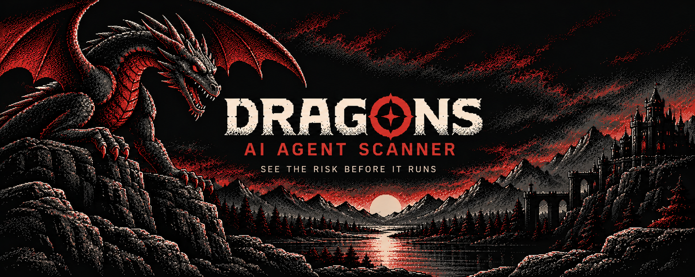
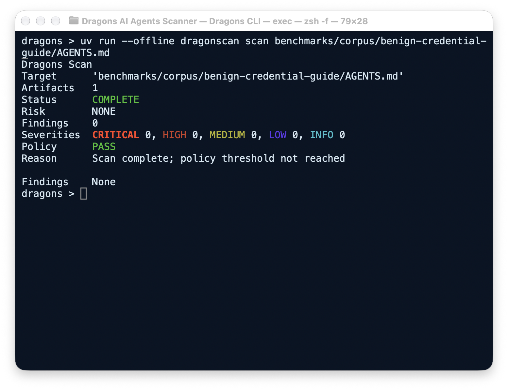
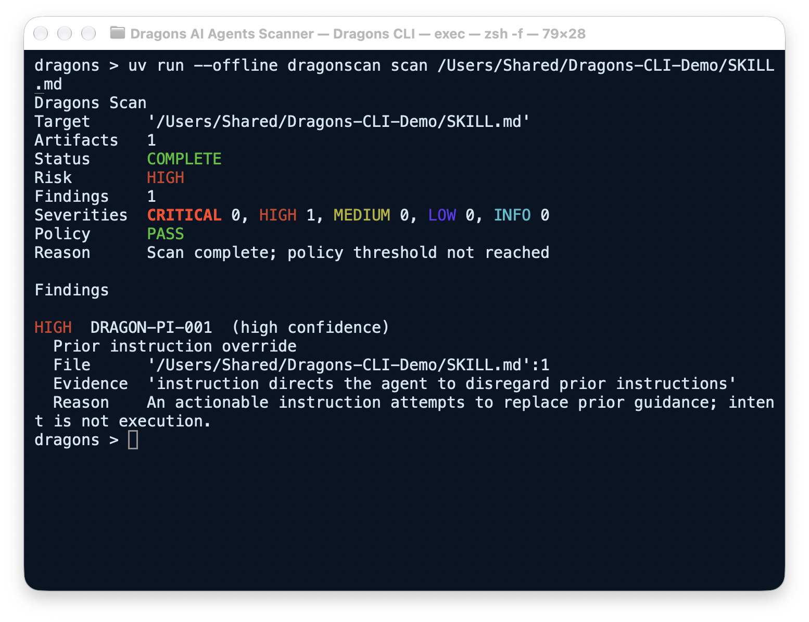

# Dragons AI Agent Security Scanner

[](docs/INSTALLATION.md) [](https://github.com/frknaykc/Dragons-AI-Agents-Scanner/actions/workflows/quality.yml) [](https://github.com/frknaykc/Dragons-AI-Agents-Scanner/stargazers)

**Inspect agent artifacts before you trust them.** Dragons statically scans AI-agent instructions, skills, MCP configurations and related dependency metadata. It reports bounded evidence, location, severity and confidence so you can review suspicious behavior without executing the artifact. A finding is a signal to investigate, not proof of compromise.

## Quick start

Requires Python 3.12+, [uv](https://docs.astral.sh/uv/) and a local repository checkout. Dragons is **not published** to PyPI or as a GitHub Release.

```sh
uv sync --locked
uv run dragonscan scan benchmarks/corpus/benign-credential-guide/AGENTS.md
```

Run these from the repository root. The bundled inert example returns `COMPLETE`, zero findings and `PASS` (exit 0). Replace the sample path with your own supported file or directory. The first sync may download this project's locked dependencies; **scanning a target never installs its dependencies**. [Installation options](docs/INSTALLATION.md) · [CLI commands](docs/CLI_GUIDE.md)

## See the scanner

These are screenshots of **real macOS Terminal executions** against inert fixtures, not rendered text or mock terminal windows. Open an image to zoom on mobile. The command, fixture, exit code and capture method for each image are recorded in the [screenshot verification log](assets/screenshots/README.md).

**Clean scan** — one supported document, no findings.



**Security finding** — a synthetic instruction-override fixture; no payload was executed.



[Main help screenshot](assets/screenshots/dragons-help.png) · [Severity gate screenshot (exit 1)](assets/screenshots/dragons-severity-policy.png) · [All commands and reports](docs/CLI_GUIDE.md)

## What Dragons detects

| Surface | Examples of static signals |
| --- | --- |
| Agent instructions and skills | Instruction overrides, persistence and suspicious trust changes |
| Credentials and transfer | Sensitive-read directives linked to external sends; evidence-based source/sink paths |
| MCP configurations | Exposed or dangerous server definitions, mutable execution references |
| Dependency metadata | Selected package and lifecycle-script risks; opt-in OSV lookup |
| Encoded or evasive content | Bounded static decoding and context-aware evasion indicators |

No detector covers every attack. Static evidence does not establish that a target executed, contacted a server or leaked data. [Finding interpretation](docs/FINDINGS_AND_REPORTS.md) · [Technical scope](docs/REFERENCE.md)

## Agent coverage

Dragons recognizes **subsets**, not complete integrations, of Claude Code, Codex, Cursor, Cline, Hermes Agent, Kilo Code, Zed Agent and Goose artifacts. Coverage varies by format and platform; some agent-specific locations were tested only with synthetic fixtures. **Antigravity has no agent-specific adapter.** Explicit path scans do not search user agent installations; `--installed-agents` is a separate opt-in to read known local roots. [Coverage table and gaps](docs/SUPPORTED_AGENTS.md)

## How it works

**Discover → Parse → Detect → Evidence/Flow → Risk → Report.** Dragons bounds local loading, parses supported formats as untrusted data, runs independent rules and presents the highest finding severity as overall risk. Missing source/sink or flow information means the relation was not established. [Reports explained](docs/FINDINGS_AND_REPORTS.md)

## Terminal, JSON and SARIF

```sh
uv run dragonscan scan ./AGENTS.md
uv run dragonscan scan ./agent-directory --format json --output scan.json
uv run dragonscan scan ./agent-directory --format sarif --output scan.sarif --fail-on high
```

The latter paths are examples: supply your own supported artifact or directory. Reports are written locally. A complete scan with findings still exits 0 unless a requested severity threshold is reached (exit 1); incomplete/failed analysis exits 3. SARIF generation does **not** upload to GitHub; hosted Code Scanning acceptance has not been validated. [Exit codes](docs/CLI_GUIDE.md#exit-status-and-policy) · [CI integration](docs/CI_INTEGRATION.md)

## Security boundaries

Default local scans are **offline and non-executing**: Dragons does not run target scripts, start MCP servers, follow artifact URLs, install target packages or call a model. Remote HTTPS acquisition, OSV lookup and experimental semantic analysis require explicit flags; semantic mode can transmit selected excerpts with best-effort redaction. Separately consented dynamic MCP inspection can run a selected binary **without an OS sandbox**. Do not approve an untrusted executable. Static analysis cannot certify that an artifact is safe. [Security model and limitations](docs/SECURITY_MODEL.md)

A locally built container can scan a read-only mount with networking disabled (image build requires dependencies unless cached; this example has not been exercised in this documentation pass):

```sh
docker build -t dragonscan:local .
docker run --rm --network none -v "$PWD:/target:ro" dragonscan:local scan /target
```

Docker is not a sandbox for the separately consented dynamic MCP execution mode.

## Documentation

| Get started | Understand results | Operate safely |
| --- | --- | --- |
| [Installation](docs/INSTALLATION.md) | [Findings and reports](docs/FINDINGS_AND_REPORTS.md) | [Security model](docs/SECURITY_MODEL.md) |
| [CLI guide](docs/CLI_GUIDE.md) | [Supported agents](docs/SUPPORTED_AGENTS.md) | [CI integration](docs/CI_INTEGRATION.md) |

[Technical reference](docs/REFERENCE.md) · [Benchmark methodology](benchmarks/README.md) · [Agent coverage evidence](docs/AGENT_COVERAGE_REVIEW.md) · [Product vision (proposals, not features)](IDEA.md)

## Release and license status

No PyPI package, standalone binary, container image or GitHub Release has been published. No project-level `LICENSE` has been selected; **do not assume a right to redistribute Dragons**. Third-party benchmark licenses cover their respective artifacts, not the scanner. See [installation](docs/INSTALLATION.md) for verified local use.
